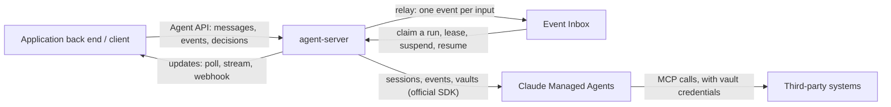

# Agent service

[中文](../zh/agent-service.md)

`agent-server` is the proactive agent that applications use through the [Agent API](agent-api.md).
It sits between three parties: applications, which send what users say and what happens in their
systems; the Event Inbox, which turns all of that into runs, one at a time per line of work; and
Claude Managed Agents (CMA), which hosts the agent loop and its tools. This document explains how it
works, what it does when something breaks, and how to run it.

## At a glance

An application is a tenant of the Inbox and every user is an inbox. The service keeps what users
and agents say in its own database; the Inbox learns only that there is something to do, by id. CMA
sits behind a port, `ManagedAgents`, with two implementations: the adapter over the official Java
SDK, and a scripted stand-in that the tests and the demo mode run on.

## From a message to a reply

1. `POST /v1/users/{user_id}/messages` stores the message and, in the same transaction, queues an
   Inbox event that names it. A relay writes the event to the Inbox right after the commit.
2. The Inbox waits for the line to go quiet for a moment, then hands the waiting events of the line
   out as one run, with a lease.
3. A worker takes the run and opens its turn, under the lease's epoch: a worker whose lease has run
   out can no longer write.
4. The line's session is checked. A session that is terminated, unknown, or left busy by a turn that
   died is replaced or brought to rest; one whose agent was configured anew is renewed.
5. The turn fixes its boundary: the last event the session holds before its input. Everything after
   it belongs to the turn.
6. It opens the session's stream, reads what is stored after the boundary, and sends the input only
   if it is not there yet.
7. It reads until the session is idle after having processed the input, answering on the way the
   tool calls that wait: the service's own tools at once, approvals and questions by people.
8. It stores the reply and ends the turn in one transaction, records the update, and acks the run.

## Lines, sessions and turns

Every input belongs to a line, and the line's key is the Inbox's merge key, so the Inbox runs a line
one turn at a time. Every line has a session of its own on CMA, which remembers the line.

| Line | Key | Its input | What the user gets |
| --- | --- | --- | --- |
| Conversation | `conv:<conversation_id>` | The user's messages | The agent's last text, as the reply |
| Subject | `task:<subject>` | The application's events and schedules | Only what the agent sends with `notify_user` |

A follow-up runs on the line that set it. A conversation's line can thus also work in the
background, for example when it reminds the user of something an hour later.

A line's session is replaced when it can no longer be used, and renewed between turns when the agent
was configured anew or the user's vaults changed. Each session is a new generation of the line; the
first input of a conversation's new session begins with what the user and the agent said before.

## When something breaks

| What happens | What the service does |
| --- | --- |
| A worker dies in the middle of a turn | The lease runs out and the Inbox hands the run out again. The turn continues from its record: the input is not sent twice and the reply not stored twice |
| A worker stalls past its lease | Its successor takes the turn over under a higher epoch; every write of the stalled worker is refused |
| The answer to the send of the input is lost | The session is read to see whether the input arrived, before anything is sent again |
| The platform is overloaded or refuses for a moment | The call is tried again a few times, with growing delays, while the lease is kept alive; then the run goes back to the Inbox for later |
| The session is terminated, unknown, or the platform gave up on the turn | The line gets a new session in the same turn, told what was said before; if that fails too, the run is tried again later |
| A turn takes longer than its deadline (10 minutes) | The session is interrupted, the turn fails, and a `run.failed` update is recorded |
| A run dies (its attempts are used up) | A sweep closes its turn and records `run.failed`; the next turn of the line brings the session to rest first |
| The stream breaks | The tail opens it again and reads what is stored in between |

Points in the turn where a test can make the worker die (`TurnHooks`) prove each of these; see the
crash tests in `TurnRecoveryIT`, `ProactiveTurnIT` and `ActionsIT`.

## Work in the background

An application's event, or a schedule that is due, wakes the agent on its subject's line. The input
is a notice in fixed words that there is something to read: what happened reaches the agent as the
result of its `read_events` tool, never as a message, because the agent takes a message as the word
of whoever it works for and the content of an event is not that. Instructions of a schedule that the
application set up are the application's, and come in the notice.

The agent tells the user with `notify_user`, or ends the turn without it; what it writes at the end
of the turn is kept as a note on the turn and shown to nobody. A notification is keyed by the run and
the call's place in it, so a run that is delivered again, or a turn that starts over in a new
session, does not tell the user twice. A turn may notify three times and a user gets at most twenty
notifications a day.

Before a conversation's session answers the user's next message, it is pointed to what work in the
background exchanged with the user in that conversation, and reads it with `read_events`.

## Waiting for people

A tool call that needs an approval, or a question asked with `ask_user`, becomes an action, and the
`action` row is the authority on its outcome: it leaves `pending` once, by a guarded update. When a
turn has nothing left to do but wait, its run is suspended in the Inbox under the resume key
`run:<run_id>`. Whatever ends an action rings: it writes an event with that key, which wakes the run;
the turn reads the outcomes from the rows. A ring that comes after the turn ended is an ordinary
event of the line, and the turn that gets it ignores it.

New input on a line withdraws what the line waits for: the waiting turn finishes, and the new input
comes in the next one. A turn that holds the line's session keeps it until it ends; a later run of
the line waits for it rather than touching the session. A message to a conversation that has a
question waiting is taken as the answer to the latest one. An action that nobody decides expires
after 24 hours, when the Inbox wakes the run. The turn's own deadline does not count the waiting.

## Delivery

Everything that happens for a user is recorded as an update in the transaction that makes it
happen, with a position (`seq`) handed out under the lock of the user's row. Positions therefore
appear in the order of the commits, and a reader that resumes after a position misses nothing, also
while many write at once. Every transaction that records updates locks the user's row first, so that
locks are always taken in the same order.

The stream polls the log, and is woken at once by commits in its own process. Webhook deliveries are
queued in the same transaction as the update, signed, and tried again for about 21 hours before the
webhook is turned off. A delivery connects to the address that the policy checked, not to whatever
the host name resolves to a moment later, and it does not follow redirects.

## Credentials and sessions

Credentials of MCP servers are stored in CMA vaults: one for the application and one per user who
has credentials of their own. A session gets the user's vault first and then the application's, at
creation; the platform adds the matching credential to every MCP call. A changed token is used from
the next call on. A session cannot take on a vault later, so a user's first credential renews their
lines' sessions at their next turn.

## Memory

An agent configured with `memory: per_user` keeps notes about each user in a memory store on CMA,
one per user and agent, which a session finds as files under `/mnt/memory/`. A conversation's
session has it to read and write. A session in the background has it to read only: there the agent
works on what other systems say, and that must not end up in what it remembers about the user. The
store is made the first time a session of the user needs it; turning memory on or off takes effect
at the next turn of each line, in a new session.

## Security

- API keys are stored as SHA-256 hashes. User tokens are signed with a key derived per application,
  expire within the hour, and can be revoked per user.
- A user token reaches only its own user's data, and never what the application decides.
- What third-party systems say reaches the agent as tool results, and the agent is told never to
  take instructions from them.
- Secrets of MCP servers stay in CMA vaults, out of the sandbox and out of this service.
- Webhooks reach only public addresses over https.
- Requests are limited per application and per user; calls to CMA stay within its rate limits.

## Running it

### Configuration

Every setting is under `agent.*` and can be set by environment variable.

| Setting | Default | Meaning |
| --- | --- | --- |
| `AGENT_JDBC_URL`, `AGENT_DB_USER`, `AGENT_DB_PASSWORD` | local `agent_dev` | Database |
| `AGENT_PORT` | `8090` | HTTP port |
| `AGENT_ADMIN_KEYS_0` | none | An administration key, at least 32 characters; more as `_1`, `_2` |
| `AGENT_TOKENS_SECRETS_0` | none | The secret that user tokens are derived from; a new one first, the old one second, to rotate |
| `AGENT_INBOX_URL`, `AGENT_INBOX_SECRET` | `http://127.0.0.1:8080`, none | The Inbox, and the secret of the client `agent-server` there |
| `AGENT_CMA_MODE` | `live` | `live` calls CMA with `ANTHROPIC_API_KEY`; `demo` runs a script instead of a model |
| `agent.worker.concurrency` | `8` | Turns that one instance works on at once |
| `agent.turn.deadline` | `10m` | Longest turn; keep it below the Inbox's `inbox.lease.max-duration` |
| `agent.cma.creations-per-minute`, `requests-per-minute` | `300`, `600` | CMA's rate limits; with several instances, give each its share |
| `agent.worker.claim-wait` | `5s` | How long a claim waits in the Inbox for work |
| `AGENT_CORS_ALLOWEDORIGINS` | none | Origins of web pages that may call the API from the browser, comma-separated |
| `AGENT_WEBHOOKS_ALLOWPRIVATENETWORKS`, `AGENT_WEBHOOKS_ALLOWPLAINHTTP` | `false`, `false` | Webhooks to private addresses and over plain http; only to try them on one machine |

The Inbox needs a client for the service with the roles `RUNTIME` and `PRODUCER` and no tenant, and
should allow more attempts than its default for long outages (`inbox.retry.max-attempts`).

### Demo mode and live mode

In demo mode a script plays every agent: it repeats what the user says, reads events and notifies
about each one, so that the whole service can be tried without a key. Live mode needs an Anthropic
API key with access to Managed Agents. Before going live, run `scripts/cma-live-check.sh`: it checks
the behaviour of CMA that the service relies on and that the documentation leaves open. Then
`scripts/agent-live-smoke.sh` runs both services against CMA and checks a conversation, a
notification and a question answered by the user, end to end; with `--api` and `--admin-key` it
checks a service that runs already, such as the one of `docker-compose.yml`.

The platform of demo mode lives in the service's memory. After a restart it takes back what the
database still names, an agent with the configuration of its profile, but what it made exists nowhere
else: live mode starts with new applications.

### Deploying

- `docker-compose.yml` runs the database, the Inbox and the service on one machine;
  [the tutorial](tutorial.md) shows how, and what to check before going live.
- Run several instances behind a load balancer; they coordinate through the Inbox and the database.
- An instance that stops lets the claims it has under way finish and gives back at once what they
  bring, so that no run waits for a lease to run out.
- The background loops (relay, workers, sweep, webhook deliveries) run in every instance.
- Rate limits and CMA limits count per instance.
- Back up the database: it holds the conversations; CMA holds the sessions' history until they are
  deleted.

## Claude Managed Agents

- CMA is in beta (`managed-agents-2026-04-01`). Its behaviour can change; the port keeps the change
  in one place.
- It bills session running time on top of tokens; a session that waits costs nothing.
- It keeps every session's history until the session is deleted. This service does not delete
  sessions.
- The port could be pointed at the Messages API instead, with the agent loop run by this service, if
  the application wants to host the loop itself.

## Limits of this build

- Streaming the reply word by word, and steering a turn with a message that arrives during it, are
  not built: a message waits for the next turn.
- Memory is per user and agent, and only for agents with a sandbox. A conversation's new session is
  also told the recent dialogue.
- The rate limits and the stream's wake-ups are per instance.
- Notifications are not sent to other channels (push, e-mail); applications do that from the updates.
