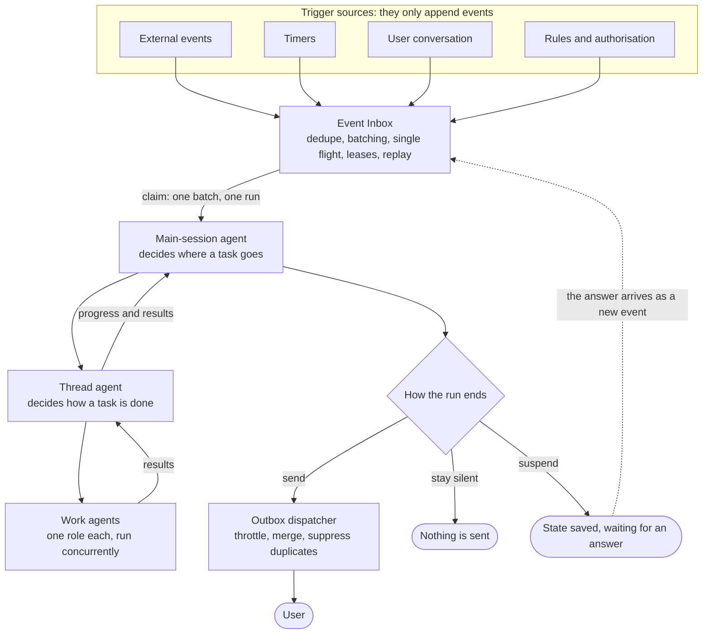

# Proactive agent architecture

[中文](../zh/architecture.md)

A proactive agent rests on one rule: every trigger (a webhook, a timer, a user message, an approval
reply) is appended to a per-user Event Inbox, and only the Inbox turns events into runs. The runtime
beneath it can be woken, suspended and resumed, and a run may end without saying anything. An Outbox
decides what the user actually receives.

This document describes the whole system. Only the Event Inbox is built in this repository; its design
is in [Event Inbox design](event-inbox-design.md).

## At a glance

Read it top down. Sources only append events. The Inbox hands one batch at a time to the main-session
agent. Every run ends by sending, staying silent or suspending. A user's reply or approval is a
user-conversation event, so the answer to a suspended run comes back through the Inbox like any other
event. Memory, governance and observability serve every layer and are not drawn.

## What this repository builds

| Layer | Role | Here |
| --- | --- | --- |
| Trigger sources | Produce events | Any signed HTTP client; timers are part of the Inbox |
| Event Inbox | Durable queue with one write entry; the source of truth | **Built** (roadmap stages M0 and M1) |
| Multi-agent hierarchy | Dispatch, execution and concurrency of agents | Not built |
| Agent runtime | Sleep, wake, run, suspend, resume | Stand-in: `ScriptedWorker` follows the runtime contract without a model |
| Outbox | Decides what is sent, where and at what pace | Stand-in: `MemoryOutbox` and `FileOutbox` dedupe on `run_id + sequence` |
| Memory | Persists across runs | Not built |
| Governance and observability | Permissions, budgets, audit, product metrics | Only the Inbox's own audit trail and metrics |

## Trigger sources

Four kinds of source wake an agent. All of them only append events; none calls the runtime directly.

| Source | Examples | Rule |
| --- | --- | --- |
| External events | IM messages, email, calendar, document and meeting changes, business-system webhooks | A webhook is acknowledged fast and only writes an event |
| Timers | Recurring jobs (daily report, inspection); one-off follow-ups ("look again later") | Stored apart from the event table; they hold future times only |
| User conversation | Messages and approval replies from IM and the desktop client | Queued with every other event, no queue-jumping; a reply continues its original session |
| Rules and authorisation | A team's written rules for what the agent may do unprompted; follow-ups an agent sets for itself | A new rule is recorded first and not executed |

## Event Inbox

The Inbox is a durable event queue with a single write entry, and it is the system's source of truth.
Each user has one inbox. Delivery is at-least-once and replayable.

| Rule | Behaviour |
| --- | --- |
| Dedupe | Keyed on the unique id the source provides; a repeated delivery keeps one event |
| Status | `pending → claimed → done / failed / dead`; after a worker crash the same run is delivered again |
| Batching | Consecutive messages and same-key events merge into one run that replies once |
| Readiness | Only events that can run now are queued; future times wait in the timer table |
| Order | One active run per merge key in an inbox, so work is never duplicated or overwritten |
| Lanes | `interactive`, `background` and `batch`, each with its own concurrency cap, so background work never blocks a reply |

An event that arrives while a run is in progress is placed in one of four ways.

| Mode | Effect |
| --- | --- |
| steer | Joins the current run; it can be taken in between two tool calls |
| followup | Waits behind the current run |
| collect | Merges with other arrivals inside a quiet window into one later run |
| interrupt | Asks the current run to yield so that the new message is handled first |

## Multi-agent hierarchy

Dispatch, execution, concurrency and message sync are runtime mechanisms. A product built on top
configures only three things: the role list, the channel bindings, and each role's skill and tool scope.

| Tier | Decides | Behaviour | Instances |
| --- | --- | --- | --- |
| Main-session agent | Where a task goes | Receives every user message and wake event first. Answers directly, continues an existing thread, or opens a new one | One main session per user, shared by every entry point |
| Thread agent | How a task is done | Owns one task in its own isolated context. Splits it into steps, picks roles, dispatches to work agents and aggregates their results | One thread per task |
| Work agent | Its own step only | Executes by role; each role has its own prompt, skills and tool scope. Several run concurrently under one task | Many per thread |

Messages flow back up, so the user never has to visit each thread.

1. A work agent hands its result to its thread agent.
2. The thread agent aggregates progress and results.
3. Thread messages sync to the main session: progress, results and anything awaiting confirmation.
4. The user replies in the main session, and the reply is routed back to the original thread.

Every entry point connects to the same inbox and the same main session, so a user can switch entry
points in the middle of a task.

## Agent runtime

All three tiers run on one runtime, and each agent is an isolated instance of it.

| Part | What it provides |
| --- | --- |
| Session and run | The lifecycle `sleep → wake → run → suspend → resume`. An idle session costs nothing, and a suspended one keeps its state |
| Agent loop | The model-call and tool-execution loop. Long tasks advance step by step and failed steps retry |
| Context budget | System prompt, tool definitions, memory index and the triggering event, resent every turn with caching |
| Sandbox and workspace | Files, outputs and execution are isolated per instance |
| Skills and tools | Authorised skills and tools, with the scope configured per role |
| Memory link | Each run loads the memory index at start, reads bodies on demand and writes back before it ends |

The runtime's contract with the Inbox is small: claim a run, heartbeat while working, and end the run
explicitly with ack, nack or suspend. It is specified in [API](api.md#runtime-contract).

## Run endings and Outbox

A run can end in only three ways, and saying nothing is a first-class outcome.

| Ending | When | What happens |
| --- | --- | --- |
| Send a message | There is a result worth telling | The result goes to the Outbox: the conclusion and a few details, never the working process |
| End silently | Nothing is worth saying | Nothing is sent. The agent stays quiet first and earns attention gradually |
| Suspend | An approval, a reply or confirmation of a high-risk action is needed | The session is saved and the run ends. The answer returns to the Inbox as a new event and restores the saved state |

The Outbox dispatcher then decides what is sent, where, and at what pace.

- It throttles per user and per channel, sorts, merges, suppresses duplicates and retries failed sends.
- One run replies once; consecutive results are batched before sending.
- Approval requests travel separately from ordinary results.
- Because a run can be delivered more than once, every message carries the key `run_id + sequence`
  and the Outbox sends each key once.

## Memory

Memory persists across runs: every run can read it, and it survives the end of a session. The runtime
and every agent instance depend on one interface with four operations (read, write, retrieve, evict).

| Dimension | Design |
| --- | --- |
| Types | User profile, user instructions, user notes, things already said, task progress; later goals, team conventions and business domains. A new type only needs registration |
| Scope | User level (shared by all of one user's agents), agent level (isolated per instance), later team or organisation level |
| Storage | Entries are files plus an index. The index stays in context and bodies load on demand |
| Retrieval | Hybrid retrieval (keyword, vector, graph), heat- and time-aware scoring, rerank, then a model filter on whether a candidate helps the current answer |
| Writing | A run stores only what cannot be looked up again; anything retrievable is stored as a pointer. A periodic review consolidates and evicts |

Every entry carries its source and date, so it can be traced and cleaned up by source.

## Governance and observability

Unattended, an agent acts with its user's permissions, so every tool call needs a verdict.

| Control | Rule |
| --- | --- |
| Credential proxy | Credentials are injected at the proxy; the agent never holds them |
| Auto mode | A classifier reviews high-risk actions; a blocked action makes the agent find another path |
| Suspend for approval | The most consequential actions wait for a human; the default is not to guess |
| Budget caps | Token and cost limits per run and per day; exceeding one stops the run |
| Audit trail | Every action, which rule blocked it and who approved it |

Proactivity without metrics degrades into harassment. The runtime supplies the data and the product
makes the judgement.

| Metric | Measures |
| --- | --- |
| Cost | Tokens and time per run, counted per result that was actually adopted |
| Interruption rate | How many messages were sent, how many were useful, how many were dismissed |
| Acceptance rate | The share of proactively proposed tasks that were accepted or corrected |
| Failures | Timeouts, hangs, duplicated work and human takeovers |

A feedback loop closes the system. The user's reaction (thanks, a correction or silence) is written to
memory and evals, which then adjust the agent's judgement, its trigger rules and its delivery pace. The
boundary of proactivity is not whether the agent can do something but whether it is worth the
interruption.

## Layering rule

The infrastructure provides the generic mechanism (inbox, scheduling, multi-agent dispatch, runtime,
memory), with state bound to the session and run lifecycle. A product configures it (rules and
authorisation, entry channels, delivery policy and copy) and does not build its own queues or
schedulers.

## Design work still open

Three layers are described as principles only and need their own design before they are built.

- **Thread sync.** How a thread's messages reach the main session (as Inbox events or as direct
  writes), and how a user's reply is routed back to its thread.
- **Outbox.** Its data model, its throttling policy, and how "one run replies once" survives retries.
  The Inbox side of that guarantee is in place: a re-delivered run keeps its `run_id`.
- **Session store.** Where a suspended run's state is kept, and for how long. The Inbox bounds the
  wait (a suspended run must carry a timeout) but stores no agent state.

Memory and governance name their interfaces and controls but not yet their contracts.

## Origin

This document and the Inbox design follow a source design draft (v0.1) for a proactive agent, with the
source's product and team names replaced by neutral ones. The source credits three public references,
which were not consulted for this build: Anthropic's "Building Always-On Agents", OpenClaw's queue
documentation (the four delivery modes) and a DeepSeek prototype's attention principles (silent endings
and the interruption-rate metric).
