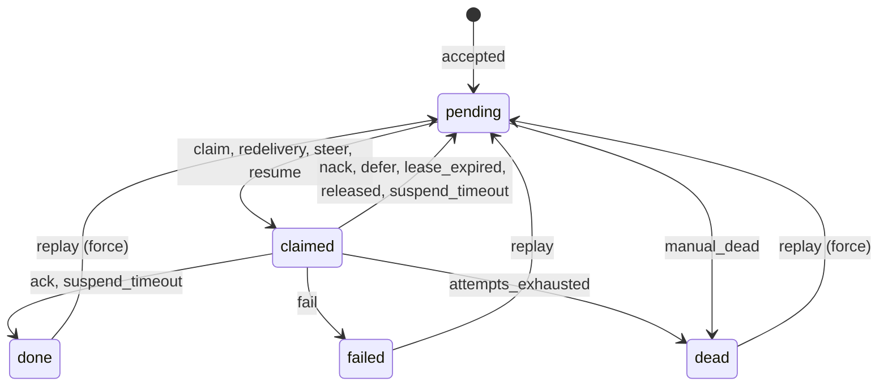
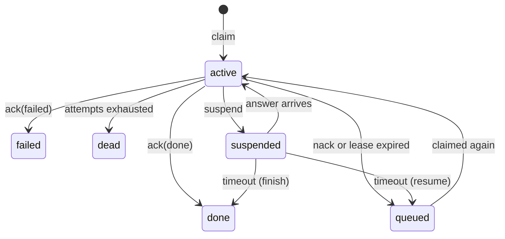

# Event Inbox design

[中文](../zh/event-inbox-design.md)

The Event Inbox is the single inbound gate of a proactive agent. Every producer appends events through
one write API, and the runtime gets exactly one action: claim a batch of ready events as a run. It is a
shared service because correctness has to live in one place. Dedupe, batching, single flight and replay
each break as soon as one of them is left to producers.

This document describes the Inbox as it is built here. Where the source design left a gap or
contradicted itself, [Decisions](#decisions) says what was chosen and why. The wire format is in
[API](api.md); the system around the Inbox is in [Architecture](architecture.md).

## Scope

The build covers roadmap stages M0 and M1.

| Stage | Delivers | State |
| --- | --- | --- |
| M0 | Write entry, dedupe, state machine, single-flight claim, timers | Built |
| M1 | Batching, the four delivery modes, lease renewal, suspend and resume, replay tooling, metrics | Built |
| M2 | Per-client rate limits, the per-inbox backlog limit (429), circuit breakers, sharding, consumption receipts | Not built |

The Inbox only moves and arbitrates "event → runnable run". It never judges whether the work is worth
doing, so no model call sits on its write path or its claim path.

| The Inbox does | The Inbox does not |
| --- | --- |
| Receive, authenticate, validate and acknowledge fast (202) | Make business judgements (whether to remind, whether to interrupt) |
| Dedupe, merge, order and decide readiness | Deliver anything (that belongs to the Outbox) |
| Persist events, run the state machine, manage leases, recover from crashes | Run agent logic or keep agent state |
| Wake, claim, replay and audit | Store memory |

## Invariants

Every design choice below protects one of these.

| No. | Invariant | Enforced by |
| --- | --- | --- |
| I1 | One write entry, append only | One `POST /events`; the timer scheduler appends through the same SQL statement; a trigger rejects any update of an event's content columns |
| I2 | At most one event per `(tenant, inbox, source_event_id)` | Unique constraint plus `ON CONFLICT DO NOTHING`; a payload hash turns "same key, different content" into a 409 |
| I3 | Single flight: no two runs work on the same thing at once | Three limits checked under the inbox row lock, backed by unique partial indexes on `run` |
| I4 | A run is not 1:1 with an event | A `run` row owns a batch of events that share a merge key; a quiet window lets a burst gather |
| I5 | At-least-once delivery, idempotent consumers | Leases and a sweeper; the same run is issued again with the same id and events; an epoch number fences stale workers |
| I6 | Future times never enter the ready queue | Check constraint `ready_at <= received_at` on `event`; future work is a row in `timer` |
| I7 | Events are immutable; every transition is auditable | `event_transition` is append-only by trigger; each state change writes its history row in the same statement |
| I8 | Tenants cannot see each other | Every key starts with `tenant_id`; every query is tenant-scoped; another tenant's object is a 404 |

I3 and I4 together mean that queueing happens per event and execution happens per run. Merged events
are not cancelled: they keep their own rows and reach their final state together with the run.

The second half of I8 in the source, that tenants cannot starve each other, is only partly met. Lane
caps and per-inbox single flight keep one inbox from holding another back, but per-tenant quotas belong
to M2.

## Components

| Part | Classes | Role |
| --- | --- | --- |
| Auth | `HmacAuthFilter`, `ClientRegistry` | Verifies the request signature and the caller's role for the path |
| Write path | `EventWriter`, `InterruptDetector` | Validate, dedupe, append; one SQL statement |
| Claim | `ClaimService`, `ClaimPlanner` | Lock the inbox, decide what to hand out, mint or re-issue a run |
| Run lifecycle | `RunLifecycleService`, `RunEventStore`, `RunSignals` | Heartbeat, ack, nack, steer, suspend, timeouts, lease expiry |
| Background loops | `LeaseSweeper`, `SuspendSweeper`, `TimerScheduler`, `ReclaimGate` | Reclaim expired leases, apply suspend deadlines, fire timers |
| Operator tools | `ReplayService`, `InboxAdminService`, `AuditLog` | Replay, dead-letter, per-inbox limits, audit log |
| Wake | `WakeBus`, `InProcessWakeBus` | Best-effort hints for long-polling claimers |
| Metrics | `InboxMetrics`, `DepthSampler` | Latency, batch size, reclaims, replays, backlog |

`ClaimPlanner` is a pure function with no clock and no database, so every scheduling rule is unit
tested without either. All SQL is hand-written and goes through `JdbcClient` with explicit
transactions, which keeps lock order and round trips visible.

## Data model

| Table | Holds | Key points |
| --- | --- | --- |
| `inbox` | One row per `(tenant_id, inbox_id)` | `next_seq`; optional lane caps and `max_active_runs`; `settings` (windows, batch caps). Its row lock is the single-flight lock |
| `event` | The source of truth | Content columns are immutable. Delivery state: `status`, `attempt`, `run_id`, `run_seq`, `delivery_mode` |
| `run` | One execution | `status`, `slot_no`, `epoch`, `attempt`, lease times, `next_attempt_at`, `resume_key`, `suspend_deadline_at`, `on_timeout` |
| `timer` | Future work, one row per occurrence | `kind` (`once`, `cron`), `cron_expr`, `time_zone`, the event it will produce, `state` |
| `event_transition` | Append-only history | `from_status`, `to_status`, `reason`, `actor`, `run_id`, `attempt`, `at` |
| `admin_audit` | Operator actions | Who did what to what, with which parameters and what came of it |

An inbox is created by the first write, timer or configuration call that names it. Ids are ULIDs, so
they sort by creation time.

The database is a backstop for the rules the code applies. Three unique partial indexes on `run`
enforce one active run per lane slot, one active run per merge key and one suspended run per resume
key. Check constraints tie a run's status to the columns that must be set in it.

## Write path

`POST /v1/inbox/{inbox_id}/events` does four things and nothing else: authenticate, validate, dedupe,
append. It never starts a run and never calls a model, so its latency does not depend on the health of
anything downstream.

On the happy path the write is one SQL statement.

1. Look for an event, or a deferred event still waiting as a timer, with this idempotency key. If one
   exists nothing is written and the inbox row is not locked.
2. Upsert the inbox row. This takes its row lock and hands out the next `seq`.
3. Insert the event with `ON CONFLICT DO NOTHING`.
4. Insert the first history row (`accepted`).

Because the inbox row lock is held until commit, the next writer gets the next `seq` only after this
one is visible. Sequence order is therefore commit order: a reader that sees `seq` 6 also sees every
lower `seq` that exists. Numbers can have gaps, because a writer that loses a race on the same
idempotency key has already taken one.

| Result | Status | Body |
| --- | --- | --- |
| New event | 202 | `deduped: false`, `status: pending` |
| The key was accepted before, same content | 202 | The earlier `event_id`, `deduped: true`, its current status |
| The key was accepted before, different content | 409 | `idempotency_conflict`; the first event is untouched |
| `ready_at` in the future | 202 | `status: scheduled`; the event waits as a timer |
| Invalid request, or payload over 64 KB | 400, 413 | Nothing is stored |
| Database unavailable | 503 | Explicit failure; the write is never downgraded to "run it directly" |

"Same content" means the same `type` and the same payload in canonical form (object keys sorted, no
insignificant whitespace), so a producer that re-serialises a retry does not trip the check.

**Fingerprint.** An event without a `source_event_id` gets the key `fp1:` followed by a SHA-256 over
tenant, client, source, type, merge key, payload hash and a discriminator. The discriminator is the
producer's `occurred_at` when present, otherwise a 60-second bucket of the arrival time. Identical
retries collapse; different payloads never do. The response carries `fingerprinted: true` and a warning,
because a retry that straddles a bucket edge becomes a second event.

**Wake hint.** After a successful write the service publishes a wake hint. A failure to publish is
logged and ignored: correctness reads only the tables.

## Runs

A run is one execution over a batch of events. It is minted once, at its first claim, and it owns its
events until it ends.

| Field | Meaning |
| --- | --- |
| `run_id` | A ULID, stable for the life of the run. A nack or a lease expiry re-issues the same run with the same events |
| `epoch` | Raised by one on every lease grant. Every later call must carry it; a stale epoch gets 409 `lease_lost` |
| `attempt` | The failure budget: 1 on the first delivery, raised by a nack or a lease expiry. A resume does not spend it |
| `run_seq` | Position of an event inside its run, from 1. Ack and suspend use it as a cursor |

Keeping the run identity stable is what lets a downstream outbox dedupe on `run_id + sequence`: a
re-delivered run produces the same keys, so the user hears once.

### The claim transaction

`POST /v1/runs/claim` is the only way events leave the inbox. One attempt on one inbox is one short
transaction.

1. Lock the inbox row. This serialises the claim against every other claim and every change of
   delivery state in that inbox.
2. Read the clock, the inbox's limits, its open runs and its unclaimed events in `seq` order.
3. Let `ClaimPlanner` decide.
4. Apply the decision with guarded statements, writing history rows in the same statements.

A claim for a named inbox waits up to 500 ms for a busy row and then answers "busy". A claim without an
inbox looks for inboxes with claimable work, oldest work first, and skips rows that are locked.

### Three limits

| Limit | Default | Purpose |
| --- | --- | --- |
| Lane slots | `interactive` 1, `background` 2, `batch` 4 | A user's background work does not block their own new message; work that takes long runs on `batch`, several pieces side by side |
| Key exclusivity | Always on | At most one active run per `merge_key` in an inbox, across lanes |
| Inbox-wide cap | Off | `max_active_runs = 1` gives the strict "one run per inbox" reading of the source |

Key exclusivity is the real content of single flight. Two runs working on the same conversation or
order would overwrite each other's state and answer twice, whichever lanes they are in.

### What a claim takes

Lanes are served in priority order: `interactive`, `background`, `batch`. A claimer may restrict itself
to some lanes. Inside a lane there are three kinds of candidate.

| Candidate | Condition |
| --- | --- |
| Re-issue a queued run | Its backoff has ended and its merge key is not active elsewhere |
| Resume a suspended run | An unclaimed event carries its resume key and its merge key is not active |
| Start a new run | A group of unclaimed events is eligible (see Batching) |

Work flagged as an interrupt goes first; after that the candidate with the lowest head `seq` wins.
Ordering is strict per merge key within a lane: a queued run goes before any younger event of its key
in that lane. Across lanes the higher-priority lane goes first, and key exclusivity still allows one
active run per key. A key that is in backoff or still inside its quiet window does not block other keys
of the lane.

When nothing can be claimed the answer is 204 with the reason and, when time alone will change the
answer, a retry hint.

| Reason | Meaning |
| --- | --- |
| `empty` | No unclaimed work |
| `busy` | There is work, but slots are taken or its merge key is being handled |
| `window` | The next batch is still inside its quiet window |
| `backoff` | The next run is waiting out its retry backoff |

"Busy" is ordinary scheduling. It is not an error and nothing counts it as a failure.

### Batching

Unclaimed events of one lane are grouped by merge key. A keyed group becomes claimable when one of
these is true.

- No new event of the key has arrived for the quiet window (1.5 s by default).
- `max_wait` has passed since the group's first event (four quiet windows by default). This stops a
  trickle of messages from holding the window open for ever.
- The group has reached a batch cap: 20 events or 256 KB.
- An event of the group is flagged as an interrupt.

A batch takes events in `seq` order up to the caps, and the head is always taken; the rest waits for
the next run. An event without a merge key is its own run and does not wait. Windows can be set per
inbox and per lane, batch caps per inbox.

## State machines

An event's delivery state changes only through the transitions below. Each one writes a history row
with a reason and an actor.

A run has its own, smaller state machine. Every arrow into `active` is a new lease grant and raises the
epoch by one.

| Reason | From → to | Written when |
| --- | --- | --- |
| `accepted` | none → `pending` | The write is accepted |
| `claim` | `pending` → `claimed` | A new run takes the event |
| `redelivery` | `pending` → `claimed` | A queued run is issued again |
| `steer` | `pending` → `claimed` | The event joins a running run |
| `resume` | `pending` → `claimed` | The event answers a suspended run |
| `ack` | `claimed` → `done` | The run ends well |
| `fail` | `claimed` → `failed` | The run ends with `ack(failed)` |
| `nack` | `claimed` → `pending` | The worker asks for a retry |
| `defer` | `claimed` → `pending` | The worker hands the run back for a reason that is not the run's; the attempt is not counted |
| `lease_expired` | `claimed` → `pending` | The sweeper takes the run back |
| `attempts_exhausted` | `claimed` → `dead` | The attempt limit is reached |
| `suspended` | `claimed` → `claimed` | The run suspends; the event stays with it |
| `suspend_timeout` | `claimed` → `done` or `pending` | The suspend deadline passes |
| `released` | `claimed` → `pending` | The event joined a run but was not consumed |
| `replay` | final → `pending` | An operator replays the event |
| `manual_dead` | `pending` → `dead` | An operator takes a waiting event out of the queue |

Actors are written as `client:<id>`, `worker:<id>`, `system:<job>` or `operator:<name>`.

## Leases and retries

A claim grants a lease of 60 seconds. A heartbeat extends it to 60 seconds from now, but never beyond
30 minutes after the grant, so a run that loops for ever cannot hold a slot for ever. Heartbeat is a
single guarded update of the run row and takes no other lock.

| Event | Effect |
| --- | --- |
| `ack(done)` | The run and the events it consumed are `done` |
| `ack(failed)` | A final failure. The run and its events are `failed` and are not retried |
| `nack` | The run is queued with a backoff of 2, 4, 8, 16 seconds (base 2, cap 5 minutes), or the delay the worker asks for |
| `nack` with `deferred` | The same, but the attempt is not counted: the worker hands the run back for a reason that is not the run's. Honoured for 30 minutes after the run was made |
| Lease expiry | The worker is presumed dead. The run is queued for immediate re-issue and the attempt is charged |
| Fifth failed attempt | The run and its events are `dead` |

Two paths guarantee that nothing stays stuck in the middle of the state machine: the lease sweeper and
the attempt limit.

The sweeper scans without locks and re-checks each run under the inbox lock, so it is safe on every
instance. An ack that arrives after the lease ran out but before the sweeper acts still counts.
After a start, a failed pass or a stalled loop, a gate holds reclaiming back for one lease interval:
during an outage no worker can heartbeat, and without the gate every healthy run would be reclaimed
the moment service returns.

Ack, nack and suspend are idempotent. Repeating the same call with the same epoch returns the earlier
outcome.

## Mid-run arrivals

An event can arrive while a run of its key is in progress. The Inbox makes the mechanical call (can
this join the current run) and the agent makes the semantic one (should it). The runtime pulls: there
is no push channel into a run.

Every heartbeat answer carries two signals, derived from the tables each time and never stored.

| Signal | Meaning |
| --- | --- |
| `steer_pending` | How many unclaimed events of the run's merge key are waiting |
| `interrupt_requested` | An interrupt-flagged event is waiting behind this run |

| Mode | What happens |
| --- | --- |
| steer | The run declared `accepts_steer`. It calls `steer` at a safe point; waiting events of its key are bound to the run and returned |
| followup | The run does not steer. The event waits, held back by key exclusivity, and is claimed after the run ends |
| collect | Several events arrive during the run. After it ends they batch into one follow-on run |
| interrupt | The run sees `interrupt_requested` and suspends. The flagged event is claimed first; the suspended run resumes later |

Because signals are derived, ignoring one has no side effect. An ignored interrupt simply becomes a
followup, so no event is ever lost.

The interrupt flag is set by the producer (`interrupt: true`) or, for a conversation message, when its
whole text is a configured stop word. An interrupt for the run's own key is meant for that run. An
interrupt for a key nobody is working on, stuck behind a full lane, is signalled to the youngest run
of that lane.

**The cursor.** A steer can race with the end of a run: the event is bound to the run, but the worker
never read it. Ack and suspend therefore carry `last_run_seq`, the highest `run_seq` the worker
consumed. Events beyond it are released to the queue (`released`) instead of sharing the outcome. A
steer call takes `after_run_seq`, so a lost steer response can be fetched again.

## Suspend and resume

A run that needs an approval or a reply suspends with a `resume_key` and a timeout.

- The run gives up its slot and its lease, so the inbox is free for other work, including new events
  of the same key.
- The events it consumed stay `claimed` and bound to it. They are not finished until the run is.
- A resume key is unique among the suspended runs of an inbox (409 `resume_key_in_use`).
- The timeout is mandatory and capped at 30 days. A suspended run without a deadline would be a state
  an event could rest in for ever.

The answer is not a callback. It is an ordinary event that carries `resume_key`. Such an event is
reserved for its run: it is never batched with other events and never steered. The next claim hands the
same run back (`kind: resume`, `resume_reason: event`) with a new epoch and the answering events.
A resume waits while the run's merge key is active in another run.

When the deadline passes with no answer, the `on_timeout` policy applies.

| Policy | Effect |
| --- | --- |
| `finish` (default) | The Inbox ends the run. Its events are `done` with reason `suspend_timeout` |
| `resume` | The run is queued and handed back with `resume_reason: timeout` and all its events |

An answer that was received before the deadline wins, even if it has not been claimed yet. An answer
that races the timeout has exactly one outcome, because both take the inbox lock.

The Inbox keeps no agent state. What a suspended run remembers is the runtime's to save.

## Timers

Future work lives in the `timer` table and only there. A due timer produces an event through the
normal write statement. It never calls the runtime, so its event gets dedupe, single flight, batching
and replay like any other.

| Kind | Created by | Fires as |
| --- | --- | --- |
| Deferred event | A write with a future `ready_at` | Itself: the type, key and payload the producer sent |
| One-off timer | `POST /timers` with `kind: once` | `timer.due` |
| Cron timer | `POST /timers` with `kind: cron` | `timer.due`, once per occurrence |

Firing is one transaction per timer: lock the timer row (skipping rows another scheduler holds), append
the event, mark the row fired and, for a cron, insert the next occurrence. A crash rolls all of it
back. A timer therefore fires exactly once, and the loop can run on every instance.

The event of an API timer has the idempotency key `timer:<timer_id>:<fire_at_epoch_seconds>` and a
payload that wraps the caller's payload with `timer_id`, `fire_at`, `kind`, `catch_up` and
`missed_count`.

**Catch-up.** After an outage a cron fires only its latest missed occurrence, once, on the `batch`
lane, with `catch_up: true` and the number of occurrences it stands for. A restart sends one daily
report, not six.

**Cron.** Expressions have five fields, or six with seconds first, and are evaluated in an IANA time
zone (UTC by default): "9 am" is the user's 9 am across daylight-saving changes. When clocks go back, a
wall-clock time that happens twice fires once. A cron may not fire more often than every 60 seconds.

A `timer_key` makes creation idempotent: creating a timer whose key is already scheduled returns the
existing one.

## Replay and audit

Operators can put finished events back in the queue, selecting by one event, by an inbox and a time
range, or by a source and a time range across the tenant. The range is on the time the event was
received and is half-open.

| Event status | Replay |
| --- | --- |
| `failed` | Allowed |
| `done`, `dead` | Needs `force`, because it repeats work that already had an outcome |
| `pending`, `claimed` | Never; reported as `in_flight` |

A replayed event keeps its identity and its place in the sequence. It is detached from its old run, its
attempt count is reset, and it will be claimed into a new run. A replay must give a reason, can be
tried as a dry run, and is limited to 10,000 events per call.

An operator can also dead-letter an event by hand, but only one that is waiting unclaimed.

Replays, manual dead-lettering, configuration changes and an operator's cancellation of a timer are
written to an append-only audit log with the client, the operator's name, the parameters and the result. One read of an event returns its whole
path from acceptance to its current state.

## Tenancy and auth

- Every key is `(tenant_id, inbox_id, …)`. The same inbox id in two tenants is two inboxes.
- A caller is a client with an HMAC secret, an optional tenant and roles.
- A tenant client always acts inside its own tenant. A platform-scope client (no tenant), such as the
  runtime or an operator, names the tenant in the request.

| Role | May call |
| --- | --- |
| `PRODUCER` | Write events and timers; read back what it wrote and cancel its own timers |
| `RUNTIME` | Claim runs and drive their lifecycle |
| `OPERATOR` | Admin endpoints; read every event and timer of the tenant and any run; cancel a timer |

Clients and secrets come from configuration in this build. Request signing is described in
[API](api.md#authentication).

## Concurrency rules

- **Lock order** is the same everywhere: timer row, inbox row, run row, event rows.
- **Every change of delivery state holds the inbox row lock.** The one exception is heartbeat, a single
  guarded update of the run row.
- **Re-check, never assume.** Every change re-checks the state it expects before it writes: heartbeat
  in its one statement (`status = 'active' AND epoch = :epoch`), the other run operations on the run
  row they hold locked, and every event statement by naming the status it moves from. Whichever of
  "ack" and "lease expired" gets the lock first wins; the other finds the run already changed.
- **Time comes from an injected application clock** and is passed into SQL; no statement uses `now()`.
  Leases, windows, backoff and timers are therefore deterministic in tests. Nodes must be
  NTP-synchronised. Clock skew can only cause an early re-delivery, which at-least-once already allows;
  the epoch prevents two owners.
- Every session sets `lock_timeout` to 10 s and `idle_in_transaction_session_timeout` to 60 s.

## Observability

Metrics are published at `/actuator/prometheus`, tagged by tenant and, except for the replay counter,
by lane. None carries the inbox id, which would be unbounded.

| Metric | Kind | Measures |
| --- | --- | --- |
| `inbox_write_seconds` | Timer, tag `result` | Time to accept an event. The dedupe ratio is `deduped / (accepted + deduped)` |
| `inbox_claim_latency_seconds` | Timer | From the moment a batch became eligible to its claim |
| `inbox_ready_to_claim_seconds` | Timer | From the head event's arrival to the claim, including the quiet window |
| `inbox_batch_size` | Summary | Events per run at claim time |
| `inbox_lease_reclaim_total` | Counter | Runs taken back after their lease expired |
| `inbox_replay_total` | Counter, tag `force` | Events replayed by an operator |
| `inbox_pending_depth` | Gauge, tag `stat` | Unclaimed events per inbox: `p50`, `p99`, `max` and `total` |
| `inbox_dead_letter_depth` | Gauge | Events past their retry limit |

Backlog is reported as the median, the 99th percentile and the maximum across inboxes. A mean would
hide the one inbox that is drowning.

## Decisions

The source design left eleven points open or stated them two ways. This is what was built.

| # | Gap in the source | Built |
| --- | --- | --- |
| 1 | One run per inbox in one place, concurrent runs per lane in another | Three limits under the inbox lock: lane slots, one active run per merge key across lanes, and an optional inbox-wide cap where 1 gives the strict reading |
| 2 | `run_id` as a hash of the batch changes if the batch changes on replay | A `run` row is minted once and owns its events. The same run is re-issued with the same events; `epoch` fences stale workers |
| 3 | No home for suspended runs or their match key | `run` holds `resume_key`, the deadline and the timeout policy. Events carry an optional `resume_key`, matched at claim. A sweeper applies the deadline |
| 4 | The fate of a suspended run's events | They stay `claimed` and bound to the run, which holds no slot and no lease. They finish when the resumed run acks, or at the deadline |
| 5 | A null `ready_at` never matches the claim filter | `ready_at` is always set. Future events live only in `timer`. Retry backoff lives on the run, so events stay immutable |
| 6 | The quiet window is longer than the claim-latency target | Latency is measured from the moment the batch became eligible. `max_wait` bounds a trickle |
| 7 | What one claim takes | One merge group: the head plus same-key events, up to 20 events or 256 KB. FIFO is strict per key within a lane |
| 8 | `failed` is called final but is retried | Two verbs. `nack` retries with backoff and ends in `dead`. `ack(failed)` is final. Replay: `failed` freely; `done` and `dead` need `force` |
| 9 | No channel for steer and interrupt | The runtime pulls. Heartbeat returns signals, `steer` binds and returns events, and ack carries a cursor |
| 10 | Missing fields | `payload_hash` on events; `cron_expr` and `time_zone` on timers |
| 11 | The fingerprint is undefined | A hash of tenant, client, source, type, merge key, payload and `occurred_at` or a 60-second bucket; flagged in the response |

Items 4 and 8 differ from the first review of the source. Marking a suspended run's events `done` at
suspend would lose them if the run later died, and treating `nack` and `ack(failed)` as one transition
would leave a worker no way to say "do not retry this".

Other choices made here:

- **A deferred event fires as itself**, with its original type and key. Only timers created through
  the timer API fire as `timer.due`.
- **The request signature covers a timestamp**, which the source did not ask for, so a captured
  request cannot be replayed later.
- **Timers are built in**, not delegated to an external scheduler. The source left this open.

## Targets and measurements

The numbers in the source are design targets. One was measured here, on a development VM with
PostgreSQL on the same machine and synchronous commit on. It is a local measurement over loopback HTTP,
not a load test.

| Write latency | p50 | p95 | p99 | Target |
| --- | --- | --- | --- | --- |
| One producer, 2,000 writes | 2.8 ms | 4.8 ms | 7.7 ms | p99 ≤ 50 ms |
| The same 2,000 writes sent again (duplicates) | 1.7 ms | 2.6 ms | 6.0 ms | |
| Eight concurrent producers, 2,000 writes | 4.9 ms | 11.0 ms | 16.8 ms | |

`WriteLatencyPerf` reproduces it (see [Testing](testing.md#write-latency)). The claim-latency targets
(interactive p95 ≤ 1 s from eligibility) are instrumented but have not been load tested.

## Limits

- **Wake hints are in-process.** With several instances, a claimer on another instance finds new work
  on its next poll (2 s by default). Correctness is unaffected.
- **A lost claim response** delays that run by one lease interval, because the run is active until its
  lease expires.
- **Discovery scans unclaimed events** to find inboxes with work. That is fine at this size; sharding
  in M2 replaces it.
- **A claim plans over the first 1,000 unclaimed events** of an inbox. A deeper backlog is served in
  order as it drains.
- **No retention or archiving jobs.** Tables only grow.
- **Clients come from configuration.** A self-service registry belongs to M2.

## Open questions from the source

- **Event schema.** One shared type namespace across products, or per-product types? The Inbox treats
  `type` as an opaque string either way.
- **Inbox dimension.** User, or user × product, when several products share the service? This decides
  whether one person's tasks in two products block each other. The inbox id is the caller's choice.
- **Consumption receipts.** Should producers get an "event handled" callback? Today they can read the
  status of their own events.
- **Priority preemption.** Lanes isolate, and an interrupt asks a run to yield, but nothing preempts a
  run that declines.
