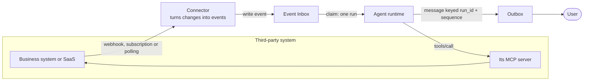
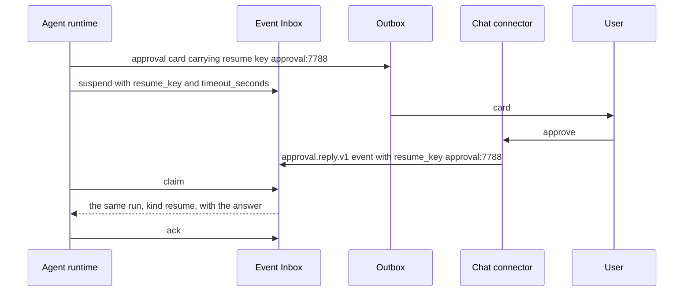

# Integration guide

[中文](../zh/integration.md)

This guide shows how to connect two kinds of system to the Event Inbox: connectors, which bring in
changes from third-party systems, and the agent runtime, which does the work. An MCP server fits in on
the agent side, as tools the agent calls during a run. It does not write to the Inbox by itself.
Every endpoint is specified in [API](api.md); this guide says which calls to make, in what order and
with what values.

To give an application the hosted agent rather than build a runtime of your own, use the
[Agent API](agent-api.md) instead: the agent service is such a runtime, on Claude Managed Agents, and
it connects MCP-based systems through the agent's configuration and its credentials.

## At a glance



A connector writes each change into the inbox of the person it concerns. The agent claims the events
as a run, calls the system's MCP tools while it works, and sends what is worth saying through the
Outbox. A reply or an approval from the user comes back through a connector as one more event.

## What the Inbox does for you

| Function | What it gives you | API |
| --- | --- | --- |
| Idempotent writes | A connector can retry any write; one change is one event | `POST /v1/inbox/{inbox_id}/events` |
| Batching | Events with the same merge key that arrive close together reach the agent as one run | `merge_key` |
| Single flight | Never two runs on the same merge key at once; background work never blocks a reply | `merge_key`, `lane` |
| Leases and redelivery | A crashed worker's run comes back with the same `run_id` and the same events | `heartbeat`, `ack`, `nack` |
| Mid-run arrivals | A running turn learns about new messages and stop requests, and can take them in | `heartbeat`, `steer` |
| Suspend and resume | A run waits days for an approval without holding anything; the answer resumes the same run | `suspend`, `resume_key` |
| Deferred events and timers | Follow-ups and recurring jobs wake the agent through the same queue | `ready_at`, `POST /v1/inbox/{inbox_id}/timers` |
| History, replay and audit | Every event's path can be read back; an operator can replay failed work | `GET /v1/inbox/{inbox_id}/events/{event_id}`, `POST /v1/admin/replay` |

## Before you start

Each system gets its own client: an id, a secret and roles, configured on the Inbox server by an
operator (see the README's configuration).

| System | Role | Tenant |
| --- | --- | --- |
| Connector | `PRODUCER` | Its tenant, so it can write nowhere else |
| Agent runtime | `RUNTIME`, plus `PRODUCER` if it schedules its own follow-ups or timers | None, to serve every tenant, or one tenant |
| Operator tools | `OPERATOR` | None, or one tenant |

- Sign every request as described in [API](api.md#authentication). The Java `InboxClient` and the
  Python example below do it for you.
- Use one inbox per person the agent serves, for example the user id. Every connector writes a
  person's events into the same inbox, so the agent sees them in one order.

## Connecting a connector

A connector only writes events. It never starts the agent and never waits for it: a 202 means the
change is stored, and the agent will see it.

### Getting changes out of the system

An MCP server answers when it is called. It does not tell anyone that something changed. A proactive
agent needs changes to arrive by themselves, so one of these feeds the connector.

| Way | Use it when | How it works |
| --- | --- | --- |
| Webhook relay | The system can call a URL when something changes | A small HTTP endpoint checks the system's signature, maps the change and writes the event. It answers the system only after the Inbox answered 202, so the system's own retries cover an Inbox outage |
| MCP resource subscription | The system's MCP server supports resource subscriptions | A long-lived MCP client calls `resources/subscribe` for each resource to watch. Each `notifications/resources/updated` names a changed resource; the client reads it with `resources/read` and writes an event keyed by the URI and the resource's version or update time |
| Polling | The system offers neither | A cron timer in the inbox wakes the agent, which looks for changes with the MCP tools and ends without a message when there are none. Or a poller writes each change it finds, keyed by object id and version, so a change seen twice stays one event |

### Mapping a change to an event

| Field | What to put in it | Example |
| --- | --- | --- |
| `source` | `connector` for enterprise systems, `biz_webhook` for business systems, `conversation` for what a person typed, approval replies included | `connector` |
| `type` | What happened, as `<system>.<object>.<change>.v<N>` | `jira.issue.updated.v1` |
| `source_event_id` | The system's own id for this change. The same change always gets the same id, and a different change never does | `jira:PROJ-123:2026-11-21T10:00:00Z` |
| `merge_key` | What must be handled together and never twice at once: a conversation, a ticket, an order | `issue:PROJ-123` |
| `lane` | `interactive` when a person waits for the answer, `background` for notifications, `batch` for bulk syncs | `background` |
| `occurred_at` | When it happened in the system | `2026-11-21T10:00:00Z` |
| `payload` | The facts the agent needs to decide what to do, at most 64 KB. Send ids and links, not documents: the agent reads details with the MCP tools | `{"issue":"PROJ-123","changed":["status"]}` |
| `trace_id` | The system's trace id, if it has one; it reaches the run and the Outbox | `4bf92f3577b34da6` |
| `resume_key` | Only on a reply that answers a waiting run | `approval:7788` |
| `interrupt` | Only on a message that asks the running work to stop. A conversation message that is exactly a stop word gets it automatically | `true` |

Leave out `source_event_id` only when the system has no id at all. The Inbox then fingerprints the
event, which protects against fewer kinds of retry.

### Writing an event in Java

`InboxClient`, from the `inbox-client` module, signs the request.

```java
InboxClient inbox = new InboxClient(URI.create("http://inbox.internal:8080"), "jira-connector", secret);

/** Hands one change to the user's inbox; returns once the Inbox has accepted it. */
WriteEventResponse deliver(String userId, String issueKey, String updatedAt, String factsJson)
        throws InterruptedException {
    WriteEventRequest event = WriteEventRequest.builder(EventSource.CONNECTOR, "jira.issue.updated.v1")
            .sourceEventId("jira:" + issueKey + ":" + updatedAt) // the same change always gets the same id
            .mergeKey("issue:" + issueKey)                       // one run at a time per issue
            .lane(Lane.BACKGROUND)
            .occurredAt(Instant.parse(updatedAt))
            .payloadJson(factsJson)                              // facts and ids, at most 64 KB
            .build();
    for (int attempt = 1; ; attempt++) {
        try {
            ApiResult<WriteEventResponse> answer = inbox.writeEvent(userId, event);
            if (answer.ok()) {
                return answer.body();                            // accepted now, or accepted before
            }
            if (answer.status() < 500 || attempt == 5) {
                throw new InboxApiException(answer.status(), answer.problem()); // a 4xx is a bug: no retry
            }
        } catch (UncheckedIOException noAnswer) {
            if (attempt == 5) {
                throw noAnswer;
            }
        }
        Thread.sleep(200L << attempt);                           // sending the same event again is safe
    }
}
```

### Answers and what to do

| Answer | Meaning | What the connector does |
| --- | --- | --- |
| 202, `deduped: false` | Accepted | Acknowledge the change to the system |
| 202, `deduped: true` | Accepted before | The same |
| 500, 503, timeout, connection error | The Inbox could not confirm the write | Retry with the same event and key, with backoff |
| 400 | The event is invalid | Do not retry; fix the mapping |
| 401, 403 | Signature, secret or role | Do not retry; check the credentials |
| 409 `idempotency_conflict` | The key was already used for different content | Do not retry; put the change's version into the key |
| 413 | The payload is over 64 KB | Send a reference instead of the content |

### Replies and approvals

- A chat connector writes each message a person sends as a `conversation` event, with the
  conversation as merge key. Messages typed in quick succession reach the agent as one run.
- When the agent asks for an approval, the card carries the resume key the run suspended with. The
  connector writes the click as a `conversation` event of type `approval.reply.v1`, with that
  `resume_key` and the approval's id as `source_event_id`, so a double click stays one event.

## Connecting an agent

The runtime works in a loop of a few calls and keeps the rules of the
[runtime contract](api.md#runtime-contract).

### The run loop

1. **Claim.** Call `POST /v1/runs/claim` with a `worker_id`, a `wait_ms` of up to 30,000, and
   `accepts_steer: true` for conversations. A 204 means there is nothing to do; claim again, after
   `X-Inbox-Retry-After-Ms` when that header is present.
2. **Prepare the turn.** The `events`, in `run_seq` order, are the turn's inputs. `kind` says how to
   start: `start` is new work, `redelivery` is the same run after a crash or a nack (start over and
   repeat nothing that already happened), `resume` continues a suspended run (load the state saved
   under `run_id`).
3. **Work.** Call the model and the MCP tools. Heartbeat at least every 20 seconds, also while a tool
   call is running, and look at the signals between steps.
4. **Speak through the Outbox.** Give every message the key `run_id` + sequence, where the n-th
   message of a run is always sequence n.
5. **End the run** with exactly one call: `ack` with `outcome: done`, `ack` with `outcome: failed`,
   `nack`, or `suspend`. Ending without a message is normal.
6. **On 409 `lease_lost`**, at any step, stop at once and change nothing: another worker owns the run.

Ack and suspend carry `last_run_seq`, the highest `run_seq` the turn used, so that an event steered in
at the last moment goes back to the queue instead of being lost.

### Run fields the agent uses

| Field | Use it for |
| --- | --- |
| `run_id` | The key of the saved session state, and the base of every idempotency key the run derives |
| `epoch` | Send it with every call on the run |
| `kind`, `resume_reason` | How to start: new, again, or continued after an answer (`event`) or a timeout (`timeout`) |
| `events` | The inputs, in `run_seq` order, each with `type`, `source`, `payload` and `source_event_id` |
| `merge_key` | The conversation or object: load its history and memory |
| `trace_id` | Pass it to logs, tool calls and the Outbox |
| `lease_expires_at` | Heartbeat before this time |

On a resume after an answer, `events` holds only the answers. `GET /v1/runs/{run_id}` returns every
event the run holds.

### Signals while the run works

| Signal in the heartbeat answer | What the agent does |
| --- | --- |
| `steer_pending` above 0 | At a safe point, call `steer`. New events of the same merge key join the run and are returned |
| `interrupt_requested` | Decide. To yield, save the state and suspend with a resume key such as `resume:<run_id>`. The flagged message is claimed first. The old run continues when an event carrying that key arrives, or, with `on_timeout: resume`, when the timeout passes |
| `extended: false` | The lease has reached its 30-minute cap. Save the state and suspend with `on_timeout: resume` and a short timeout; the run comes back with a fresh lease |

Ignoring a signal is safe: the events wait and are claimed after the run ends.

### Calling MCP tools inside a run

- The Inbox is not in the path. The agent calls its MCP servers directly, with credentials the
  runtime holds, never ones carried in events.
- A run can be delivered more than once. Before a tool call that changes something, make sure a
  repeat does no harm: pass an idempotency key built from `run_id` and the step number when the tool
  accepts one, otherwise read the current state first and skip what is already done.
- Ask before acting on anything high-risk: suspend for an approval and act after the resume.
- A transient tool failure (timeout, 5xx, rate limit) ends the run with `nack`, with
  `retry_after_ms` if the tool said when to come back. A permanent one (invalid request, permission
  denied) ends it with `ack`, `outcome: failed` and the reason.
- Keep heartbeating while a slow tool call runs.

### Writing the agent in Java

`ScriptedWorker`, in `inbox-client`, already keeps the contract: it claims, carries the epoch, steers,
ends every run with one call, stops on a lost lease and turns an exception into a `nack`. The agent
goes into its callback. Below, `outbox`, `sessions`, `Session` and `tools` stand for your own parts:
the delivery service, where session state is kept, and the MCP client.

```java
InboxClient inbox = new InboxClient(URI.create("http://inbox.internal:8080"), "agent-runtime", secret);
ScheduledExecutorService keepAlive = Executors.newSingleThreadScheduledExecutor();

ScriptedWorker worker = new ScriptedWorker(inbox, outbox, "agent-1", context -> {
    ClaimedRun run = context.run();
    // Keep the lease while the model or a tool is busy. A lost lease shows up at the turn's own
    // heartbeat below, which throws LeaseLostException and ends the turn without touching the run.
    ScheduledFuture<?> beats = keepAlive.scheduleAtFixedRate(() -> {
        try {
            context.heartbeat();
        } catch (RuntimeException reportedByTheTurn) {
            // nothing to do here
        }
    }, 20, 20, TimeUnit.SECONDS);
    try {
        Session session = sessions.load(run.runId());          // empty unless this run saved one
        for (ClaimedEvent event : context.events()) {
            if (event.runSeq() > session.lastRunSeq()) {        // skip what the saved session holds
                session.add(event);
            }
        }
        while (!session.finished()) {
            HeartbeatResponse signals = context.heartbeat();
            if (signals.interruptRequested()) {                 // yield: the stop request goes first
                sessions.save(run.runId(), session);
                return new ScriptedWorker.Decision.Suspend("resume:" + run.runId(), 60, SuspendRequest.RESUME);
            }
            if (signals.steerPending() > 0) {
                context.steer().forEach(session::add);          // new messages of the same conversation
            }
            session.step(tools);                                // one model call and its MCP tool calls
        }
        if (session.answer() != null) {
            context.send("im", session.answer());               // saying nothing is a normal ending too
        }
        return new ScriptedWorker.Decision.Done();
    } finally {
        beats.cancel(false);
    }
});
while (running) {
    worker.runOnce(ClaimRequest.any("agent-1").withSteer(true).withWait(20_000));
}
```

### Writing the agent in another language

Any language with HTTP and HMAC-SHA256 will do.
[inbox_example.py](../../examples/python/inbox_example.py) is a complete example that uses only the
Python standard library: a connector write with retries, and an agent turn that claims, heartbeats,
acks, and nacks on failure. Its one function that every request goes through:

```python
def call(client_id, secret, method, path, body=None):
    """Sends one signed request; returns (status, headers, parsed JSON body or None).

    The signature covers a timestamp, the method, the path with its query and the body, exactly as sent.
    """
    data = b"" if body is None else json.dumps(body, separators=(",", ":")).encode("utf-8")
    timestamp = str(int(time.time()))
    string_to_sign = "\n".join(["v1", timestamp, method, path, hashlib.sha256(data).hexdigest()])
    signature = hmac.new(secret.encode("utf-8"), string_to_sign.encode("utf-8"), hashlib.sha256).hexdigest()
    request = urllib.request.Request(BASE_URL + path, data=data if body is not None else None, method=method)
    request.add_header("X-Client-Id", client_id)
    request.add_header("X-Timestamp", timestamp)
    request.add_header("X-Signature", "hmac-sha256=" + signature)
    if body is not None:
        request.add_header("Content-Type", "application/json")
    try:
        with urllib.request.urlopen(request, timeout=60) as response:
            raw = response.read()
            return response.status, response.headers, json.loads(raw) if raw else None
    except urllib.error.HTTPError as error:
        raw = error.read()
        return error.code, error.headers, json.loads(raw) if raw else None
```

### Approvals



While the run waits it holds no slot, so the user's other work goes on. With `on_timeout: finish`, the
default, a run that gets no answer ends silently at the deadline; with `on_timeout: resume` it is
handed back with `resume_reason: timeout`.

### Follow-ups and timers

- For a one-off follow-up, such as looking again in two hours, write an `agent_self` event with
  `ready_at`, keyed by `run_id` and a counter. A runtime without a tenant adds `tenant_id` to the
  write.
- For a recurring job, create a timer: `POST /v1/inbox/{inbox_id}/timers` with `kind: cron`, a `cron`
  expression, a `time_zone` and a `timer_key`.
- When a follow-up or timer fires, look first and stay silent if nothing is worth saying.
- Never sleep inside a run: a waiting run holds a slot, and a restart loses the wait.

### Errors

| Situation | Answer | What the runtime does |
| --- | --- | --- |
| Nothing to claim | 204 | Claim again; first wait for `X-Inbox-Retry-After-Ms` when present |
| Another worker owns the run | 409 `lease_lost` | Stop; send nothing more; do not end the run |
| The resume key is already waited for | 409 `resume_key_in_use` | Use a key that includes `run_id` |
| The Inbox is unavailable | 503 or connection error | Retry the same call with the same epoch; ending calls are idempotent |
| A suspend without a timeout | 400 | Always send `timeout_seconds` |

## Checklists

Connector:

- [ ] Every event has a `source_event_id` that is the same on every retry and different for every change
- [ ] The merge key names what must never be worked on twice at once
- [ ] A 5xx answer or a network error is retried with the same event; a 4xx answer is not
- [ ] Payloads stay under 64 KB and carry references, not documents
- [ ] The client secret comes from a secret store

Agent runtime:

- [ ] Every call after the claim carries the epoch, and a 409 `lease_lost` stops the turn
- [ ] A heartbeat at least every 20 seconds, during long tool calls too
- [ ] Every run ends with exactly one of ack, nack or suspend
- [ ] Messages go through an outbox keyed `run_id` + sequence, and every tool call that changes something is safe to repeat
- [ ] Every suspend has a timeout
- [ ] Follow-ups are events with `ready_at`, never a sleep

## Trying it

1. Start the service as in the README's quick start.
2. Run `python3 examples/python/inbox_example.py write` as the connector, then
   `python3 examples/python/inbox_example.py work` as the agent.
3. Read the test that runs the pattern you need end to end:

| Pattern | Test |
| --- | --- |
| A webhook leads to one reply | `ScenarioAE2E` |
| Messages typed in a row become one run | `ScenarioBE2E` |
| Approval with suspend and resume | `ScenarioCE2E` |
| A crash and redelivery, with the reply sent once | `ScenarioDE2E` |
| A follow-up two hours later | `ScenarioEE2E` |
| Steer and interrupt | `F9DeliveryModesIT` |
