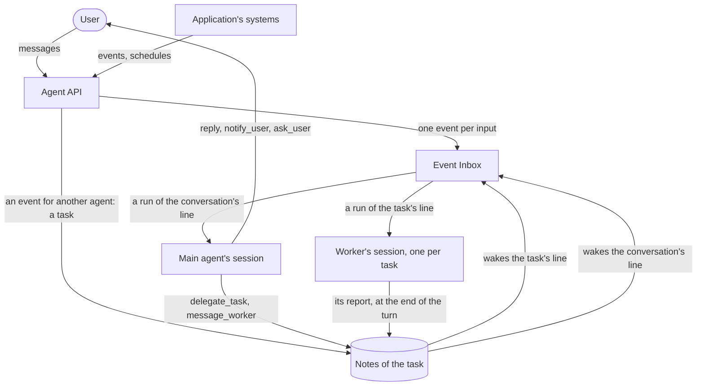

# Main agent and workers

[中文](../zh/main-agent.md)

A main agent is the one agent that everything about a user reaches: what they write, what happens in
the application's systems, what falls due, and what the agents that work for it report. It decides
what each of these calls for, tells the user or stays quiet, and hands longer work to workers, which
are agents with sessions of their own. What it begins on its own initiative waits for the user's
confirmation, unless the user has authorised that kind of work. This document reviews the service as
it was before, records
why the main agent is built the way it is, and explains how it works.
[Agent API](agent-api.md#a-main-agent-and-its-tasks) has the application's side.

## At a glance

The main agent and a worker never call each other. What one has for the other is stored as a note of
the task, and an event for the other's line is queued in the same transaction. A report is therefore
input like any other: deduplicated, run one at a time, and still there after a crash. What the
application hands to a worker itself takes the same way, so the main agent hears of that as well.

## What the review found

The service as it stood was reviewed against one requirement: an agent that perceives what goes on
around a user, takes things on for them unasked, and still takes their messages and tasks.

| Finding | What it means for a main agent |
| --- | --- |
| Only the Event Inbox turns events into runs, one per line at a time, under a lease | Kept as the base. Whatever a main agent and its workers exchange goes the same way, or dedupe, single flight, replay and the audit trail no longer cover it |
| Every line has a session of its own, and lines know nothing of each other | A conversation's session heard of work in the background afterwards, and only what the user had been notified of. No session saw the whole of a user |
| Each subject's session decides alone whether the user is told | Proactivity was per subject. Nothing weighed one subject against another, or against what the user had just said |
| An agent cannot start another one | Long work ran inside the turn of the line that got the event, within the turn's 10 minutes, and held that line meanwhile |
| What other systems say reaches an agent only as a tool result | Kept, and extended: what a main agent writes to a worker, and what a worker reports, are not the user's word either |
| [The architecture](architecture.md#multi-agent-hierarchy) names three tiers | Two are built here: the main session, and one thread per task. Several work agents under one thread are left to the platform |

## The decision

**A main agent is a conversation's agent with a list of workers. Each task gets a worker's session of
its own, on a line of its own, and the two sides exchange notes through the Event Inbox.**

Three changes carry it.

1. **Everything goes to one session.** Events and schedules that the application sends for a main
   agent are handled on the line of the conversation it serves, not on a line per subject, and its
   workers' reports come to the same line. The session that talks to the user hears everything.
2. **Delegating is a tool call.** `delegate_task` starts a task on a line of its own,
   `work:<task_id>`, where the worker's agent runs. What the worker writes last in a turn is its
   report, and the report wakes the main agent.
3. **Nothing works for the user that the main agent does not know of.** In a conversation that a
   main agent serves, an event that the application sends for another agent is not a line of its own
   any more. It is a task of the main agent, and word of it reaches the main agent through the Inbox
   at once, like everything else that it perceives.

Claude Managed Agents has multi-agent sessions of its own, in beta: a coordinator hands work to
sub-agents that run as threads of its session. That is the obvious alternative, and it is not what
carries the tasks here.

| Question | Workers as lines of the Inbox (built) | Workers as threads of the main session |
| --- | --- | --- |
| What wakes a worker | An Inbox event: deduplicated, one run at a time, leased, replayable, audited | The coordinator's call inside its turn, which this service only sees in the stream |
| What a worker shares with the main agent | The notes of the task, and nothing else | The session's sandbox, files, vaults and memory |
| Who can write to a worker | The main agent, at any time, with `message_worker` | Only the coordinator: a client cannot post into a thread |
| What the user waits for | Not for the work: the main agent's turn ends as soon as it has delegated | For the work: the session is busy while any of its threads is, so the turn lasts as long as the work |
| When the main agent gets a new session | The tasks go on, and the new session is told that they are open | The threads go with the session |
| What it costs | A session per task, with the time it takes to start, and no shared working directory | Nothing on top: a thread starts inside the running session |

The first two rows decide it. Every wake-up that goes around the Inbox is one that its guarantees do
not cover. And a worker reads what other systems say, so it must not share the vaults and the memory
of the session that talks to the user; threads of one session cannot be kept apart like that, lines
can. The last row is the price, and it is paid per task.

Two things would change the decision.

- The platform lets a client post into a thread, and gives a thread resources of its own. Threads
  could then be lines.
- Work needs several agents in one working directory, such as code in one checkout. That is what the
  platform's threads are for, inside a worker's session; it is not wired here yet.

## What reaches the main agent

| What happens | How the main agent gets it | Lane |
| --- | --- | --- |
| The user writes | As the message that starts the turn | `interactive` |
| An event of the application for this agent | A notice in fixed words; the content through `read_events` | `background` |
| A schedule of the application, or a follow-up the main agent set itself | A notice in fixed words, with the instructions or the note | `background` |
| A worker reports, a worker's turn fails, or somebody else closes a task | A notice in fixed words; the content through `read_events` | `background` |
| The application hands an event to one of its workers itself | A notice in fixed words; what was handed over through `read_events` | `background` |

All five are runs of one line, `conv:<conversation_id>`, so they come to one session, one at a time.
What arrives close together is handed over together, which is what lets the main agent weigh one
thing against another before it speaks.

The service adds a few sentences to a main agent's instructions. They say that everything about the
user comes to this session; that each time it is the agent's judgement whether to act, to tell the
user or to stay quiet, with the user's attention as the scarcest thing it has; and that it starts
work unasked only when that is clearly what the user wants and easy to undo, and otherwise proposes.

An application can have ordinary agents next to a main agent. In a conversation that no main agent
serves, their events go to the line of their subject, as before. In a conversation that a main agent
serves they become tasks of the main agent, as the next section but one describes.

## From a request to its result

1. A run of the main agent's line begins: the user wrote, or something happened.
2. The main agent calls `delegate_task` with a role, a title and instructions. In one transaction the
   service stores the task, its line and the instructions as the task's first note, and queues the
   event `agent.task_message.v1` for the task's line.
3. The main agent ends its turn. It tells the user what it has started, or says nothing. Nothing
   waits for the worker.
4. The Inbox runs the worker's turn on the task's line. The worker reads the instructions with
   `read_events`, works with its own tools, and writes its report at the end of the turn.
5. The service stores the report as a note and queues `agent.task_report.v1` for the main agent's
   line.
6. The main agent's next turn reads the report with `read_events`, next to whatever else is waiting,
   and decides: tell the user, send the worker more with `message_worker`, close the task, or
   nothing.

A task stays open after a report. The worker's session remembers the task, so a later message to it
continues the work instead of starting it over.

## Work that the application hands to a worker

The application does not have to go through the main agent's judgement for work that it knows whom
to give: an event that names another agent (`agent`) goes to that agent. Where a main agent serves
the conversation, this is what happens.

1. The service makes a task of the main agent for the event's `subject`, with the named agent as its
   worker, or takes the open task of that subject. The task is the application's (`created_by: app`)
   and starts without a confirmation: the application ordered it.
2. The event is stored as a note of the task, and the worker's line is woken. The worker reads the
   event with `read_events`, as information from another system.
3. In the same transaction a second note tells the main agent what the application handed over, and
   the main agent's line is woken with `agent.task_report.v1`. It hears of the work when it starts,
   not when it is done.
4. The worker reports to the main agent, like any worker. It cannot reach the user.

The main agent mostly takes note and stays quiet. It can step in, because it knows what the user said:
`message_worker` gives the worker what it needs to know, and `close_task` stops work that the user no
longer wants. `list_tasks` shows these tasks next to the ones it delegated, with who started each and
what its worker waits for somebody to approve.

Later events of a subject go to the same task while it is open, and so to the session that remembers
the earlier ones; a subject keeps its worker. An agent that is not on the main agent's list works
under it all the same, under its own name for want of a role. An event that names no agent, or the
main agent, is the main agent's own and comes to its line as before.

## Who lets a task start

A task does not always start when the main agent delegates it. What decides is whose idea the task
was, and the turn tells: in a turn that the user began with a message the main agent acts at the
user's word, in any other turn on its own initiative. The application sets the rule per role, with
`start` in the main agent's list of workers.

| `start` of the role | The user asked for it in the conversation | The main agent's own initiative |
| --- | --- | --- |
| `ask`, the default | Starts | Waits for the user's confirmation, unless the user has given a standing authorisation for the role |
| `always_ask` | Waits for the user's confirmation | Waits for the user's confirmation; no standing authorisation is possible |
| `always_allow` | Starts | Starts |

A task that waits has the state `proposed`. It costs nothing on the platform: its worker gets a
session only when the task starts. The application shows it to the user with the main agent's
`summary` of it, what it wants to do and why, which comes with the update `task.created`. The
summary is also put into the conversation, as a message with `kind: proposal` that names the task in
`task_id`: an application that shows nothing but the conversation shows the proposal too. The user
answers in one of three ways.

1. In the application: `POST /v1/users/{user_id}/tasks/{task_id}/start` confirms the task, and
   closing it declines it. The main agent is told of a decline, so that it does not propose the same
   again.
2. In the conversation: when the user writes that the main agent should go ahead, the main agent
   starts the task with `start_task`. That works only in a turn that the user began.
3. Not at all: after 3 days the task can no longer be started.

A standing authorisation is the user's to give and to take back, with `PUT` and
`DELETE /v1/users/{user_id}/grants/{agent_key}/{role}`; the application can do both for them, and no
agent can. It names a role, and a role can do what its worker's agent can do, so an authorisation is
as wide as the application made the role. The same agent can stand behind several roles, so an
application that wants finer rules makes finer roles.

Every task records in `authorized_by` why it was allowed to start: `conversation`, `user`, `app`,
`grant` or `policy`. The share of proposed tasks that users confirm is the acceptance rate that
[the architecture](architecture.md#governance-and-observability) asks for. A confirmation is for the
task, not for everything the worker then does: a tool call that needs an approval still waits for
one.

## Asking the user

For any other agent, a question holds its turn: the run waits in the Inbox until the user answers,
and new input on the line withdraws the question. On a main agent's line that would undo every
question, because everything that concerns the user comes in there: the next event or report, which
has nothing to do with the question, would end the wait. So a main agent asks in passing.

1. `ask_user` puts the question on record, as an action, and into the conversation, as a message
   with `kind: question`. The call returns at once and the turn ends as usual.
2. Events, schedules and reports that come in afterwards are handled as always. The question stays.
3. The user's next message in the conversation is the answer, and a turn of its own that the user
   began. An answer given in the application, with `POST .../actions/{action_id}/resolve`, is stored
   as that message and handled the same way.
4. When the user declines, or nobody answers within 24 hours, the main agent is told by an event of
   the service's own, `agent.question_unanswered`, which it reads in the background.

One question waits at a time: a newer question takes the place of one that still waits, and a turn
asks one. In the background a question counts against what the user may be sent in a day, as a
notification does. What the user answers is the user's word, so a task that the main agent delegates
in that turn starts without a confirmation, like anything else the user asks for.

## Use cases

The requirement was checked against the design case by case. "New" marks what the check added.

| Case | Supported | How |
| --- | --- | --- |
| The user asks for work in the conversation | Yes | `delegate_task` in a turn that the user began starts at once |
| Something happens, and the main agent sees work that it could do | Yes | The event reaches its session, next to the conversation and whatever else is waiting |
| The user confirms that work in the application | Yes, new | The task is `proposed` until `POST .../tasks/{task_id}/start` |
| The user declines it | Yes, new | Closing a proposed task declines it, and the main agent is told |
| The user has authorised that kind of work, and it runs by itself | Yes, new | A grant for the role; the task records `grant` |
| The user takes the authorisation back | Yes, new | Later tasks wait again; those that have started go on |
| The application wants one role always confirmed, and another never | Yes, new | `always_ask` and `always_allow` |
| The user answers in the conversation instead | Yes, new | `start_task`, in a turn of the user only |
| Nobody answers | Yes, new | The task can no longer be started after 3 days |
| Several things happen close together | Yes | One turn gets them together, so one task can cover them |
| Work under way needs a decision on one action | Yes | The worker's tool call waits for its approval, as for any agent |
| The user stops work that started by itself | Yes | They close the task, or tell the main agent |
| The product shows nothing but the conversation | Yes, new | The proposal is a message of the conversation, and the user's "go ahead" there starts the task |
| The main agent asks the user something, and other things happen before the answer | Yes, new | The question is asked in passing: nothing but the user's word ends it, and the answer is the user's next message |
| The application gives work straight to a worker | Yes, new | The event becomes a task of the main agent, which hears of it at once; the worker reports to the main agent |
| The user asks the main agent about something a worker waits for | Yes, new | `list_tasks` shows what each worker waits for somebody to approve |
| The user wants to see a plan before confirming | No | The user confirms the main agent's summary; a worker does not plan first |
| The user authorises more narrowly than a role | No | An authorisation names a role; the application can make its roles finer |

## Tools

| Tool | For the main agent | For a worker in a task |
| --- | --- | --- |
| `delegate_task` | Makes a task for one of its roles, and answers with the task's id and whether it has started or waits for the user | Not there |
| `start_task` | Starts a task that waits, when the user has said in the conversation to go ahead | Not there |
| `message_worker` | Sends the worker of an open task more: an answer, a correction, a next step | Not there |
| `list_tasks` | The open tasks, its own and the application's: their state, who started each, what its worker waits for, and the latest word from each | Not there |
| `close_task` | Ends a task. A turn of the worker that is under way stops, and what it waits for is withdrawn | Not there |
| `read_events` | Events, due follow-ups and what workers have for it | What the main agent sent, and its own due follow-ups |
| `notify_user`, `ask_user` | `notify_user` as for every agent; `ask_user` asks without waiting, see [Asking the user](#asking-the-user) | Refused: a worker reports to the main agent, which decides what the user hears |
| `schedule_followup` | As for every agent | Wakes the worker later, on the same task |

## Tasks

| State | Meaning |
| --- | --- |
| `proposed` | The task waits for the user's confirmation; its worker has not been woken |
| `queued` | Something the main agent sent waits for the worker |
| `working` | A turn of the worker is under way |
| `idle` | The worker has reported, or has nothing to do; the task waits for the main agent |
| `closed` | Over. Nothing more comes from it |

A task is closed by the main agent (`close_task`), by the user or the application
(`POST /v1/users/{user_id}/tasks/{task_id}/close`), or by the service: its sweep closes a task that
has waited 3 days for a confirmation, and when the main agent delegates again, a task that has been
idle for 7 days is closed too. When the user or the application closes a task, the main agent is
woken and told. When the service does, nothing wakes it: it is told the next time something else
wakes it in the background.

The tables are `delegated_task` and `task_note`. A task names the main agent's line, the role, the
worker's agent and the call that made it; a note has a direction, a kind (`assignment`, `message`, `event`, `assigned`,
`report`, `failure` or `closed`) and its text. Every change of a task's state is recorded as an
update, `task.created` or `task.updated`.

## When something breaks

| What happens | What the service does |
| --- | --- |
| The service's worker dies right after `delegate_task` | The run is delivered again. The call is named by the run and its place among the run's calls, so it finds the task it made, and the worker is woken once |
| A turn of the worker fails, or runs out of time | A note from the service tells the main agent that the work is not done. The main agent sends the worker a message to have it try again, or closes the task |
| The worker ends its turn without writing anything | If the main agent had sent something, the service reports that in the worker's place, so the main agent never waits for nothing |
| The task is closed while the worker works | The worker's session is interrupted, and no report is stored |
| The main agent's session is replaced | The first turn of the new session is told what was said before and that tasks are open, also when that turn starts in the background |
| The main agent delegates more and more | `delegate_task` is refused, with the reason, while 4 tasks are queued or worked on, or 20 are open |
| Nobody confirms a proposed task | After 3 days the sweep closes it and records `task.updated`, so that the application that shows it knows; an attempt to confirm it then is refused |
| The main agent proposes more and more | `delegate_task` is refused while 5 tasks wait for a confirmation |
| A main agent that may start work unasked starts more and more | After 10 such tasks in 24 hours for one user, the next ones wait for the user's confirmation, authorisation or not |
| The application sends events of more and more subjects | At 20 open tasks, the application's own task that has rested longest is closed to make room; when there is none, the event is refused with a 409 |

`CoordinatorIT` and `TaskConfirmationIT` have a test for each row.

## Trust

- What the main agent writes to a worker is not the user's word. The worker gets it as the result of
  `read_events`, and is told to do it within what its own instructions allow.
- What a worker reports is information for the main agent, never instructions. The main agent's
  instructions say so.
- An event that the application hands to a worker is information too, for the worker that reads it
  and for the main agent that is told of it. Both get it as the result of `read_events`.
- A worker cannot reach the user. A tool call of a worker that needs an approval still goes to
  whoever approves it, as for any agent.
- A user's own client sees a task's title, role and state, and can close it. What the worker
  reported and what the two agents wrote to each other is for the API key only.
- Delegating is one level deep: a worker is never a main agent, and an agent that is on a list of
  workers cannot become one.
- The main agent cannot confirm what it proposed, and cannot authorise itself: `start_task` is
  refused outside a turn of the user, and there is no tool for a grant.
- What the user confirms is what was proposed: a task that has not started takes no further message
  from the main agent.
- A worker's session has its agent's memory to read only, like every session in the background. The
  main agent's session is the exception: it reads events and reports, and it can write the memory.
  Only its instructions keep the two apart, so an application for which that is not enough leaves
  `memory` off for its main agent.

## Settings and limits

| What | Default | Setting |
| --- | --- | --- |
| Roles on a main agent's list | at most 10 | fixed |
| When a task of a role may start | `ask` | `start` of the role in the agent's `coordinator` |
| Tasks of one conversation that wait for a confirmation | 5 | `agent.tasks.max-proposed` |
| How long a task waits for a confirmation | 3 days | `agent.tasks.proposal-ttl` |
| Tasks that start without the user being asked, by a standing authorisation or by `always_allow` | 10 in 24 hours for one user; further ones wait for a confirmation | `agent.tasks.max-unasked-per-day` |
| Tasks of one conversation that are queued or worked on | 4 | `max_active_tasks` of the agent's `coordinator`, 1 to 20 |
| Tasks of one conversation that are open | 20 | `agent.tasks.max-open` |
| How long an idle task is kept | 7 days | `agent.tasks.idle-ttl` |
| Instructions of a task, and a later message to its worker | 8,000 characters | `agent.tasks.max-instructions` |
| A worker's report | 16,000 characters, then cut off | `agent.tasks.max-report` |
| The Inbox lane on which workers run | `batch` | `agent.tasks.lane`: `batch` or `background` |
| Workers of one user that run at the same time | 1 | The Inbox's `inbox.lanes.batch.cap`; `docker-compose.yml` sets 4 |
| How long a turn of a worker may take | 20 minutes; a conversation's turn has 10 | `agent.tasks.turn-deadline`, below the Inbox's `inbox.lease.max-duration` |

Workers have a lane of their own so that a worker's long turn never holds up what wakes the main
agent, and the main agent's turns never wait for a free slot behind workers.

## Why this, and what would show it wrong

This section records the judgement behind the decision, so that it can be checked later. The
percentages are estimates of the author, made in November 2026 for the following six months.

| Judgement | Confidence | What it rests on | What would show it wrong |
| --- | --- | --- | --- |
| Workers belong on lines of the Inbox, not on threads of the main session | 80% | The platform's documentation of its multi-agent sessions, read in November 2026: threads share the session's resources, and a client cannot post into one | The platform gives threads resources of their own and lets clients post into them; or most tasks turn out to need a shared working directory |
| One session for everything about a user is affordable | 70% | A turn of the main agent that only sorts and delegates is short; long work is the workers' | A user's message often waits behind a turn in the background; the input tokens of the main agent's turns grow with every event |
| The platform's threads are the right tool inside a worker | 65% | They start without a new session and share files, which is what several steps of one task need | The official SDK does not carry them, or their cost per thread is close to a session's |
| The main agent should hear of the application's work for a worker at once, not at the report | 75% | The user may ask about it at any moment, and only the main agent knows what the user said | Nearly all of the turns it costs end with nothing done, or the cost of them is what applications complain about |
| Confirmation belongs to the task, and standing authorisation to the role | 85% | A role is what the application bounds with tools and approvals, so it can be authorised without knowing the task | Users ask to authorise by kind of event or up to an amount instead, or want a plan to confirm and not a summary |

The strongest argument against the decision is cost and delay. A main agent that hears everything
runs a turn for everything, including what it then decides to ignore, and a user's message waits
while such a turn runs, because a line runs one turn at a time. Anthropic
[reports](https://www.anthropic.com/engineering/multi-agent-research-system) that its own multi-agent
research system used about 15 times the tokens of a chat. The answer built here is
structural, not complete: turns of the main agent are kept short by delegating, events that arrive
together become one turn, and events that never need the main agent can still be sent to an ordinary
agent on its subject's line.

What to measure once the service runs with a model:

- How long a user's message waits behind a turn in the background on the same line, at the 95th
  percentile.
- The input tokens of the main agent's turns per user and day, and how many of those turns end
  without a message or a task.
- How many tasks end with a failure note, and how many are closed by the user.
- How many proposed tasks users confirm, decline and let expire, by role.

## What is not built

- The third tier: several agents under one task, in the platform's threads inside a worker's
  session.
- Writing to a worker directly as the user. The user talks to the main agent, which passes it on.
- Steering: a message that arrives while the main agent works in the background waits for that turn
  to end.
- A worker does not have the main agent's memory of the user. What it needs to know is written into
  the task.
- A plan to confirm. The user confirms the main agent's summary of a task; the worker does not draft
  a plan for them first.
- Authorisations narrower than a role, for example by kind of event or up to an amount.
- A tool of the main agent's own that needs an approval still holds its turn, and whatever comes in
  next ends that wait. Work that needs approvals belongs with a worker.
- A schedule that the application sets for another agent, in a conversation that a main agent
  serves, still runs on a line of its own.
- A main agent hears of the tasks of its conversation. What happens in another conversation of the
  same user, it does not.
- Nothing here ran against a model or the platform: the tests use the scripted stand-in.
