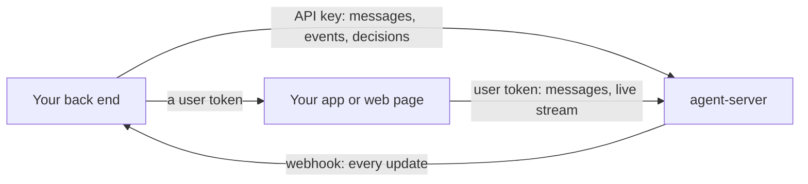

# Tutorial: run it and connect your application

[中文](../zh/tutorial.md)

This tutorial is for teams that want to put the proactive agent into their own product. It starts the
whole service on one machine in a few minutes, tries it, connects an application step by step, and
ends with what to check before real users come. The [Agent API](agent-api.md) guide describes every
endpoint; [Agent service](agent-service.md) explains how the service works inside.

## What you will run

| Part | What it does |
| --- | --- |
| `agent-server` | The Agent API that your applications call, on port 8090 |
| `inbox-server` | The Event Inbox: it turns messages and events into runs, one at a time per line of work. Only `agent-server` talks to it |
| PostgreSQL | The databases of both services |
| Claude Managed Agents | Anthropic's platform that runs the agent and its tools. In demo mode a script in `agent-server` stands in for it |

The service starts in demo mode, which needs no key: the agent repeats what users say and tells them
about every event. That is enough to build and test an integration. Live mode puts Claude behind the
same API, with an Anthropic API key ([step 10](#10-switch-to-live-mode)).

## 1. Start the service

### With Docker

You need Docker with Compose v2 (Docker Desktop, or Docker Engine 24 or later) and git; the examples
also use curl and python3. On Windows, run the commands in WSL or Git Bash.

```bash
git clone -b claude/tender-heisenberg-z2tbl7 https://github.com/joannaann0213-coder/Agent-research.git
cd Agent-research/proactive-agent
docker compose up -d --build --wait
docker compose ps
curl -s http://localhost:8090/actuator/health
```

The first build downloads the dependencies and takes a few minutes; with `--wait` the command returns
once the three services are `healthy`, as `docker compose ps` shows, and the health check answers with
`"status":"UP"`. The API listens on `127.0.0.1:8090`, so only this machine reaches it.

```bash
# Follow the log of the agent service
docker compose logs -f agent
# Stop everything; the data stays in a Docker volume
docker compose down
# Stop everything and delete the data
docker compose down -v
```

Settings go into a file `.env` next to `docker-compose.yml`: copy `.env.example`, which explains each
of them, and run `docker compose up -d` again after a change.

### Without Docker

You need JDK 21, Maven 3.9 and PostgreSQL 16. Build both services and create their databases
(`scripts/pg-local.sh` does it on Debian and Ubuntu), then start them as
[the README](../../README.md#agent-service) shows.

```bash
mvn -DskipTests package
scripts/pg-local.sh
```

## 2. Try it

```bash
examples/agent-api/quickstart.sh
```

The script plays an operator, an application's back end and a user's client in turn: it registers
the application `acme`, gets an API key, describes an agent, gets a token for the user `u42`, sends a
message, waits for the reply, reports an event of the application's systems and waits for the
notification. Its end looks like this:

```text
6. The reply comes a moment later.
   agent: You said: Where is my order 1234?
7. Something happens in the application's systems.
8. The agent decides whether the user needs to know; what it says shows among the updates.
   notification: [demo] Something happened that you should know about: order.delayed (order-1234).
9. Everything that happened for the user, in order:
   1 message.created message
   2 message.created reply
   3 message.created notification
```

`examples/agent-api/agent_api.py` is a small client in Python, with nothing but the standard library;
run as a script, it does the same and follows the user's updates as a live stream:

```bash
python3 examples/agent-api/agent_api.py --api http://localhost:8090 --admin change-me-admin-key-0123456789abcdef
```

## 3. How your application fits in

| In your product | In the Agent API |
| --- | --- |
| Your product, or one deployment of it | An application, `app_id` |
| One of your users | A user, under your own `user_id` |
| A chat window or thread | A conversation, `conversation_id` |
| Something your systems notice: an order is late, a ticket is answered | An event, about a `subject` |
| A decision that a person has to take | An action |
| Something to do at a given time | A schedule |

Three credentials, for three kinds of caller:

| Credential | Who holds it | Where it comes from |
| --- | --- | --- |
| Administration key | You, who run the service | `AGENT_ADMIN_KEYS_0` in `.env` |
| API key, `afk.…` | Your application's back end | `POST /v1/admin/apps/{app_id}/keys` |
| User token, `aft.…` | One user's app or web page, for 15 minutes to an hour | `POST /v1/users/{user_id}/tokens`, called by your back end |



There are two ways to connect, and they mix:

- Through your back end. It sends everything with the API key and gets every update by webhook. Your
  users never talk to the service, and you decide what reaches them. This suits business systems, and
  products that have a chat of their own already.
- Directly from your users' apps. Your back end gives the app of a signed-in user a user token, and
  the app sends the user's messages and follows the live stream itself. Your back end still reports
  events and takes the decisions that are the application's. This suits consumer apps.

## 4. Open an application

The operator registers each application once and gives its back end an API key.

```bash
API=http://localhost:8090
ADMIN=change-me-admin-key-0123456789abcdef
curl -s -X POST $API/v1/admin/apps -H "Authorization: Bearer $ADMIN" \
  -H 'Content-Type: application/json' -d '{"app_id": "shop", "name": "My shop"}'
KEY=$(curl -s -X POST $API/v1/admin/apps/shop/keys -H "Authorization: Bearer $ADMIN" \
  -H 'Content-Type: application/json' -d '{"label": "back end"}' \
  | python3 -c "import json,sys; print(json.load(sys.stdin)['api_key'])")
curl -s $API/v1/whoami -H "Authorization: Bearer $KEY"
```

The key is shown this once: keep it in your back end's secret store. To replace it, make a new one
and then revoke the old one with `DELETE /v1/admin/apps/{app_id}/keys/{key_id}`.

## 5. Describe the agent

`PUT /v1/agents/default` says what the agent is for, which model it uses and which of your systems it
may reach. Send the whole configuration every time. Save this as `agent.json`:

```json
{
  "name": "Shop assistant",
  "instructions": "You help the customers of My Shop with their orders, deliveries and returns. Answer briefly. When an order is late, tell the customer with notify_user, and offer a voucher only when it is late by more than three days.",
  "model": "claude-opus-5-5",
  "effort": "medium",
  "mcp_servers": [
    {"name": "orders", "url": "https://mcp.shop.example/orders", "approval": "always_allow", "approver": "app"},
    {"name": "refunds", "url": "https://mcp.shop.example/refunds", "approval": "always_ask", "approver": "user"}
  ],
  "session_budget_usd": 2
}
```

```bash
curl -s -X PUT $API/v1/agents/default -H "Authorization: Bearer $KEY" \
  -H 'Content-Type: application/json' -d @agent.json
```

- `instructions` hold your rules, including what to do with each kind of event: what an event
  carries reaches the agent as information, never as instructions.
- `mcp_servers` are your systems, as MCP servers that the agent calls. With `approval: always_ask`
  every call waits for a person, and `approver` says whose decision it is ([step 8](#8-approvals-and-questions)).
- `sandbox` gives the agent a container with a shell, files and web search. `memory: per_user` lets it
  remember each user across conversations, and needs the sandbox.
- An application can have several agents, under other keys than `default`. A conversation keeps the
  agent that its first message names with `agent`.

In demo mode the script ignores the configuration, but the service checks it as in live mode.

## 6. Connect your back end

### Messages

A user's message, sent by your back end. `202` means stored, not answered:

```bash
curl -s -X POST $API/v1/users/u-1001/messages -H "Authorization: Bearer $KEY" \
  -H 'Content-Type: application/json' \
  -d '{"message_id": "web-7f3a", "conversation_id": "support", "text": "Where is my order 1234?"}'
```

`message_id` is your own id for the message: sending it again does no harm, so retry after a
timeout. Each `conversation_id` is a conversation of its own, `default` unless named.

The reply, and everything else that happens for a user, is an update: `message.created`,
`action.created`, `action.resolved` or `run.failed`. Your back end gets them one of two ways.

| Way | How | Good for |
| --- | --- | --- |
| Webhook | `PUT /v1/webhook` once; the service then posts every update of every user | Back ends in production |
| Polling | `GET /v1/users/{user_id}/updates?after=<seq>`, with the `next_after` of the page before | Scripts, tests, and back ends that cannot take requests |

```bash
curl -s "$API/v1/users/u-1001/updates?after=0" -H "Authorization: Bearer $KEY"
```

### Updates by webhook

Set the webhook up once, with an address of your own back end in place of the example:

```bash
curl -s -X PUT $API/v1/webhook -H "Authorization: Bearer $KEY" \
  -H 'Content-Type: application/json' -d '{"url": "https://api.shop.example/agent-webhook"}'
```

The answer shows `signing_secret`, which starts with `whsec_`, this once; `rotate_secret: true` makes
a new one. Check the signature of every delivery before you trust it, answer with a 2xx at once, and
ignore an `id` that you have seen. In Node.js:

```javascript
import crypto from "node:crypto";

// secret: the signing_secret. headers: their names in lower case. body: the raw body, a Buffer.
export function verifyWebhook(secret, headers, body, toleranceSeconds = 300) {
  const key = Buffer.from(secret.replace(/^whsec_/, ""), "base64");
  const signed = Buffer.concat([Buffer.from(`${headers["webhook-id"]}.${headers["webhook-timestamp"]}.`), body]);
  const expected = "v1," + crypto.createHmac("sha256", key).update(signed).digest("base64");
  const fresh = Math.abs(Date.now() / 1000 - Number(headers["webhook-timestamp"])) <= toleranceSeconds;
  return fresh && headers["webhook-signature"].split(" ").some((candidate) =>
    candidate.length === expected.length && crypto.timingSafeEqual(Buffer.from(candidate), Buffer.from(expected)));
}
```

In Python, `verify_webhook` of `examples/agent-api/agent_api.py` does the same; in Java,
`WebhookSignature.verify` of the module `agent-api`.

### Try a webhook on your machine

Webhooks go only to public https addresses. To try one on your machine, let the service deliver to
private addresses over plain http, and start the receiver of the examples, which checks every
delivery and prints it:

```bash
[ -f .env ] || cp .env.example .env
# Set AGENT_WEBHOOKS_ALLOWPRIVATENETWORKS and AGENT_WEBHOOKS_ALLOWPLAINHTTP to true in .env; never in production
docker compose up -d --wait
SECRET=$(curl -s -X PUT $API/v1/webhook -H "Authorization: Bearer $KEY" \
  -H 'Content-Type: application/json' -d '{"url": "http://host.docker.internal:9999/", "rotate_secret": true}' \
  | python3 -c "import json,sys; print(json.load(sys.stdin)['signing_secret'])")
python3 examples/agent-api/webhook_receiver.py --port 9999 --secret "$SECRET"
```

Send a message from another terminal, and the receiver prints the message and the reply.

## 7. Connect your users' apps

Your back end gets a token for the user who is signed in, and hands it to their app:

```bash
curl -s -X POST $API/v1/users/u-1001/tokens -H "Authorization: Bearer $KEY" \
  -H 'Content-Type: application/json' -d '{"ttl_seconds": 900}'
```

The token reaches that user's messages, updates, schedules and credentials, and the actions that are
the user's to decide; it never reaches events or agents. Get a new one before `expires_at`.
`DELETE /v1/users/{user_id}/tokens` ends all of a user's tokens, for example when they sign out.

A web page sends messages with the token and follows the user's updates as server-sent events. A
browser's `EventSource` cannot send a header, so the stream is opened with a one-time ticket; when the
connection ends, this code opens it again after the last update it got:

```javascript
const API = "https://agent.shop.example";

async function call(token, method, path, body) {
  const response = await fetch(API + path, {
    method,
    headers: { "Authorization": `Bearer ${token}`, "Content-Type": "application/json" },
    body: body === undefined ? undefined : JSON.stringify(body),
  });
  if (!response.ok) throw new Error(`${response.status} ${await response.text()}`);
  return response.status === 204 ? null : response.json();
}

// userId: the signed-in user. getToken: a user token from your back end. after: the seq of the
// last update the page has (0: all of them). onUpdate: gets every later update, in order.
export function followUser(userId, getToken, after, onUpdate) {
  let stream = null;
  let closed = false;
  async function connect() {
    if (closed) return;
    try {
      const { ticket } = await call(await getToken(), "POST", `/v1/users/${userId}/stream-tickets`);
      stream = new EventSource(`${API}/v1/users/${userId}/stream?ticket=${encodeURIComponent(ticket)}&after=${after}`);
      for (const type of ["message.created", "action.created", "action.resolved", "run.failed"]) {
        stream.addEventListener(type, (event) => {
          const update = JSON.parse(event.data);
          after = update.seq;
          onUpdate(update);
        });
      }
      // A ticket opens the stream once: when the stream ends, open it again with a new ticket.
      stream.onerror = () => { stream.close(); setTimeout(connect, 2000); };
    } catch (error) {
      setTimeout(connect, 5000);
    }
  }
  connect();
  return {
    send: async (text, conversationId = "default") =>
      call(await getToken(), "POST", `/v1/users/${userId}/messages`, { text, conversation_id: conversationId }),
    close: () => { closed = true; if (stream) stream.close(); },
  };
}
```

```javascript
const chat = followUser("u-1001", () => fetch("/my-api/agent-token").then((r) => r.json()).then((t) => t.token), 0,
  (update) => console.log(update.type, update.data));
await chat.send("Where is my order 1234?");
```

`getToken` asks your own back end, which may hand out the same token until shortly before it expires.
A page on another origin than the API needs that origin allowed: put it into
`AGENT_CORS_ALLOWEDORIGINS` in `.env`, for example `https://app.shop.example,http://localhost:3000`.
A mobile app makes the same calls; it can follow the stream with any SSE library, or poll the updates.

## 8. Approvals and questions

When the agent wants to call a tool of a server with `approval: always_ask`, or asks the user
something with `ask_user`, the turn waits and an action appears, with an `action.created` update. Show
it to whoever decides, and send the decision:

```bash
curl -s $API/v1/users/u-1001/actions -H "Authorization: Bearer $KEY"
curl -s -X POST $API/v1/users/u-1001/actions/ACTION_ID/resolve -H "Authorization: Bearer $KEY" \
  -H 'Content-Type: application/json' -d '{"decision": "approve"}'
```

| Kind | What to show | The decision |
| --- | --- | --- |
| `approval` | `tool`: the server, the tool and its input | `{"decision": "approve"}`, or `{"decision": "deny", "message": "why"}` |
| `question` | `question`, and `options` when the agent gave some | `{"answer": "..."}`; a message to the conversation answers it too |

A user token decides only what is the user's to decide (`approver: user`, and questions); your back
end decides the rest. An action that nobody decides expires after 24 hours. The demo script never asks,
so try this part in live mode, for example with `scripts/agent-live-smoke.sh`.

## 9. Events, systems and schedules

Tell the agent what happens in your systems; it decides whether the user needs to hear about it:

```bash
curl -s -X POST $API/v1/users/u-1001/events -H "Authorization: Bearer $KEY" \
  -H 'Content-Type: application/json' \
  -d '{"event_id": "order-1234-late", "type": "order.delayed", "subject": "order-1234",
       "data": {"order_id": "1234", "new_delivery_date": "2026-11-27"}}'
```

Events of one `subject` are handled one after the other by an agent that remembers the earlier ones.
What it tells the user arrives as a message with `kind: notification`, in the conversation that
`conversation_id` names (`default` unless named). `deliver_at` holds an event back until its time.

Give the agent the credentials of your MCP servers. They go to a vault on the agent platform, never
into this service or the agent's sandbox:

```bash
curl -s -X PUT $API/v1/credentials/orders -H "Authorization: Bearer $KEY" \
  -H 'Content-Type: application/json' \
  -d '{"mcp_server_url": "https://mcp.shop.example/orders", "token": "your-orders-api-token"}'
```

A user's own account, connected with OAuth in your app, goes to
`PUT /v1/users/{user_id}/credentials/{name}` with `oauth` instead of `token`; see
[the guide](agent-api.md#credentials-for-mcp-servers).

A schedule has the agent do something at a given time: once (`at`), or by a `cron` rule read in the
user's `time_zone`. The agent also sets follow-ups for itself, such as "remind me in an hour".

```bash
curl -s -X POST $API/v1/users/u-1001/schedules -H "Authorization: Bearer $KEY" \
  -H 'Content-Type: application/json' \
  -d '{"name": "Morning brief", "instructions": "Tell the user about any order that needs them today.",
       "cron": "0 8 * * 1-5", "time_zone": "Asia/Shanghai", "subject": "orders"}'
```

## 10. Switch to live mode

You need an Anthropic API key with access to Claude Managed Agents. Live mode does not start with the
example secrets of the documentation, so make secrets of your own:

```bash
[ -f .env ] || cp .env.example .env
openssl rand -hex 32
```

In `.env`, set `AGENT_CMA_MODE=live` and `ANTHROPIC_API_KEY`, and give `AGENT_ADMIN_KEYS_0`,
`AGENT_TOKENS_SECRETS_0` and `AGENT_INBOX_SECRET` a value each from `openssl rand -hex 32`. Then start
again, and check a conversation, a notification and a question end to end:

```bash
docker compose up -d --wait
ADMIN=$(grep '^AGENT_ADMIN_KEYS_0=' .env | cut -d= -f2)
scripts/agent-live-smoke.sh --api http://localhost:8090 --admin-key "$ADMIN"
```

The agents that demo mode made exist only in the demo: in live mode, register new applications, or
start from an empty database with `docker compose down -v`. Every turn now calls the model and runs a
session on the platform, which costs tokens and session time; a session that waits costs nothing. The
platform keeps the history of every session until it is deleted, and this service does not delete it.

## Before real users come

- Secrets of your own in `.env`, and each application's API key in its back end's secret store.
- https in front of the API: a reverse proxy or load balancer ends TLS and forwards to port 8090,
  which stays on `127.0.0.1`. It must not buffer the stream `/v1/users/{user_id}/stream` (with nginx,
  `proxy_buffering off`).
- The webhook at a public https address of your back end, and both settings for trying webhooks
  locally back to `false`.
- `AGENT_CORS_ALLOWEDORIGINS` with the origins of your web pages, and nothing else.
- Backups of the database: the Docker volume `pgdata`, or a managed PostgreSQL that
  `docker-compose.yml` points the services at.
- The limits for your traffic: requests per application and per user, notifications per user a day
  ([the guide](agent-api.md#limits)).
- For more traffic, several instances of `agent-server` behind a load balancer
  ([Agent service](agent-service.md#deploying)).

## When something does not work

| What you see | What to do |
| --- | --- |
| The build stops while Maven downloads | Docker's build needs Maven Central; behind a proxy, set it up for Docker |
| Port 8090 is taken | Set `AGENT_PUBLISH=127.0.0.1:18090` in `.env`, and call that port |
| The agent service does not start: "live mode needs secrets of your own" | Set your own secrets in `.env`, as in [step 10](#10-switch-to-live-mode) |
| `401 unauthenticated` | The credential is wrong, revoked or expired: a user token lasts 15 minutes unless asked otherwise |
| No reply comes | `docker compose logs agent`; a `run.failed` update says why a turn failed. In live mode, check the key and the model |
| An application made in demo mode does not answer in live mode | Register a new application, or start again from an empty database |
| `PUT /v1/webhook` answers `400` | The address is not https, not public, or its host cannot be found; see [step 6](#try-a-webhook-on-your-machine) to try one locally |
| The browser reports a CORS error | Add the page's origin to `AGENT_CORS_ALLOWEDORIGINS` and run `docker compose up -d` |
| A changed database password in `.env` does not work | Passwords are set when the database is made; `docker compose down -v` starts again, and deletes the data |
| The stream works locally, but not behind the proxy | The proxy buffers it: turn buffering off for the stream |
