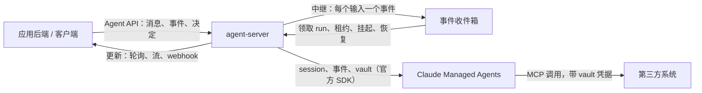

# Agent 服务

[English](../en/agent-service.md)

`agent-server` 就是应用通过 [Agent API](agent-api.md) 使用的那个主动式 agent。它处在三方之间：应用，送来用户说的话和应用系统里发生的事；事件收件箱，把这一切变成一个个
run，同一条工作线同一时刻只有一个；Claude Managed Agents（CMA），托管 agent 循环和它的工具。本文说明它如何工作、出了问题怎么办、怎样运行。

## 总览

一个应用是收件箱里的一个租户，每个用户是一个收件箱。用户和 agent 说的话保存在本服务自己的数据库里；收件箱只通过 id 知道“有事要做”。CMA
藏在一个端口 `ManagedAgents` 后面，有两个实现：基于官方 Java SDK 的适配器，以及测试和演示模式使用的脚本化替身。

## 从一条消息到一条回复

1. `POST /v1/users/{user_id}/messages` 保存消息，并在同一个事务里排好一个指向它的收件箱事件。提交之后，中继立刻把事件写进收件箱。
2. 收件箱等这条工作线安静片刻，然后把这条线上等待的事件作为一个 run 交出去，附带租约。
3. worker 领取这个 run，在租约的 epoch 下打开这一轮：租约已过期的 worker 再也写不进去。
4. 检查这条线的 session。已终止、平台不认识，或者被已死的回合留在忙碌状态的 session 会被替换或先让它停下；agent 重新配置过的会被换新。
5. 这一轮确定自己的边界：session 在本轮输入之前保存的最后一个事件。之后的一切都属于这一轮。
6. 打开 session 的流，读取边界之后已保存的内容，只有输入还不在时才发送。
7. 一直读到 session 在处理完输入之后变为空闲，途中回答等待中的工具调用：服务自带的工具立即回答，审批和提问交给人。
8. 在一个事务里保存回复并结束这一轮，记录更新，然后确认这个 run。

## 工作线、session 与回合

每个输入都属于一条工作线，线的 key 就是收件箱的 merge key，所以收件箱对一条线一次只跑一轮。每条线在 CMA 上有自己的 session，记得这条线上的事。

| 工作线 | key | 它的输入 | 用户得到什么 |
| --- | --- | --- | --- |
| 会话 | `conv:<conversation_id>` | 用户的消息 | agent 最后写的文字，作为回复 |
| 主题 | `task:<subject>` | 应用的事件和定时计划，前提是会话不由主 agent 服务 | 只有 agent 用 `notify_user` 发出的内容 |
| 主 agent 的会话 | `conv:<conversation_id>` | 用户的消息；应用发给主 agent 的事件和定时计划；它的 worker 的汇报；应用把什么交给了 worker 的告知 | 对消息的回复；在后台，只有 agent 用 `notify_user` 发出的内容 |
| 任务 | `work:<task_id>` | 主 agent 发给 worker 的内容、应用给这个 worker 的事件和定时计划，以及 worker 自己的跟进 | 什么都没有：worker 最后写的文字是给主 agent 的汇报 |

跟进在设置它的那条线上运行。因此会话所在的线也可以在后台工作，比如一小时后提醒用户某件事。

一条线的 session 无法再用时会被替换；agent 重新配置过或者用户的 vault 变了，会在两轮之间换新。每个 session 是这条线的新一代；会话的新 session 的第一个输入，会以用户和 agent 之前说过的话开头。

## 主 agent 与 worker

配置里带有 `coordinator` 的 agent 是主 agent。应用发给它的事件和定时计划，不在每个主题各自的线上处理，而是在它所服务的会话那条线上处理，这样关于用户的一切都由同一个 session
得知。主 agent 用 `delegate_task` 开一个任务：一条独立的工作线 `work:<task_id>`，worker 的 agent 在这条线上、在自己的 session
里运行。双方从不直接调用对方。一方要给另一方的东西存成任务的一条记录，并在同一个事务里给对方的工作线排一个事件，于是收件箱像对待任何输入一样把它变成一个 run。

worker 跑在收件箱的 `batch` lane 上，这样 worker 的长回合不会挡住唤醒主 agent 的东西；这条 lane 的上限就是一个用户同时运行多少个
worker。worker 接触不到用户：它在一轮里最后写的文字就是汇报，汇报会唤醒主 agent；它的回合失败时，由服务替它写一条记录。

应用也可以自己把活交给 worker。在主 agent 服务的会话里，指明另一个 agent 的事件不会得到自己主题的线：它成为主 agent 的一个任务，每个主题一个，以那个
agent 为 worker。事件是给 worker 的一条记录；同一个事务里，第二条记录告诉主 agent，并给它的线排一个事件。指明另一个 agent 的定时计划，定时器仍然挂在主
agent 的线上；到点时，这条线上的 run 在主 agent 的任何回合之前，以同样的方式把它交给 worker，然后结束。于是，替用户干的活，没有哪一件是主
agent 没有通过收件箱得知的。

主 agent 还知道它的任务各自的现状。worker 要等人审批时有一条记录告诉它，怎么决定的又有一条。它没看过的记录都会交给它的下一个回合，不管那是后台的回合，还是用户的下一条消息；是后者时，服务会在消息前面说明有新情况要读。本来要送某条记录的
run，发现记录已经读过，就不跑回合直接结束。

哪些记录会唤醒主 agent、要求它告诉用户多少，取决于用户想要的主动程度：`proactive`、`balanced` 或 `quiet`。档位先看用户自己的设置，没有就用 agent
的默认值，再没有就用服务的默认值；服务在每个后台回合里把它告诉主 agent。对照表见[主 agent 与 worker](main-agent.md#主动程度)。

会话的线一次只跑一轮，而用户不应该排在后台工作后面等。后台回合正占着这条线时用户发来消息，这个回合就让路：它的 session 被叫停，回合放开 session，它的 run
在收件箱里挂起 `agent.turn.yield-delay` 这么久。用户的消息由收件箱优先交出，先得到自己的回合；之后回来的 run 在同一个 session 里把回合重新开始。副作用以 run
和调用在回合里的序号为键，所以什么都不会发生两次。

主 agent 自己起意的任务不会自己开始。它以 `proposed` 状态等用户确认，除非它那个角色的规则（`start`）或者用户的长期授权允许它直接开始。在等的任务没有 session，收件箱里也没有它的事件；确认之后才排上唤醒
worker 的事件。规则见[主 agent 与 worker](main-agent.md#谁让任务开始)，设计、工具和理由见那份文档的其余部分。

## 出了问题时

| 发生了什么 | 服务怎么做 |
| --- | --- |
| worker 在一轮中途死掉 | 租约到期，收件箱重新交出这个 run。这一轮按记录继续：输入不会发两次，回复不会存两次 |
| worker 卡住超过了租约 | 后继者在更高的 epoch 下接手这一轮；卡住的 worker 的每次写入都会被拒绝 |
| 发送输入的应答丢了 | 先读 session 看输入是否已到达，再决定要不要重发 |
| 平台过载或暂时拒绝 | 在保持租约的同时，以递增的间隔重试几次；之后把 run 交还收件箱，稍后再处理 |
| session 已终止、平台不认识它，或平台放弃了这一轮 | 在同一轮里给这条线换一个新 session，并告诉它之前说过什么；如果还不行，稍后重试这个 run |
| 一轮超过了时限（10 分钟） | 中断 session，这一轮失败，并记录一条 `run.failed` 更新 |
| 一个 run 死了（尝试次数用完） | 清扫把它的回合关掉并记录 `run.failed`；这条线的下一轮会先让 session 停下来 |
| 流断了 | 跟随器重新打开它，并读取中间已保存的内容 |
| worker 在任务上的一轮失败了 | 除了 `run.failed`，还会写一条记录告诉这个任务的主 agent 工作没做完，并唤醒它 |

测试可以在一轮中的若干点让 worker 死掉（`TurnHooks`），以此证明上面每一条；见 `TurnRecoveryIT`、`ProactiveTurnIT`、`ActionsIT` 和 `CoordinatorIT` 里的崩溃测试。

## 后台工作

应用的事件，或者到期的定时计划，会在对应主题的线上唤醒 agent。输入是一段固定措辞的通知，说明有东西要读：发生了什么，是作为 agent 的
`read_events` 工具的结果交给它的，从不作为消息，因为 agent 把消息当作它所服务的人说的话，而事件的内容不是。应用设置的定时计划，其指令属于应用，放在通知里给出。

agent 用 `notify_user` 告诉用户，或者不用它直接结束这一轮；它在一轮末尾写的文字作为这一轮的备注保留，不给任何人看。通知以 run
和调用在其中的位置为键，所以重新投递的 run，或者在新 session 里重来的一轮，都不会把同一件事告诉用户两次。一轮最多通知三次，一个用户一天最多收到二十条通知。

会话的 session 在回答用户下一条消息之前，会被提示后台工作和用户在这个会话里交流过什么，并用 `read_events` 读取。

## 等人决定

需要审批的工具调用，或者用 `ask_user` 提的问题，会成为一个动作，而 `action` 行是结果的唯一依据：它只会通过一次带条件的更新离开
`pending`。当一轮除了等人已经无事可做时，它的 run 在收件箱里以 resume key `run:<run_id>` 挂起。任何结束动作的操作都会“按门铃”：写一个带这个
key 的事件，把 run 唤醒；这一轮从各行里读取结果。在这一轮结束之后才到的门铃，只是这条线上的普通事件，拿到它的那一轮会忽略它。

一条线上的新输入会作废这条线正在等待的东西：等待中的那一轮收尾，新输入在下一轮处理。持有这条线 session 的回合会一直持有到结束；同一条线上后来的
run 会等它，而不会去碰那个 session。会话里有问题在等待时，发到这个会话的消息被当作最近一个问题的回答。没人决定的动作 24 小时后过期，届时收件箱会唤醒那个 run。这一轮自己的时限不计入等待的时间。

主 agent 的提问是例外，因为关于它的用户的一切都从它那条线进来：它是顺带提问的。不会有 run 为它挂起，用户的回答是用户的下一条消息，也是独立的一轮；没人及时回答时，由清扫来结束它。原因见
[主 agent 与 worker](main-agent.md#向用户提问)。

## 送达

用户身上发生的每件事，都在让它发生的那个事务里记录为一条更新，位置（`seq`）在锁住用户行的情况下分配。因此位置按提交的顺序出现，从某个位置之后接着读的人什么都不会漏，即使同时有很多写入。每个记录更新的事务都先锁用户行，所以加锁的顺序处处相同。

流轮询这份日志，同一进程里的提交会立即把它唤醒。webhook 投递与更新在同一个事务里入队、签名，失败后会在约 21 小时内反复重试，然后 webhook 被关闭。投递连接的是策略检查过的那个地址，而不是主机名片刻之后解析出的地址，并且不跟随重定向。

## 凭据与 session

MCP 服务器的凭据保存在 CMA 的 vault 里：应用一个，每个有自己凭据的用户各一个。session 在创建时先挂用户的 vault，再挂应用的；平台把匹配的凭据附加到每次 MCP 调用上。改过的 token 从下一次调用起生效。session 之后无法再挂新的 vault，所以用户的第一个凭据会让他各条线的 session 在下一轮换新。

## 记忆

配置了 `memory: per_user` 的 agent 会把关于每个用户的笔记保存在 CMA 的记忆库里，每个用户、每个 agent 一个，session 在 `/mnt/memory/`
下以文件形式看到它。会话的 session 可读可写。后台的 session 只读：在那里 agent 处理的是其他系统给出的内容，这些内容不能混进它对用户的记忆。记忆库在用户的 session 第一次需要时创建；打开或关闭记忆，会在每条线的下一轮、在新的 session 里生效。主 agent 的 session 属于会话，所以它能写记忆，尽管它也在这个 session
里读事件和汇报；由此带来的后果见[主 agent 与 worker](main-agent.md#信任边界)。

## 安全

- API key 以 SHA-256 哈希保存。用户 token 用按应用派生的密钥签名，一小时内过期，可以按用户整体吊销。
- 用户 token 只能访问自己用户的数据，永远看不到该由应用决定的东西。
- 第三方系统给出的内容以工具结果的形式交给 agent，agent 被告知永远不要从中接受指令。
- MCP 服务器的密钥留在 CMA 的 vault 里，不进沙箱，也不进本服务。
- webhook 只能通过 https 访问公网地址。
- 请求按应用和按用户限流；对 CMA 的调用控制在它的限流之内。

## 运行

### 配置

所有配置项都在 `agent.*` 下，都可以用环境变量设置。

| 配置项 | 默认值 | 含义 |
| --- | --- | --- |
| `AGENT_JDBC_URL`, `AGENT_DB_USER`, `AGENT_DB_PASSWORD` | 本地 `agent_dev` | 数据库 |
| `AGENT_PORT` | `8090` | HTTP 端口 |
| `AGENT_ADMIN_KEYS_0` | 无 | 一个管理员 key，至少 32 个字符；更多的用 `_1`、`_2` |
| `AGENT_TOKENS_SECRETS_0` | 无 | 派生用户 token 密钥的 secret；轮换时新的放第一个，旧的放第二个 |
| `AGENT_INBOX_URL`, `AGENT_INBOX_SECRET` | `http://127.0.0.1:8080`、无 | 收件箱地址，以及本服务在那里的 client `agent-server` 的 secret |
| `AGENT_CMA_MODE` | `live` | `live` 用 `ANTHROPIC_API_KEY` 调用 CMA；`demo` 用脚本代替模型 |
| `agent.worker.concurrency` | `8` | 一个实例同时处理的回合数 |
| `agent.turn.deadline` | `10m` | 一轮的最长时间；要小于收件箱的 `inbox.lease.max-duration` |
| `agent.cma.creations-per-minute`, `requests-per-minute` | `300`、`600` | CMA 的限流；多个实例时按份分给每个实例 |
| `agent.worker.claim-wait` | `5s` | 一次领取在收件箱里等待工作的最长时间 |
| `agent.tasks.lane` | `batch` | 主 agent 的 worker 运行所在的收件箱 lane：`batch` 或 `background` |
| `agent.tasks.max-open`, `idle-ttl` | `20`、`7d` | 每个主 agent 会话里开着的任务数，以及闲置的任务保留多久之后会被关闭以腾出位置 |
| `agent.tasks.max-proposed`, `proposal-ttl` | `5`、`3d` | 每个主 agent 会话里可以等用户确认的任务数，以及一个任务等多久 |
| `agent.tasks.proactivity` | `proactive` | 用户没说过、agent 自己的配置里也没写时，主 agent 的主动程度：`proactive`、`balanced` 或 `quiet` |
| `agent.notify.quiet-per-user-per-day` | `5` | 想让主 agent 安静的用户 24 小时内收到的通知数，用户自己要的事的结果不计在内 |
| `agent.turn.max-yields`, `yield-delay` | `2`、`5s` | 后台回合给同一条线上用户的消息让路的次数，以及让开多久；设为 `0` 即关闭 |
| `AGENT_CORS_ALLOWEDORIGINS` | 无 | 可以从浏览器调用 API 的网页的源，用逗号分隔 |
| `AGENT_WEBHOOKS_ALLOWPRIVATENETWORKS`, `AGENT_WEBHOOKS_ALLOWPLAINHTTP` | `false`、`false` | 允许 webhook 投递到内网地址、使用明文 http；只用于在一台机器上试用 |

收件箱需要为本服务配置一个 client，角色为 `RUNTIME` 和 `PRODUCER`，不属于任何租户；为了扛住较长的故障，应把最大尝试次数调得比默认值高（`inbox.retry.max-attempts`）。要让主 agent 的 worker 并行运行，把 `batch` lane
的上限调高（`inbox.lanes.batch.cap`，默认是 1；`docker-compose.yml` 里设为 4）。

### 演示模式与真实模式

演示模式下由脚本扮演所有 agent：它重复用户说的话、读取事件并逐条通知；作为主 agent，它把用户写在 `task:` 后面的内容交给 worker；作为
worker，它汇报说做完了。这样不用 key 也能试用整个服务。真实模式需要一个开通了 Managed Agents 的 Anthropic API
key。上线前先运行 `scripts/cma-live-check.sh`：它检查本服务所依赖、而文档没有说清的那些 CMA 行为。然后运行 `scripts/agent-live-smoke.sh`：它用 CMA 启动两个服务，端到端检查一段会话、一条通知，以及一个由用户回答的提问；加上 `--api` 和 `--admin-key` 时，它检查一个已经在运行的服务，比如 `docker-compose.yml` 启动的那个。`scripts/main-agent-live.sh`
对主 agent 和 worker 做同样的检查。这些脚本最近一次运行的结果见[测试](testing.md#对真实服务的验证)。

演示模式的平台在服务的内存里。重启之后，它会认领数据库里仍然记着的东西（agent 按其配置恢复），但它创建的东西别处都没有：真实模式要从新的应用开始。

### 部署

- `docker-compose.yml` 在一台机器上运行数据库、收件箱和本服务；[教程](tutorial.md)说明怎么用，以及上线前要检查什么。
- 在负载均衡后面跑多个实例；它们通过收件箱和数据库协调。
- 实例停止时，会等它进行中的领取结束，并立即交还领到的 run，这样没有 run 需要等租约过期。
- 后台循环（中继、worker、清扫、webhook 投递）在每个实例里都会运行。
- 限流和 CMA 配额都按实例计算。
- 备份数据库：会话内容在里面；session 的历史保存在 CMA，直到被删除为止。

## Claude Managed Agents

- CMA 目前是 beta（`managed-agents-2026-04-01`）。它的行为可能变化；端口把变化限制在一个地方。
- 除了 token，它还按 session 运行时长计费；等待中的 session 不计费。
- 它会保存每个 session 的历史，直到 session 被删除。本服务不删除 session。
- 如果应用想自己托管 agent 循环，可以把端口改接 Messages API，由本服务来跑循环。

## 本版本的限制

- 逐字流式输出回复，以及用回复途中到达的消息引导当前这一轮，都没有实现：消息要等下一轮。
- 记忆按用户和 agent 区分，并且只适用于开启了沙箱的 agent。会话的新 session 同时也会被告知最近的对话。
- 限流和流的唤醒都按实例计算。
- 通知不会发到其他渠道（推送、邮件）；应用根据更新自行处理。
- 主 agent 一次只处理一件事。后台回合会给用户的消息让路，之后重新开始，所以用户不用等它；但用户的第二条消息仍然要等第一条的回复。一个任务之下的多个 agent、用户直接给
  worker 写消息，都没有实现；见[主 agent 与 worker](main-agent.md#没有实现什么)。
