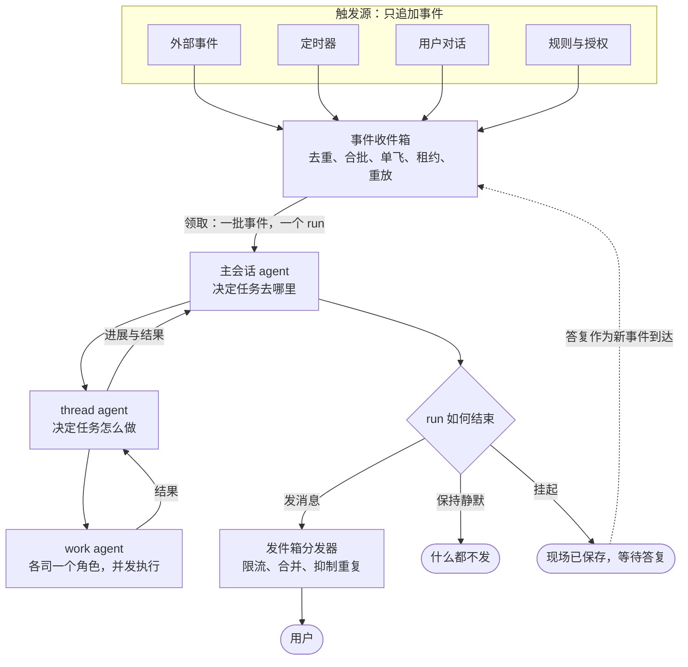

# 主动式 agent 架构

[English](../en/architecture.md)

主动式 agent 立足于一条规则：每一个触发（webhook、定时器、用户消息、审批回复）都追加到每个用户自己的事件收件箱里，并且只有收件箱能把事件变成
run。它下面的运行时可以被唤醒、挂起和恢复，一个 run 也可以什么都不说就结束。用户最终收到什么，由发件箱决定。

本文描述整个系统。本仓库只实现了事件收件箱，它的设计见[事件收件箱设计](event-inbox-design.md)。

## 总览

自上而下阅读。触发源只追加事件。收件箱每次把一批事件交给主会话 agent。每个 run 以发消息、保持静默或挂起三者之一结束。用户的回复或审批是一条用户对话事件，所以挂起的
run 等到的答复，和其他事件一样经由收件箱回来。记忆、治理和可观测性服务于每一层，图中没有画出。

## 本仓库实现了什么

| 层 | 职责 | 在本仓库 |
| --- | --- | --- |
| 触发源 | 产生事件 | 任何带签名的 HTTP 客户端；定时器是收件箱的一部分 |
| 事件收件箱 | 单一写入口的持久队列；事实源 | **已实现**（路线图 M0 和 M1 阶段） |
| 多 agent 层 | agent 的分发、执行与并发 | 未实现 |
| Agent 运行时 | 休眠、唤醒、运行、挂起、恢复 | **已实现**，即 agent 服务，跑在 Claude Managed Agents 上（`agent-server`）；单独运行收件箱时由 `ScriptedWorker` 代替 |
| 发件箱 | 决定发什么、发到哪里、以什么节奏发 | **已实现**于 agent 服务：每个用户一份更新日志，可轮询、订阅流、推送 webhook；单独运行收件箱时由 `MemoryOutbox` 和 `FileOutbox` 代替 |
| 记忆 | 跨 run 持久保存 | 未实现 |
| 治理与可观测性 | 权限、预算、审计、产品指标 | 收件箱的审计记录和指标；agent 服务里有 key 与用户 token、限流、通知配额和 session 预算 |

## 触发源

唤醒 agent 的来源有四类。它们都只追加事件，没有哪一类直接调用运行时。

| 来源 | 例子 | 规则 |
| --- | --- | --- |
| 外部事件 | IM 消息、邮件、日历、文档与会议变更、业务系统 webhook | webhook 快速确认，只写入一条事件 |
| 定时器 | 周期任务（日报、巡检）；一次性跟进（“过一会儿再看”） | 与事件表分开存放；只保存未来的时间 |
| 用户对话 | 来自 IM 和桌面客户端的消息与审批回复 | 与其他事件一起排队，不插队；回复接续原来的会话 |
| 规则与授权 | 团队写下的、agent 可以主动去做的规则；agent 给自己设的跟进 | 新规则先记录，不执行 |

## 事件收件箱

收件箱是一个单一写入口的持久事件队列，也是整个系统的事实源。每个用户一个收件箱。投递语义是至少一次、可重放。

| 规则 | 行为 |
| --- | --- |
| 去重 | 以来源提供的唯一 id 为键；重复投递只保留一条事件 |
| 状态 | `pending → claimed → done / failed / dead`；worker 崩溃后，同一个 run 会再次下发 |
| 合批 | 连续的消息和同键事件合并成一个 run，只回复一次 |
| 就绪 | 只有现在就能运行的事件才入队；未来的时间留在定时器表里 |
| 顺序 | 同一个收件箱里每个合并键只有一个 active run，所以工作不会重复，状态不会被覆盖 |
| Lane | `interactive`、`background` 和 `batch`，各有自己的并发上限，所以后台工作不会挡住回复 |

run 进行期间到达的事件，有四种安置方式。

| 模式 | 效果 |
| --- | --- |
| steer | 并入当前 run；可以在两次工具调用之间被接收 |
| followup | 排在当前 run 之后 |
| collect | 与静默窗口内到达的其他事件合并，进入后面的同一个 run |
| interrupt | 请当前 run 让路，先处理新消息 |

## 多 agent 层

分发、执行、并发和消息同步都是运行时的机制。建在其上的产品只需要配置三样东西：角色清单、渠道绑定，以及每个角色的技能与工具范围。

| 层级 | 决定 | 行为 | 实例 |
| --- | --- | --- | --- |
| 主会话 agent | 任务去哪里 | 最先收到每一条用户消息和唤醒事件。直接回答、接续已有的 thread，或者新开一个 | 每个用户一个主会话，所有入口共用 |
| Thread agent | 任务怎么做 | 在自己的隔离上下文里负责一个任务。把它拆成步骤、挑选角色、分派给 work agent，并汇总它们的结果 | 每个任务一个 thread |
| Work agent | 只管自己的那一步 | 按角色执行；每个角色有自己的提示词、技能和工具范围。同一个任务下可以并发运行多个 | 每个 thread 多个 |

消息向上回流，所以用户不必逐个 thread 去看。

1. Work agent 把结果交给它的 thread agent。
2. Thread agent 汇总进展与结果。
3. Thread 的消息同步到主会话：进展、结果，以及一切待确认的事项。
4. 用户在主会话里回复，回复再被路由回原来的 thread。

每个入口都接到同一个收件箱和同一个主会话，所以用户可以在任务进行到一半时换一个入口接着用。

## Agent 运行时

三个层级都跑在同一个运行时上，每个 agent 都是它的一个隔离实例。

| 部分 | 提供什么 |
| --- | --- |
| 会话与 run | 生命周期 `sleep → wake → run → suspend → resume`。空闲的会话零消耗，挂起的会话保留现场 |
| Agent 循环 | 模型调用与工具执行的循环。长任务逐步推进，失败的步骤会重试 |
| 上下文预算 | 系统提示词、工具定义、记忆索引和触发事件，每一轮都重发，并用缓存压低成本 |
| 沙箱与工作区 | 文件、产出和执行按实例隔离 |
| 技能与工具 | 经过授权的技能和工具，范围按角色配置 |
| 记忆链路 | 每个 run 开始时加载记忆索引，按需读取正文，结束前写回 |

运行时与收件箱之间的契约很小：领取一个 run，工作期间发心跳，并用 ack、nack 或 suspend 显式地结束这个 run。具体规定见
[API](api.md#运行时契约)。

## Run 的结束方式与发件箱

一个 run 只有三种结束方式，而什么都不说是其中名正言顺的一种。

| 结束方式 | 何时 | 发生什么 |
| --- | --- | --- |
| 发消息 | 有值得告知的结果 | 结果进入发件箱：结论加少量细节，绝不包含工作过程 |
| 静默结束 | 没有值得说的 | 什么都不发。Agent 先保持安静，再逐步赢得注意力 |
| 挂起 | 需要审批、回复，或需要对高风险动作做确认 | 会话被保存，run 结束。答复作为新事件回到收件箱，并恢复保存的现场 |

随后由发件箱分发器决定发什么、发到哪里、以什么节奏发。

- 它按用户和渠道限流、排序、合并、抑制重复，并重试失败的发送。
- 一个 run 只回复一次；连续的结果先合批再发送。
- 审批请求与普通结果分开传递。
- 因为一个 run 可能被下发不止一次，每条消息都带有键 `run_id + sequence`，发件箱对每个键只发送一次。

## 记忆

记忆跨 run 持久存在：每个 run 都能读到它，会话结束后它依然保留。运行时和每个 agent 实例都依赖同一个接口，它有四个操作（读、写、检索、淘汰）。

| 维度 | 设计 |
| --- | --- |
| 类型 | 用户画像、用户指令、用户笔记、已经说过的事、任务进展；后续还有目标、团队约定和业务领域。新增一个类型只需要注册 |
| 作用域 | 用户级（一个用户的所有 agent 共享）、agent 级（按实例隔离），后续还有团队或组织级 |
| 存储 | 条目是文件加索引。索引留在上下文里，正文按需加载 |
| 检索 | 混合检索（关键词、向量、图），结合热度与时间打分，重排，最后由模型判断每条候选是否有助于当前的回答，并据此过滤 |
| 写入 | Run 只存“查不回来”的东西；凡是能查到的都存成指针。定期复盘负责整理和淘汰 |

每个条目都带有来源和日期，所以可以追溯，也可以按来源清理。

## 治理与可观测性

无人值守时，agent 带着用户的权限行动，所以每一次工具调用都要有结论。

| 控制 | 规则 |
| --- | --- |
| 凭据代理 | 凭据在代理侧注入，agent 自身从不持有 |
| 自动模式 | 分类器审查高风险动作；动作被拦截后，agent 要换一条路径 |
| 挂起待批 | 后果最重的动作必须等人；默认不猜 |
| 预算上限 | 每个 run、每天的 token 与费用封顶；超额即停 |
| 审计留痕 | 每一次动作、被哪条规则拦截、由谁批准 |

主动性没有指标就会退化成骚扰。运行时提供数据，产品做判定。

| 指标 | 衡量什么 |
| --- | --- |
| 成本 | 每个 run 的 token 与耗时，按真正被采用的结果来计 |
| 打扰率 | 发了多少条消息、多少条有用、多少条被关掉 |
| 接受率 | 主动提出的任务中，被接受或被纠正的比例 |
| 失败 | 超时、卡死、重复工作和人工接管 |

一个反馈回路让系统闭合。用户的反应（感谢、纠正或沉默）被写入记忆与评测，再由它们调整 agent 的判断、触发规则和触达节奏。主动性的分界不在能不能做，而在值不值得打扰。

## 分层规则

基础设施提供通用机制（收件箱、调度、多 agent 分发、运行时、记忆），状态绑定在会话和 run 的生命周期上。产品负责配置它（规则与授权、入口渠道、触达策略与文案），不自建队列或调度器。

## 尚未完成的设计工作

有三层目前只有原则性的描述，在实现之前需要各自的设计。

- **Thread 同步。** Thread 的消息如何到达主会话（作为收件箱事件，还是直接写入），以及用户的回复如何路由回它的 thread。
- **发件箱。** 它的数据模型、限流策略，以及“一个 run 只回复一次”在重试之下如何成立。这项保证在收件箱这一侧已经就位：重复下发的 run
  保持原来的 `run_id`。
- **会话存储。** 挂起的 run 的现场存在哪里、保存多久。收件箱给等待设了上界（挂起的 run 必须带超时），但不保存任何 agent 状态。

记忆和治理已经点明了各自的接口和控制手段，但还没有给出契约。

## 来源

本文和收件箱设计都源自一份主动式 agent 的设计草稿（v0.1），其中的产品名和团队名已替换为中性名称。原稿列出了三份公开参考资料，本次实现没有查阅它们：Anthropic
的《Building Always-On Agents》、OpenClaw 的队列文档（四种投递模式），以及 DeepSeek 原型的注意力原则（静默结束与打扰率指标）。
