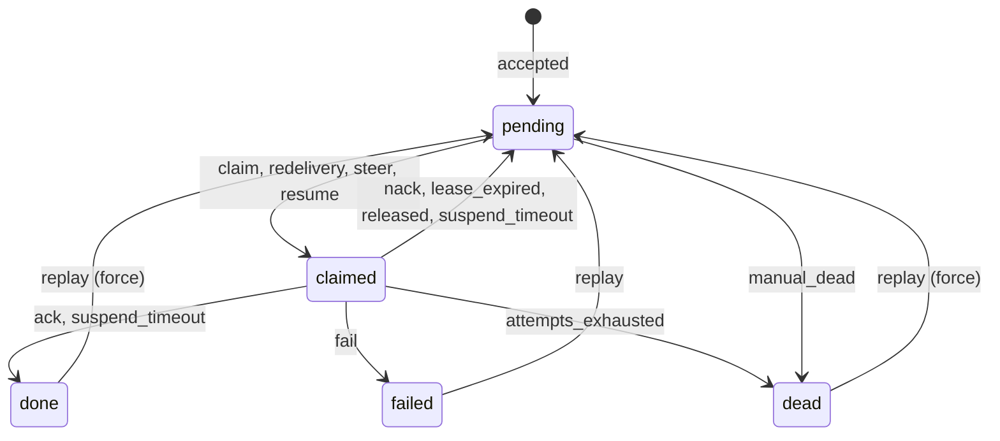
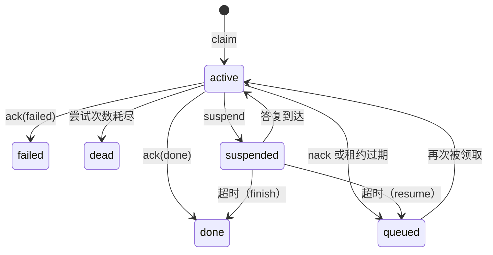

# 事件收件箱设计

[English](../en/event-inbox-design.md)

事件收件箱是主动式 agent 唯一的入站关口。每个生产方都通过同一个写入 API 追加事件，而运行时只有一个动作：把一批就绪事件领取为一个
run。它之所以是一个共享服务，是因为正确性必须集中在一处。去重、合批、单飞和重放，只要有一项交给生产方自己做，就会出问题。

本文描述的是这里实际实现出来的收件箱。原设计留有空白或自相矛盾的地方，[决策](#决策)一节说明了选了什么、为什么。传输格式见
[API](api.md)；收件箱周围的系统见[架构](architecture.md)。

## 范围

本次实现覆盖路线图的 M0 和 M1 阶段。

| 阶段 | 交付 | 状态 |
| --- | --- | --- |
| M0 | 写入口、去重、状态机、单飞领取、定时器 | 已实现 |
| M1 | 合批、四种投递模式、租约续期、挂起与恢复、重放工具、指标 | 已实现 |
| M2 | 按 client 限流、单收件箱积压上限（429）、熔断、分片、消费回执 | 未实现 |

收件箱只负责“事件 → 可运行的 run”的搬运和仲裁。它从不判断这件事值不值得做，所以它的写入路径和领取路径上都没有模型调用。

| 收件箱做什么 | 收件箱不做什么 |
| --- | --- |
| 接收、鉴权、校验并快速确认（202） | 做业务判断（要不要提醒、要不要打断） |
| 去重、合并、排序、判定就绪 | 投递任何东西（那是发件箱的事） |
| 持久化事件、运行状态机、管理租约、从崩溃中恢复 | 运行 agent 逻辑或保存 agent 状态 |
| 唤醒、领取、重放和审计 | 存储记忆 |

## 不变量

下面每一个设计选择都在保护其中一条。

| 编号 | 不变量 | 靠什么保证 |
| --- | --- | --- |
| I1 | 单一写入口，只追加 | 只有一个 `POST /events`；定时器调度器通过同一条 SQL 语句追加；触发器拒绝对事件内容列的任何更新 |
| I2 | 每个 `(tenant, inbox, source_event_id)` 最多一条事件 | 唯一约束加 `ON CONFLICT DO NOTHING`；payload 哈希把“同键不同内容”变成 409 |
| I3 | 单飞：不会有两个 run 同时处理同一件事 | 在收件箱行锁之下检查三道限制，并由 `run` 上的部分唯一索引兜底 |
| I4 | Run 与事件不是一一对应 | 一行 `run` 拥有一批共享合并键的事件；静默窗口让一阵突发有时间聚拢 |
| I5 | 至少一次投递，消费方幂等 | 租约加清扫器；同一个 run 连同原来的 id 和事件再次下发；epoch 编号把过期的 worker 隔离在外 |
| I6 | 未来的时间绝不进入就绪队列 | `event` 上的检查约束 `ready_at <= received_at`；未来的工作是 `timer` 里的一行 |
| I7 | 事件不可变；每一次状态迁移都可审计 | `event_transition` 由触发器保证只追加；每次状态变化都在同一条语句里写下它的历史行 |
| I8 | 租户之间互不可见 | 每个键都以 `tenant_id` 开头；每个查询都限定在租户内；别的租户的对象一律是 404 |

I3 和 I4 合起来的意思是：排队按事件进行，执行按 run 进行。被合并的事件并没有被取消：它们各自保留自己的行，并与所在的 run
一起到达终态。

原设计中 I8 的后半句，即租户之间不会互相饿死，目前只是部分满足。Lane 上限和单收件箱单飞能让一个收件箱拖不住另一个，但按租户的配额属于
M2。

## 组件

| 部分 | 类 | 职责 |
| --- | --- | --- |
| 鉴权 | `HmacAuthFilter`, `ClientRegistry` | 校验请求签名，以及调用方的角色是否允许访问该路径 |
| 写入路径 | `EventWriter`, `InterruptDetector` | 校验、去重、追加；一条 SQL 语句 |
| 领取 | `ClaimService`, `ClaimPlanner` | 锁住收件箱，决定下发什么，新建或重新下发一个 run |
| Run 生命周期 | `RunLifecycleService`, `RunEventStore`, `RunSignals` | 心跳、ack、nack、steer、suspend、超时、租约过期 |
| 后台循环 | `LeaseSweeper`, `SuspendSweeper`, `TimerScheduler`, `ReclaimGate` | 回收过期租约、执行挂起期限、触发定时器 |
| 运维工具 | `ReplayService`, `InboxAdminService`, `AuditLog` | 重放、转入死信、按收件箱设置限制、审计日志 |
| 唤醒 | `WakeBus`, `InProcessWakeBus` | 给长轮询领取方的尽力而为的提示 |
| 指标 | `InboxMetrics`, `DepthSampler` | 延迟、批大小、回收次数、重放次数、积压 |

`ClaimPlanner` 是一个纯函数，不碰时钟也不碰数据库，所以每一条调度规则都能脱离这两者做单元测试。所有 SQL 都是手写的，通过
`JdbcClient` 在显式事务里执行，这样加锁顺序和往返次数一目了然。

## 数据模型

| 表 | 存什么 | 要点 |
| --- | --- | --- |
| `inbox` | 每个 `(tenant_id, inbox_id)` 一行 | `next_seq`；可选的 lane 上限和 `max_active_runs`；`settings`（窗口、合批上限）。它的行锁就是单飞锁 |
| `event` | 事实源 | 内容列不可变。投递状态：`status`、`attempt`、`run_id`、`run_seq`、`delivery_mode` |
| `run` | 一次执行 | `status`、`slot_no`、`epoch`、`attempt`、租约时间、`next_attempt_at`、`resume_key`、`suspend_deadline_at`、`on_timeout` |
| `timer` | 未来的工作，每次触发一行 | `kind`（`once`、`cron`）、`cron_expr`、`time_zone`、它将产生的事件、`state` |
| `event_transition` | 只追加的历史 | `from_status`、`to_status`、`reason`、`actor`、`run_id`、`attempt`、`at` |
| `admin_audit` | 运维操作 | 谁对什么做了什么，用了哪些参数，结果如何 |

第一次点到某个收件箱的写入、定时器或配置调用会把它创建出来。Id 都是 ULID，所以按创建时间有序。

数据库为代码执行的规则兜底。`run` 上有三个部分唯一索引，分别保证每个 lane 槽位一个 active run、每个合并键一个 active run、每个
resume key 一个挂起的 run。检查约束把 run 的状态和该状态下必须有值的列绑在一起。

## 写入路径

`POST /v1/inbox/{inbox_id}/events` 只做四件事：鉴权、校验、去重、追加。它从不启动 run，也从不调用模型，所以它的延迟不取决于任何下游是否健康。

在正常路径上，一次写入就是一条 SQL 语句。

1. 查找带这个幂等键的事件，或者仍以定时器形式等待的延迟事件。如果已经存在，就什么都不写，收件箱的行也不加锁。
2. Upsert 收件箱的行。这一步拿到它的行锁，并发出下一个 `seq`。
3. 用 `ON CONFLICT DO NOTHING` 插入事件。
4. 插入第一条历史行（`accepted`）。

因为收件箱的行锁一直持有到提交，下一个写入方只有在这一条可见之后才能拿到下一个 `seq`。所以序号顺序就是提交顺序，读的一方绝不会看到
`seq` 6 却看不到 5。

| 结果 | 状态码 | 响应体 |
| --- | --- | --- |
| 新事件 | 202 | `deduped: false`，`status: pending` |
| 这个键之前接收过，内容相同 | 202 | 先前的 `event_id`，`deduped: true`，以及它当前的状态 |
| 这个键之前接收过，内容不同 | 409 | `idempotency_conflict`；第一条事件不受影响 |
| `ready_at` 在未来 | 202 | `status: scheduled`；事件以定时器的形式等待 |
| 请求不合法，或 payload 超过 64 KB | 400, 413 | 什么都不存 |
| 数据库不可用 | 503 | 显式失败；写入绝不降级为“直接执行” |

“内容相同”指 `type` 相同，并且 payload 的规范形式相同（对象的键排序、去掉无意义的空白），所以生产方在重试时重新序列化也不会触发这项检查。

**指纹。** 没有 `source_event_id` 的事件，其键为 `fp1:` 加上一个 SHA-256，输入是租户、client、来源、类型、合并键、payload
哈希和一个区分量。有 `occurred_at` 时区分量就是生产方给的 `occurred_at`，否则是到达时间所在的 60 秒桶。完全相同的重试会合并，payload
不同的绝不会合并。响应里带有 `fingerprinted: true` 和一条警告，因为跨过桶边界的重试会变成第二条事件。

**唤醒提示。** 写入成功后，服务会发布一条唤醒提示。发布失败只记日志、不影响结果：正确性只看表。

## Run

一个 run 是对一批事件的一次执行。它在第一次被领取时创建，只创建一次，并在结束之前一直拥有它的事件。

| 字段 | 含义 |
| --- | --- |
| `run_id` | 一个 ULID，在 run 的整个生命期内不变。Nack 或租约过期后，下发的是同一个 run 和同样的事件 |
| `epoch` | 每授予一次租约加一。之后的每次调用都必须带上它；过期的 epoch 得到 409 `lease_lost` |
| `attempt` | 失败预算：第一次下发时为 1，nack 或租约过期会让它加一。恢复不消耗它 |
| `run_seq` | 事件在其 run 内的位置，从 1 开始。Ack 和 suspend 用它作游标 |

保持 run 的身份不变，下游的发件箱才能按 `run_id + sequence` 去重：重复下发的 run 产生同样的键，用户就只会听到一次。

### 领取事务

`POST /v1/runs/claim` 是事件离开收件箱的唯一途径。对一个收件箱的一次尝试就是一个短事务。

1. 锁住收件箱的行。这使本次领取与该收件箱上的其他领取、以及一切投递状态的变更串行化。
2. 读取时钟、收件箱的限制、它的未结束 run，以及按 `seq` 排序的未领取事件。
3. 让 `ClaimPlanner` 做决定。
4. 用带守卫条件的语句执行这个决定，并在同一批语句里写下历史行。

指定了收件箱的领取，遇到行被占用时最多等 500 毫秒，然后回答“busy”。不指定收件箱的领取会去找有可领取工作的收件箱，最老的工作优先，并跳过被锁住的行。

### 三道限制

| 限制 | 默认值 | 目的 |
| --- | --- | --- |
| Lane 槽位 | `interactive` 1，`background` 2，`batch` 1 | 用户的后台工作不会挡住他自己的新消息 |
| 键互斥 | 始终生效 | 同一个收件箱里，每个 `merge_key` 最多一个 active run，跨 lane 也是如此 |
| 收件箱总上限 | 关闭 | `max_active_runs = 1` 就是原设计里“一个收件箱一个 run”的严格读法 |

键互斥才是单飞的实质。两个 run 同时处理同一段对话或同一张订单，无论它们在哪条 lane 上，都会互相覆盖状态并且回复两次。

### 一次领取拿走什么

Lane 按优先级顺序服务：`interactive`、`background`、`batch`。领取方可以把自己限定在其中几条 lane 上。在一条 lane 内，候选有三种。

| 候选 | 条件 |
| --- | --- |
| 重新下发一个排队中的 run | 它的退避已经结束，且它的合并键没有在别处活跃 |
| 恢复一个挂起的 run | 有一条未领取的事件带着它的 resume key，且它的合并键不在活跃中 |
| 开始一个新 run | 有一组未领取的事件已经符合条件（见“合批”） |

带打断标记的工作排在最前；其次是头部 `seq` 最小的候选胜出。顺序在每个合并键之内是严格的：排队中的 run
先于同键的任何更晚的事件。处在退避期或仍在静默窗口内的键，不会挡住同一条 lane 上的其他键。

没有东西可领取时，回答是 204，带上原因；如果只靠时间流逝答案就会改变，还会带上重试提示。

| 原因 | 含义 |
| --- | --- |
| `empty` | 没有未领取的工作 |
| `busy` | 有工作，但槽位已被占用，或者它的合并键正在被处理 |
| `window` | 下一批还在静默窗口内 |
| `backoff` | 下一个 run 正在等它的重试退避结束 |

“Busy”是正常的调度结果。它不是错误，也不计入任何失败统计。

### 合批

同一条 lane 上未领取的事件按合并键分组。带键的一组在满足下面任一条件时变为可领取。

- 该键已有一个静默窗口的时间（默认 1.5 秒）没有新事件到达。
- 距这一组的第一条事件已经过了 `max_wait`（默认四个静默窗口）。这避免了细水长流的消息把窗口永远撑开。
- 这一组达到了合批上限：20 条事件或 256 KB。
- 这一组里有事件带打断标记。

一批按 `seq` 顺序取事件，取到上限为止，并且头部那条一定会被取走；剩下的等下一个 run。没有合并键的事件自成一个
run，而且不等待。窗口和上限都可以按收件箱、按 lane 设置。

## 状态机

事件的投递状态只能通过下面这些迁移改变。每一次迁移都会写下一条带原因和操作者的历史行。

Run 有它自己的、更小的状态机。每一条指向 `active` 的箭头都是一次新的租约授予，epoch 随之加一。

| 原因 | 从 → 到 | 何时写入 |
| --- | --- | --- |
| `accepted` | 无 → `pending` | 写入被接收 |
| `claim` | `pending` → `claimed` | 一个新 run 拿走该事件 |
| `redelivery` | `pending` → `claimed` | 排队中的 run 被再次下发 |
| `steer` | `pending` → `claimed` | 事件并入一个运行中的 run |
| `resume` | `pending` → `claimed` | 事件是对某个挂起 run 的答复 |
| `ack` | `claimed` → `done` | Run 正常结束 |
| `fail` | `claimed` → `failed` | Run 以 `ack(failed)` 结束 |
| `nack` | `claimed` → `pending` | Worker 要求重试 |
| `lease_expired` | `claimed` → `pending` | 清扫器把 run 收回 |
| `attempts_exhausted` | `claimed` → `dead` | 达到尝试次数上限 |
| `suspended` | `claimed` → `claimed` | Run 挂起；事件留在它名下 |
| `suspend_timeout` | `claimed` → `done` 或 `pending` | 挂起期限已过 |
| `released` | `claimed` → `pending` | 事件并入了某个 run，但没有被消费 |
| `replay` | 终态 → `pending` | 运维人员重放该事件 |
| `manual_dead` | `pending` → `dead` | 运维人员把一条等待中的事件移出队列 |

操作者写作 `client:<id>`、`worker:<id>`、`system:<job>` 或 `operator:<name>`。

## 租约与重试

一次领取授予 60 秒的租约。心跳把它延长到从现在起 60 秒，但绝不超过授予之后的 30 分钟，所以一个死循环的 run
不可能永远占着槽位。心跳只是对 run 行的一次带守卫条件的更新，不拿别的锁。

| 事件 | 效果 |
| --- | --- |
| `ack(done)` | Run 及其消费的事件变为 `done` |
| `ack(failed)` | 终态失败。Run 及其事件变为 `failed`，不再重试 |
| `nack` | Run 进入排队，退避依次为 2、4、8、16 秒（底数 2，封顶 5 分钟），或者 worker 指定的延迟 |
| 租约过期 | 认定 worker 已死。Run 进入排队并立即可以重新下发，同时计一次尝试 |
| 第五次尝试失败 | Run 及其事件变为 `dead` |

有两条路径保证没有任何东西会卡在状态机的中间：租约清扫器和尝试次数上限。

清扫器扫描时不加锁，然后在收件箱锁之下逐个复查每个 run，所以它在每个实例上运行都是安全的。在租约已经到期、但清扫器尚未动手之前到达的 ack
仍然算数。启动之后、某一轮失败之后或循环卡顿之后，会有一道闸门把回收推迟一个租约周期：故障期间没有 worker
能发心跳，如果没有这道闸门，服务一恢复，所有健康的 run 都会被立刻回收。

Ack、nack 和 suspend 都是幂等的。用同一个 epoch 重复同一个调用，返回的是先前的结果。

## 运行中到达的事件

事件可能在同键的 run 进行期间到达。收件箱做机械层面的判断（这条事件能不能并入当前 run），agent 做语义层面的判断（应不应该）。由运行时来拉取：没有往
run 里推送的通道。

每次心跳的应答都带有两个信号，它们每次都从表里现算，从不落库。

| 信号 | 含义 |
| --- | --- |
| `steer_pending` | 该 run 的合并键下，有多少条未领取的事件在等待 |
| `interrupt_requested` | 有一条带打断标记的事件排在这个 run 后面等待 |

| 模式 | 发生什么 |
| --- | --- |
| steer | Run 声明了 `accepts_steer`。它在安全点调用 `steer`；同键的等待事件被绑定到该 run 并返回给它 |
| followup | Run 不接受 steer。事件等待，被键互斥挡住，在 run 结束后被领取 |
| collect | Run 进行期间到达了多条事件。Run 结束后它们合批成一个后续 run |
| interrupt | Run 看到 `interrupt_requested` 后挂起。带标记的事件先被领取；挂起的 run 稍后恢复 |

因为信号是现算的，忽略它不会有任何副作用。被忽略的打断只是变成了 followup，所以任何事件都不会丢。

打断标记由生产方设置（`interrupt: true`）；对于对话消息，当它的全部文本恰好是一个配置好的停止词时，也会被置上。针对 run
自己那个键的打断，就是给这个 run 的。针对一个没人在处理的键的打断，如果被堵在一条已满的 lane 后面，会把信号发给那条 lane 上最年轻的 run。

**游标。** Steer 可能与 run 的结束撞在一起：事件已经绑定到 run，但 worker 从来没有读到它。所以 ack 和 suspend 都带上
`last_run_seq`，即 worker 消费过的最大 `run_seq`。超出它的事件会被放回队列（`released`），而不是跟着分享这次结果。Steer 调用接受
`after_run_seq`，所以丢失的 steer 响应可以重新取回。

## 挂起与恢复

需要审批或回复的 run，带着一个 `resume_key` 和一个超时挂起。

- Run 交出它的槽位和租约，所以收件箱可以去做别的工作，包括同键的新事件。
- 它消费过的事件保持 `claimed`，并继续绑定在它名下。Run 没结束，它们就不算结束。
- Resume key 在一个收件箱的挂起 run 之间是唯一的（409 `resume_key_in_use`）。
- 超时是必填的，上限 30 天。没有期限的挂起 run，会成为事件可以永远停留的状态。

答复不是回调。它是一条带着 `resume_key` 的普通事件。这样的事件为它的 run 保留：它绝不与别的事件合批，也绝不被
steer。下一次领取会把同一个 run 交回来（`kind: resume`，`resume_reason: event`），带上新的 epoch 和作为答复的那些事件。如果该 run
的合并键正在另一个 run 里活跃，恢复会等待。

期限已过而没有答复时，按 `on_timeout` 策略处理。

| 策略 | 效果 |
| --- | --- |
| `finish`（默认） | 收件箱结束这个 run。它的事件变为 `done`，原因是 `suspend_timeout` |
| `resume` | Run 进入排队，并带着 `resume_reason: timeout` 和它的全部事件被交回 |

在期限之前收到的答复优先，即使它还没有被领取。与超时撞在一起的答复只会有一种结果，因为两者都要拿收件箱锁。

收件箱不保存任何 agent 状态。挂起的 run 记得什么，由运行时自己保存。

## 定时器

未来的工作存在 `timer` 表里，也只存在那里。到期的定时器通过正常的写入语句产生一条事件。它从不调用运行时，所以它的事件和其他事件一样享有去重、单飞、合批和重放。

| 种类 | 由什么创建 | 触发成什么 |
| --- | --- | --- |
| 延迟事件 | 带未来 `ready_at` 的一次写入 | 它自己：生产方发来的类型、键和 payload |
| 一次性定时器 | `POST /timers`，`kind: once` | `timer.due` |
| Cron 定时器 | `POST /timers`，`kind: cron` | `timer.due`，每次触发一条 |

每个定时器的触发是一个事务：锁住定时器的行（跳过别的调度器持有的行），追加事件，把这一行标记为已触发；如果是 cron，再插入下一次触发。崩溃会把这一切全部回滚。所以一个定时器恰好触发一次，而且这个循环可以在每个实例上运行。

API 定时器产生的事件，其幂等键为 `timer:<timer_id>:<fire_at_epoch_seconds>`，其 payload 把调用方的 payload 包了一层，外加
`timer_id`、`fire_at`、`kind`、`catch_up` 和 `missed_count`。

**补触发。** 故障之后，cron 只触发它错过的最近一次，只触发一次，走 `batch` lane，并带上 `catch_up: true` 和它所代表的次数。重启之后发出的是一份日报，而不是六份。

**Cron。** 表达式为五段，或者以秒开头的六段，并在一个 IANA 时区内求值（默认 UTC）：“上午 9 点”就是用户的上午 9
点，跨夏令时切换也是如此。时钟回拨时，出现两次的那个墙上时间只触发一次。Cron 的触发间隔不能小于 60 秒。

`timer_key` 让创建变得幂等：创建一个键已经在排期中的定时器，返回的是已有的那一个。

## 重放与审计

运维人员可以把已结束的事件放回队列，选择方式有三种：按单条事件，按一个收件箱加一个时间范围，或者按一个来源加一个时间范围（在整个租户内）。范围针对事件的接收时间，左闭右开。

| 事件状态 | 重放 |
| --- | --- |
| `failed` | 允许 |
| `done`, `dead` | 需要 `force`，因为这是在重复已经有结果的工作 |
| `pending`, `claimed` | 绝不；报告为 `in_flight` |

被重放的事件保持它的身份和它在序列中的位置。它从旧的 run 上解绑，尝试次数清零，并会被领取进一个新的
run。重放必须给出原因，可以先试运行（dry run），每次调用最多 10,000 条事件。

运维人员也可以手工把一条事件转入死信，但只限于正在等待、尚未被领取的事件。

重放、手工转入死信、配置变更，以及运维人员对定时器的取消，都会写入一个只追加的审计日志，其中有 client、运维人员的名字、参数和结果。读取一条事件，一次就能拿到它从被接收到当前状态的完整路径。

## 租户与鉴权

- 每个键都是 `(tenant_id, inbox_id, …)`。两个租户里相同的收件箱 id 是两个收件箱。
- 调用方是一个 client，带有一个 HMAC 密钥、一个可选的租户和若干角色。
- 属于某个租户的 client 始终在自己的租户内行事。平台级的 client（不带租户），比如运行时或运维人员，在请求里指明租户。

| 角色 | 可以调用 |
| --- | --- |
| `PRODUCER` | 写入事件和定时器；读回自己写入的内容，取消自己的定时器 |
| `RUNTIME` | 领取 run 并驱动它们的生命周期 |
| `OPERATOR` | 管理接口；读取租户的每一条事件、每一个定时器和任意 run；取消定时器 |

在这一版里，client 和密钥来自配置。请求签名的做法见 [API](api.md#鉴权)。

## 并发规则

- **加锁顺序**处处一致：定时器行、收件箱行、run 行、事件行。
- **每一次投递状态的变更都持有收件箱的行锁。** 唯一的例外是心跳，它只是对 run 行的一次带守卫条件的更新。
- **靠守卫条件，不靠假设。** 每条语句都写明它期望的状态（`status = 'active' AND
  epoch = :epoch`），所以“ack”和“租约过期”两者谁先拿到锁谁就赢，另一个会发现已经没有可改的东西。
- **时间来自注入的应用时钟**，并作为参数传进 SQL；没有任何语句使用 `now()`。所以租约、窗口、退避和定时器在测试里都是确定性的。各节点必须做
  NTP 同步。时钟偏差只会造成提前的重复下发，而这在至少一次的语义下本来就是允许的；epoch 保证不会出现两个持有者。
- 每个会话都把 `lock_timeout` 设为 10 秒，把 `idle_in_transaction_session_timeout` 设为 60 秒。

## 可观测性

指标发布在 `/actuator/prometheus`，按租户和 lane 打标签。没有任何指标带收件箱 id，因为它的取值是无界的。

| 指标 | 类型 | 衡量什么 |
| --- | --- | --- |
| `inbox_write_seconds` | 计时器，标签 `result` | 接收一条事件的耗时。去重率为 `deduped / (accepted + deduped)` |
| `inbox_claim_latency_seconds` | 计时器 | 从一批事件符合条件的那一刻到它被领取 |
| `inbox_ready_to_claim_seconds` | 计时器 | 从头部事件到达到被领取，包含静默窗口 |
| `inbox_batch_size` | 分布摘要 | 领取时每个 run 的事件数 |
| `inbox_lease_reclaim_total` | 计数器 | 租约过期后被收回的 run 数 |
| `inbox_replay_total` | 计数器，标签 `force` | 运维人员重放的事件数 |
| `inbox_pending_depth` | 仪表，标签 `stat` | 每个收件箱的未领取事件数：`p50`、`p99`、`max` 和 `total` |
| `inbox_dead_letter_depth` | 仪表 | 超过重试上限的事件数 |

积压按各收件箱的中位数、99 分位和最大值来报告。平均值会把那个正在被淹没的收件箱藏起来。

## 决策

原设计有十一处悬而未决，或者有两种说法。下面是实际实现的做法。

| # | 原设计的空白 | 实现 |
| --- | --- | --- |
| 1 | 一处说一个收件箱一个 run，另一处说每条 lane 上可以并发 | 收件箱锁之下的三道限制：lane 槽位、每个合并键跨 lane 只有一个 active run，以及一个可选的收件箱总上限，设为 1 即为严格读法 |
| 2 | `run_id` 是批次的哈希，重放时批次一变它就变 | 一行 `run` 只创建一次，并拥有它的事件。同一个 run 带着同样的事件被重新下发；`epoch` 把过期的 worker 隔离在外 |
| 3 | 挂起的 run 及其匹配键无处安放 | `run` 保存 `resume_key`、期限和超时策略。事件带一个可选的 `resume_key`，在领取时匹配。由清扫器执行期限 |
| 4 | 挂起 run 的事件何去何从 | 它们保持 `claimed`，绑定在这个既不占槽位也不持租约的 run 上。它们在恢复后的 run ack 时结束，或者在期限到达时结束 |
| 5 | 为空的 `ready_at` 永远匹配不上领取的过滤条件 | `ready_at` 始终有值。未来的事件只存在于 `timer`。重试退避记在 run 上，所以事件保持不可变 |
| 6 | 静默窗口比领取延迟的目标还长 | 延迟从这一批符合条件的那一刻算起。`max_wait` 给细水长流设了上界 |
| 7 | 一次领取拿走什么 | 一个合并组：头部加上同键的事件，最多 20 条或 256 KB。FIFO 只在每个键之内是严格的 |
| 8 | `failed` 被称为终态，却又被重试 | 两个动词。`nack` 带退避重试，最终落到 `dead`。`ack(failed)` 是终态。重放：`failed` 随时可以；`done` 和 `dead` 需要 `force` |
| 9 | Steer 和 interrupt 没有通道 | 由运行时拉取。心跳返回信号，`steer` 绑定并返回事件，ack 带一个游标 |
| 10 | 缺少字段 | 事件上的 `payload_hash`；定时器上的 `cron_expr` 和 `time_zone` |
| 11 | 指纹没有定义 | 对租户、client、来源、类型、合并键、payload，以及 `occurred_at` 或 60 秒桶做哈希；并在响应里标明 |

第 4 项和第 8 项与最初评审原设计时的建议不同。如果在挂起的那一刻就把事件标成 `done`，run 之后一旦死掉这些事件就丢了；如果把 `nack` 和
`ack(failed)` 当成同一种迁移，worker 就没有办法表达“这个不要重试”。

这里还做了另外几个选择：

- **延迟事件以它自己的身份触发**，带着原来的类型和键。只有通过定时器 API 创建的定时器才触发成 `timer.due`。
- **请求签名覆盖了一个时间戳**，这是原设计没有要求的；这样被截获的请求就不能在之后重放。
- **定时器是内建的**，没有委托给外部调度器。原设计对此没有定论。

## 目标与实测

原设计里的数字都是设计目标。其中一项在这里实测过：环境是一台开发用虚拟机，PostgreSQL 在同一台机器上，同步提交开启。这是经由回环 HTTP
的本地测量，不是压测。

| 写入延迟 | p50 | p95 | p99 | 目标 |
| --- | --- | --- | --- | --- |
| 一个生产方，2,000 次写入 | 2.8 ms | 4.8 ms | 7.7 ms | p99 ≤ 50 ms |
| 同样的 2,000 次写入再发一遍（重复） | 1.7 ms | 2.6 ms | 6.0 ms | |
| 八个并发生产方，2,000 次写入 | 4.9 ms | 11.0 ms | 16.8 ms | |

`WriteLatencyPerf` 可以复现它（见[测试](testing.md#写入延迟)）。领取延迟的目标（interactive 从符合条件算起 p95 ≤ 1
秒）已经有了埋点，但还没有做过压测。

## 限制

- **唤醒提示是进程内的。** 部署多个实例时，另一个实例上的领取方要等到下一次轮询（默认 2 秒）才发现新工作。正确性不受影响。
- **领取响应丢失**会让那个 run 延迟一个租约周期，因为在租约过期之前它一直是 active 的。
- **发现机制要扫描未领取的事件**，以找出有工作的收件箱。在目前的规模下没有问题；M2 的分片会取代它。
- **一次领取只对收件箱的前 1,000 条未领取事件做规划。** 更深的积压会随着消化按顺序得到处理。
- **没有保留期和归档任务。** 表只增不减。
- **Client 来自配置。** 自助注册属于 M2。

## 原设计遗留的开放问题

- **事件 schema。** 各产品共用一个类型命名空间，还是每个产品各有自己的类型？无论哪种，收件箱都把 `type` 当作不透明的字符串。
- **收件箱的维度。** 多个产品共用这个服务时，按用户，还是按用户 × 产品？这决定了同一个人在两个产品里的任务会不会互相阻塞。收件箱
  id 由调用方自己决定。
- **消费回执。** 生产方要不要收到“事件已处理”的回调？目前它们可以读取自己事件的状态。
- **优先级抢占。** Lane 做的是隔离，打断是请一个 run 让路，但如果 run 不让，没有任何机制能抢占它。
