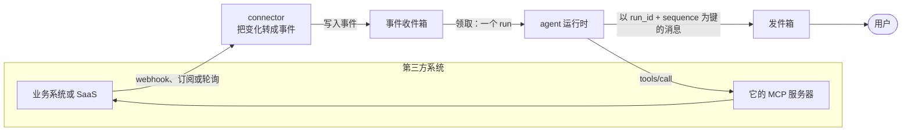
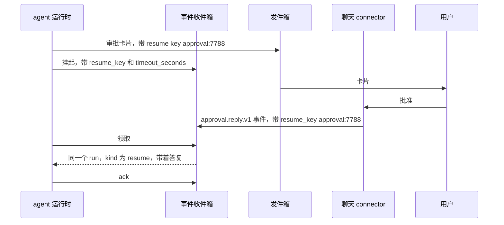

# 接入指南

[English](../en/integration.md)

本指南说明如何把两类系统接入事件收件箱：connector 把第三方系统里的变化带进来，agent 运行时负责干活。MCP 服务器属于 agent
这一侧，是 agent 在 run 里调用的工具，它自己不会往收件箱里写任何东西。每个接口的规格见 [API](api.md)；本指南说明该调用哪些接口、按什么顺序、填什么值。

如果是想让应用直接用上托管好的 agent，而不是自己写一个运行时，请改用 [Agent API](agent-api.md)：agent 服务就是这样一个运行时，跑在 Claude Managed Agents 上，通过 agent 的配置和凭据接入基于 MCP 的系统。

## 总览



connector 把每一次变化写进相关用户的收件箱。agent 把这些事件作为一个 run 领取，干活时调用该系统的 MCP
工具，再把值得说的话通过发件箱发出去。用户的回复或审批，经由 connector 作为一条新事件回来。

## 收件箱为你做什么

| 功能 | 带给你什么 | API |
| --- | --- | --- |
| 幂等写入 | connector 可以放心重试任何一次写入；一次变化就是一条事件 | `POST /v1/inbox/{inbox_id}/events` |
| 合批 | 合并键相同、先后紧挨着到达的事件，作为一个 run 交给 agent | `merge_key` |
| 单飞 | 同一个合并键绝不会同时有两个 run；后台工作绝不会挡住回复 | `merge_key`, `lane` |
| 租约与重新下发 | worker 崩溃后，它的 run 以同一个 `run_id`、同样的事件再次下发 | `heartbeat`, `ack`, `nack` |
| 运行中到达的事件 | 正在进行的一轮能得知新消息和停止请求，并且可以把它们并进来 | `heartbeat`, `steer` |
| 挂起与恢复 | run 可以为一次审批等上几天而不占用任何资源；答复会恢复同一个 run | `suspend`, `resume_key` |
| 延迟事件与定时器 | 跟进和周期任务经由同一个队列唤醒 agent | `ready_at`, `POST /v1/inbox/{inbox_id}/timers` |
| 历史、重放与审计 | 每条事件的路径都能读回；运维人员可以重放失败的工作 | `GET /v1/inbox/{inbox_id}/events/{event_id}`, `POST /v1/admin/replay` |

## 开始之前

每个系统有自己的 client：一个 id、一个密钥和若干角色，由运维人员在收件箱服务端配置（见 README 的配置一节）。

| 系统 | 角色 | 租户 |
| --- | --- | --- |
| connector | `PRODUCER` | 它自己的租户，这样它写不到别处 |
| agent 运行时 | `RUNTIME`；如果要给自己安排跟进或定时器，再加上 `PRODUCER` | 不填，以服务所有租户；或者填一个租户 |
| 运维工具 | `OPERATOR` | 不填，或者填一个租户 |

- 每个请求都按 [API](api.md#鉴权) 里的说明签名。Java 的 `InboxClient` 和下面的 Python 示例都替你做好了。
- agent 服务的每个人用一个收件箱，例如直接用用户 id。所有 connector 都把同一个人的事件写进同一个收件箱，这样 agent 看到的是同一个顺序。

## 接入 connector

connector 只负责写事件。它从不启动 agent，也从不等待 agent：202 表示这次变化已经存下，agent 一定会看到它。

### 从第三方系统取出变化

MCP 服务器只在被调用时作答，不会主动告诉任何人有东西变了。主动式 agent 需要变化自己送上门，所以 connector 要靠下面三种方式之一拿到变化。

| 方式 | 适用于 | 做法 |
| --- | --- | --- |
| Webhook 转发 | 系统能在发生变化时调用一个 URL | 一个小的 HTTP 端点校验系统的签名，映射这次变化并写入事件。它要等收件箱回答 202 之后才答复系统，这样收件箱短暂不可用时，系统自己的重试就能兜住 |
| MCP 资源订阅 | 系统的 MCP 服务器支持资源订阅 | 一个长期运行的 MCP 客户端对每个要关注的资源调用 `resources/subscribe`。每条 `notifications/resources/updated` 指明一个变了的资源；客户端用 `resources/read` 读取它，再写入一条事件，以资源 URI 加上资源的版本或更新时间作为键 |
| 轮询 | 两者都没有 | 在收件箱里建一个 cron 定时器来唤醒 agent，由 agent 用 MCP 工具查看有没有变化，没有就不发消息直接结束。或者由一个轮询程序把发现的每次变化写进来，以对象 id 加版本作为键，同一次变化看到两次也只算一条事件 |

### 把一次变化映射成事件

| 字段 | 填什么 | 例子 |
| --- | --- | --- |
| `source` | 企业系统用 `connector`，业务系统用 `biz_webhook`，人输入的内容（包括审批回复）用 `conversation` | `connector` |
| `type` | 发生了什么，格式为 `<system>.<object>.<change>.v<N>` | `jira.issue.updated.v1` |
| `source_event_id` | 系统自己给这次变化的 id。同一次变化永远是同一个 id，不同的变化绝不共用 | `jira:PROJ-123:2026-11-21T10:00:00Z` |
| `merge_key` | 需要放在一起处理、绝不能同时处理两次的东西：一段对话、一个工单、一张订单 | `issue:PROJ-123` |
| `lane` | 有人在等答复用 `interactive`，通知类用 `background`，批量同步用 `batch` | `background` |
| `occurred_at` | 它在系统里发生的时间 | `2026-11-21T10:00:00Z` |
| `payload` | agent 决定怎么做所需要的事实，最多 64 KB。发 id 和链接，不要发整份文档：细节由 agent 用 MCP 工具去读 | `{"issue":"PROJ-123","changed":["status"]}` |
| `trace_id` | 系统的 trace id（如果有）；它会一直带到 run 和发件箱 | `4bf92f3577b34da6` |
| `resume_key` | 只用在回答某个等待中 run 的回复上 | `approval:7788` |
| `interrupt` | 只用在要求停下正在进行的工作的消息上。内容恰好是一个停止词的对话消息会自动带上 | `true` |

只有当系统完全没有 id 时，才省略 `source_event_id`。这时收件箱会给事件算指纹，能防住的重试情形要少一些。

### 用 Java 写入事件

`inbox-client` 模块里的 `InboxClient` 会给请求签名。

```java
InboxClient inbox = new InboxClient(URI.create("http://inbox.internal:8080"), "jira-connector", secret);

/** Hands one change to the user's inbox; returns once the Inbox has accepted it. */
WriteEventResponse deliver(String userId, String issueKey, String updatedAt, String factsJson)
        throws InterruptedException {
    WriteEventRequest event = WriteEventRequest.builder(EventSource.CONNECTOR, "jira.issue.updated.v1")
            .sourceEventId("jira:" + issueKey + ":" + updatedAt) // the same change always gets the same id
            .mergeKey("issue:" + issueKey)                       // one run at a time per issue
            .lane(Lane.BACKGROUND)
            .occurredAt(Instant.parse(updatedAt))
            .payloadJson(factsJson)                              // facts and ids, at most 64 KB
            .build();
    for (int attempt = 1; ; attempt++) {
        try {
            ApiResult<WriteEventResponse> answer = inbox.writeEvent(userId, event);
            if (answer.ok()) {
                return answer.body();                            // accepted now, or accepted before
            }
            if (answer.status() < 500 || attempt == 5) {
                throw new InboxApiException(answer.status(), answer.problem()); // a 4xx is a bug: no retry
            }
        } catch (UncheckedIOException noAnswer) {
            if (attempt == 5) {
                throw noAnswer;
            }
        }
        Thread.sleep(200L << attempt);                           // sending the same event again is safe
    }
}
```

### 应答与处理

| 应答 | 含义 | connector 怎么做 |
| --- | --- | --- |
| 202，`deduped: false` | 已接收 | 向系统确认这次变化 |
| 202，`deduped: true` | 之前已经接收过 | 同上 |
| 500、503、超时、连接错误 | 收件箱没能确认这次写入 | 用同一个事件、同一个键重试，带退避 |
| 400 | 事件不合法 | 不重试；修正映射 |
| 401、403 | 签名、密钥或角色有问题 | 不重试；检查凭据 |
| 409 `idempotency_conflict` | 这个键已经被不同的内容用过 | 不重试；把这次变化的版本放进键里 |
| 413 | payload 超过 64 KB | 改为发送引用，而不是内容本身 |

### 回复与审批

- 聊天 connector 把用户发的每条消息写成一条 `conversation` 事件，以这段对话作为合并键。连着打的几条消息会作为一个 run 交给 agent。
- agent 请求审批时，卡片里带着 run 挂起时用的 resume key。connector 把用户的点击写成一条类型为 `approval.reply.v1` 的
  `conversation` 事件，带上这个 `resume_key`，并以审批单的 id 作为 `source_event_id`，所以双击也只算一条事件。

## 接入 agent

运行时就是由几个调用组成的循环，并且要遵守[运行时契约](api.md#运行时契约)里的规则。

### run 循环

1. **领取。** 调用 `POST /v1/runs/claim`，带上 `worker_id` 和最多 30,000 的 `wait_ms`；对话类场景再带上
   `accepts_steer: true`。204 表示没有事可做，再次领取即可；如果带有 `X-Inbox-Retry-After-Ms` 响应头，就等到那之后。
2. **准备这一轮。** 按 `run_seq` 排序的 `events` 就是这一轮的输入。`kind` 说明从哪里开始：`start` 是新工作；`redelivery`
   是崩溃或 nack 之后的同一个 run（从头再来，已经发生过的一律不重复）；`resume` 是继续一个挂起的 run（加载以 `run_id` 保存的状态）。
3. **干活。** 调用模型和 MCP 工具。至少每 20 秒发一次心跳，工具调用进行中也要发；在两步之间查看信号。
4. **通过发件箱说话。** 每条消息的键是 `run_id` + sequence，一个 run 的第 n 条消息的 sequence 永远是 n。
5. **结束 run**，恰好调用一次：`outcome: done` 的 `ack`、`outcome: failed` 的 `ack`、`nack` 或 `suspend`。不发任何消息就结束是正常的。
6. **遇到 409 `lease_lost`**，不管在哪一步，都立刻停下、什么都不改：这个 run 已经属于另一个 worker。

Ack 和 suspend 都带上 `last_run_seq`，即这一轮用到的最大 `run_seq`，这样在最后一刻被 steer 进来的事件会回到队列，而不是丢失。

### agent 用到的 run 字段

| 字段 | 用途 |
| --- | --- |
| `run_id` | 保存会话状态用的键，也是这个 run 派生的所有幂等键的基础 |
| `epoch` | 这个 run 上的每次调用都要带上 |
| `kind`, `resume_reason` | 从哪里开始：新的、再来一次，或者在答复（`event`）或超时（`timeout`）之后继续 |
| `events` | 输入，按 `run_seq` 排序，每条都有 `type`、`source`、`payload` 和 `source_event_id` |
| `merge_key` | 对话或对象：据此加载它的历史和记忆 |
| `trace_id` | 传给日志、工具调用和发件箱 |
| `lease_expires_at` | 在这个时间之前发心跳 |

因答复而恢复时，`events` 里只有那些答复。`GET /v1/runs/{run_id}` 会返回这个 run 名下的全部事件。

### run 运行中的信号

| 心跳应答里的信号 | agent 怎么做 |
| --- | --- |
| `steer_pending` 大于 0 | 在安全点调用 `steer`。同一合并键的新事件会并入这个 run，并返回给你 |
| `interrupt_requested` | 自行决定。要让路，就保存状态，用 `resume:<run_id>` 这样的 resume key 挂起。带标记的消息会先被领取。旧 run 在带有这个键的事件到达时继续；如果用了 `on_timeout: resume`，超时一到也会继续 |
| `extended: false` | 租约已经到了 30 分钟的上限。保存状态，用 `on_timeout: resume` 和一个较短的超时挂起；run 会带着新的租约回来 |

忽略信号是安全的：那些事件会一直等着，在这个 run 结束后被领取。

### 在 run 里调用 MCP 工具

- 收件箱不在这条路径上。agent 直接调用它的 MCP 服务器，用的是运行时持有的凭据，绝不是事件里带来的。
- 一个 run 可能被下发不止一次。在调用会改变东西的工具之前，要确保重复执行没有坏处：工具支持幂等键时，用 `run_id`
  和步骤序号拼一个传进去；否则先读当前状态，跳过已经做完的部分。
- 高风险的动作先问再做：挂起等待审批，恢复之后再执行。
- 暂时性的工具失败（超时、5xx、限流）用 `nack` 结束 run；如果工具说明了何时再来，就带上 `retry_after_ms`。永久性的失败（请求不合法、没有权限）用
  `ack`、`outcome: failed` 加上原因结束。
- 工具调用很慢时，也要一直发心跳。

### 用 Java 编写 agent

`inbox-client` 里的 `ScriptedWorker` 已经遵守了契约：它负责领取、带上 epoch、steer、让每个 run 恰好以一次调用结束、在租约丢失时停下，并把异常变成
`nack`。agent 的逻辑写在它的回调里。下面的 `outbox`、`sessions`、`Session` 和 `tools` 代表你自己的部分：投递服务、保存会话状态的地方，以及
MCP 客户端。

```java
InboxClient inbox = new InboxClient(URI.create("http://inbox.internal:8080"), "agent-runtime", secret);
ScheduledExecutorService keepAlive = Executors.newSingleThreadScheduledExecutor();

ScriptedWorker worker = new ScriptedWorker(inbox, outbox, "agent-1", context -> {
    ClaimedRun run = context.run();
    // Keep the lease while the model or a tool is busy. A lost lease shows up at the turn's own
    // heartbeat below, which throws LeaseLostException and ends the turn without touching the run.
    ScheduledFuture<?> beats = keepAlive.scheduleAtFixedRate(() -> {
        try {
            context.heartbeat();
        } catch (RuntimeException reportedByTheTurn) {
            // nothing to do here
        }
    }, 20, 20, TimeUnit.SECONDS);
    try {
        Session session = sessions.load(run.runId());          // empty unless this run saved one
        for (ClaimedEvent event : context.events()) {
            if (event.runSeq() > session.lastRunSeq()) {        // skip what the saved session holds
                session.add(event);
            }
        }
        while (!session.finished()) {
            HeartbeatResponse signals = context.heartbeat();
            if (signals.interruptRequested()) {                 // yield: the stop request goes first
                sessions.save(run.runId(), session);
                return new ScriptedWorker.Decision.Suspend("resume:" + run.runId(), 60, SuspendRequest.RESUME);
            }
            if (signals.steerPending() > 0) {
                context.steer().forEach(session::add);          // new messages of the same conversation
            }
            session.step(tools);                                // one model call and its MCP tool calls
        }
        if (session.answer() != null) {
            context.send("im", session.answer());               // saying nothing is a normal ending too
        }
        return new ScriptedWorker.Decision.Done();
    } finally {
        beats.cancel(false);
    }
});
while (running) {
    worker.runOnce(ClaimRequest.any("agent-1").withSteer(true).withWait(20_000));
}
```

### 用其他语言编写 agent

任何支持 HTTP 和 HMAC-SHA256 的语言都可以。[inbox_example.py](../../examples/python/inbox_example.py) 是一个只用 Python
标准库的完整示例：带重试的 connector 写入，以及一轮领取、心跳、ack、失败时 nack 的 agent 处理。所有请求都要经过的那个函数如下：

```python
def call(client_id, secret, method, path, body=None):
    """Sends one signed request; returns (status, headers, parsed JSON body or None).

    The signature covers a timestamp, the method, the path with its query and the body, exactly as sent.
    """
    data = b"" if body is None else json.dumps(body, separators=(",", ":")).encode("utf-8")
    timestamp = str(int(time.time()))
    string_to_sign = "\n".join(["v1", timestamp, method, path, hashlib.sha256(data).hexdigest()])
    signature = hmac.new(secret.encode("utf-8"), string_to_sign.encode("utf-8"), hashlib.sha256).hexdigest()
    request = urllib.request.Request(BASE_URL + path, data=data if body is not None else None, method=method)
    request.add_header("X-Client-Id", client_id)
    request.add_header("X-Timestamp", timestamp)
    request.add_header("X-Signature", "hmac-sha256=" + signature)
    if body is not None:
        request.add_header("Content-Type", "application/json")
    try:
        with urllib.request.urlopen(request, timeout=60) as response:
            raw = response.read()
            return response.status, response.headers, json.loads(raw) if raw else None
    except urllib.error.HTTPError as error:
        raw = error.read()
        return error.code, error.headers, json.loads(raw) if raw else None
```

### 审批



run 等待期间不占槽位，所以用户的其他工作照常进行。默认的 `on_timeout: finish` 下，得不到答复的 run 到期后静默结束；用
`on_timeout: resume` 则会带着 `resume_reason: timeout` 被交回。

### 跟进与定时器

- 一次性的跟进，比如两小时后再看一眼：写一条带 `ready_at` 的 `agent_self` 事件，键用 `run_id` 加一个计数。不属于任何租户的运行时，写入时要加上
  `tenant_id`。
- 周期任务就建一个定时器：`POST /v1/inbox/{inbox_id}/timers`，带上 `kind: cron`、`cron` 表达式、`time_zone` 和 `timer_key`。
- 跟进或定时器触发时，先查看，没有值得说的就保持静默。
- 绝不要在 run 里 sleep：等待中的 run 占着槽位，一次重启就会把这次等待弄丢。

### 错误处理

| 情况 | 应答 | 运行时怎么做 |
| --- | --- | --- |
| 没有可领取的 | 204 | 再次领取；如果带有 `X-Inbox-Retry-After-Ms`，先等那么久 |
| run 已属于另一个 worker | 409 `lease_lost` | 停下；不再发送任何东西；也不要结束这个 run |
| 已经有 run 在等这个 resume key | 409 `resume_key_in_use` | 换一个包含 `run_id` 的键 |
| 收件箱不可用 | 503 或连接错误 | 用同一个 epoch 重试同一个调用；结束类调用是幂等的 |
| 挂起时没带超时 | 400 | 一定要带上 `timeout_seconds` |

## 检查清单

connector：

- [ ] 每条事件都有 `source_event_id`，每次重试都相同，每次变化都不同
- [ ] 合并键指向绝不能同时被处理两次的东西
- [ ] 5xx 应答或网络错误用同一个事件重试；4xx 应答不重试
- [ ] payload 小于 64 KB，带的是引用而不是文档
- [ ] client 密钥来自密钥管理系统

agent 运行时：

- [ ] 领取之后的每次调用都带上 epoch，遇到 409 `lease_lost` 就停止这一轮
- [ ] 至少每 20 秒发一次心跳，长时间的工具调用期间也一样
- [ ] 每个 run 都恰好以 ack、nack 或 suspend 之一结束
- [ ] 消息通过以 `run_id` + sequence 为键的发件箱发送，每个会改变东西的工具调用都可以安全地重复
- [ ] 每次挂起都带超时
- [ ] 跟进是带 `ready_at` 的事件，绝不是 sleep

## 试一试

1. 按 README 的快速开始启动服务。
2. 先以 connector 的身份运行 `python3 examples/python/inbox_example.py write`，再以 agent 的身份运行
   `python3 examples/python/inbox_example.py work`。
3. 阅读端到端演示你所需模式的测试：

| 模式 | 测试 |
| --- | --- |
| 一个 webhook 带来一次回复 | `ScenarioAE2E` |
| 连着打的几条消息变成一个 run | `ScenarioBE2E` |
| 挂起等待审批，再恢复 | `ScenarioCE2E` |
| 崩溃后重新下发，回复只发一次 | `ScenarioDE2E` |
| 两小时后的跟进 | `ScenarioEE2E` |
| steer 与打断 | `F9DeliveryModesIT` |
