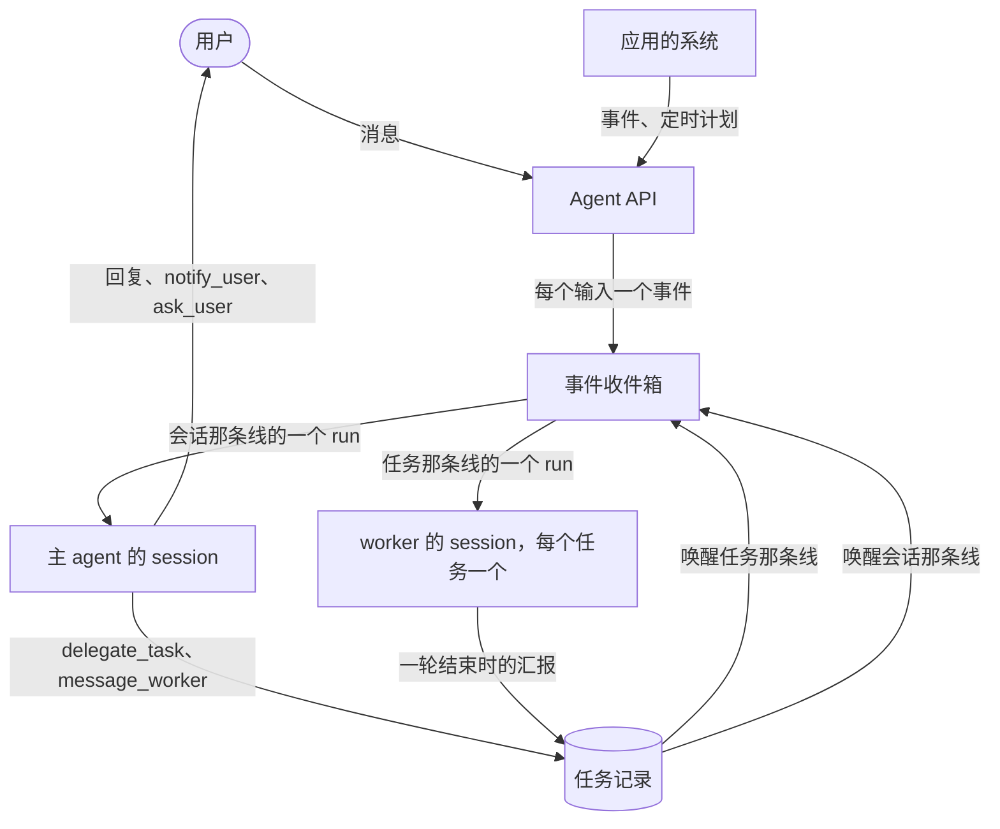

# 主 agent 与 worker

[English](../en/main-agent.md)

主 agent 是关于一个用户的一切都会到达的那一个 agent：用户写的话、应用系统里发生的事、到期的事，以及替它干活的 agent 的汇报。每一件事该怎么办由它判断：告诉用户，或者保持安静；耗时的工作交给
worker，也就是各有自己 session 的 agent。本文先回顾改动之前的服务，再记录主 agent 为什么这样实现，最后说明它如何工作。应用这一侧的用法见
[Agent API](agent-api.md#主-agent-和它的任务)。

## 总览

主 agent 和 worker 从不直接调用对方。一方要给另一方的东西，存成这个任务的一条记录，并在同一个事务里给对方的工作线排一个事件。所以汇报和别的输入一样：会去重，一次只跑一轮，进程崩溃之后也还在。

## 回顾发现了什么

回顾现有服务时只对照一个需求：一个 agent，能感知用户周边发生的事，主动替用户把事情接下来，同时照常接收用户的消息和任务。

| 发现 | 对主 agent 意味着什么 |
| --- | --- |
| 只有事件收件箱能把事件变成 run，一条工作线一次一个，带租约 | 保留，作为基础。主 agent 和 worker 之间的往来也必须走这条路，否则去重、单飞、重放和审计记录就管不到它们 |
| 每条工作线有自己的 session，线与线互不知情 | 会话的 session 只能事后得知后台的工作，而且只知道通知过用户的那部分。没有哪个 session 看得到一个用户的全貌 |
| 每个主题的 session 自己决定要不要告诉用户 | 主动性是按主题割裂的。没有谁能把一个主题和另一个主题放在一起权衡，或者和用户刚说的话放在一起权衡 |
| agent 不能启动另一个 agent | 耗时的工作只能在收到事件的那条线的回合里做，受一轮 10 分钟的限制，期间占着那条线 |
| 其他系统说的话只以工具结果的形式到达 agent | 保留，并且延伸：主 agent 写给 worker 的话、worker 的汇报，同样不是用户说的话 |
| [架构文档](architecture.md#多-agent-层)列了三个层级 | 这里实现了两层：主会话，以及每个任务一个 thread。一个 thread 之下的多个 work agent 留给平台 |

## 决策

**主 agent 就是带一份 worker 名单的会话 agent。每个任务有自己的 worker session，跑在自己的工作线上，双方通过事件收件箱交换任务记录。**

靠两处改动实现。

1. **一切都进同一个 session。** 应用发给主 agent 的事件和定时计划，在它所服务的会话那条线上处理，而不是每个主题一条线；它的 worker
   的汇报也回到这条线。和用户说话的那个 session，什么都听得到。
2. **委派是一次工具调用。** `delegate_task` 在一条独立的工作线 `work:<task_id>` 上开一个任务，worker 的 agent
   就在这条线上运行。worker 在一轮里最后写的文字就是它的汇报，汇报会唤醒主 agent。

Claude Managed Agents 自己有多 agent session，目前是 beta：协调者把工作交给子 agent，子 agent 作为它那个 session 里的 thread
运行。这是最容易想到的另一种做法，但这里的任务没有建在它上面。

| 问题 | worker 是收件箱里的工作线（已实现） | worker 是主 session 里的 thread |
| --- | --- | --- |
| 什么唤醒 worker | 一个收件箱事件：去重、一次一个 run、有租约、可重放、可审计 | 协调者在自己回合里的一次调用，本服务只能在流里看到 |
| worker 和主 agent 共用什么 | 任务记录，别无其他 | 那个 session 的沙箱、文件、vault 和记忆 |
| 谁能给 worker 写东西 | 主 agent，随时可以，用 `message_worker` | 只有协调者：客户端不能往 thread 里发消息 |
| 用户要等什么 | 不用等这件工作：主 agent 委派完，它的回合就结束了 | 要等这件工作：只要有一个 thread 在忙，session 就在忙，所以这一轮和工作一样长 |
| 主 agent 换了新 session 时 | 任务继续，新 session 会被告知还有任务开着 | thread 随 session 一起没了 |
| 代价 | 每个任务一个 session，有启动时间，也没有共用的工作目录 | 没有额外代价：thread 在已经运行的 session 里启动 |

起决定作用的是前两行。每一次绕过收件箱的唤醒，都不在收件箱的保证之内。worker 读的是其他系统说的话，所以它不能和那个与用户说话的 session 共用 vault 和记忆；同一个 session
里的 thread 做不到这样隔开，工作线可以。最后一行是代价，每个任务付一次。

有两件事会改变这个决策。

- 平台允许客户端往 thread 里发消息，并且让 thread 有自己的资源。那时 thread 就可以充当工作线。
- 工作需要几个 agent 在同一个工作目录里干活，比如同一份检出的代码。平台的 thread 正适合这种情况，用在 worker 的 session 里面；这里还没有接上。

## 什么会到达主 agent

| 发生了什么 | 主 agent 怎么拿到 | Lane |
| --- | --- | --- |
| 用户写了消息 | 作为开启这一轮的消息 | `interactive` |
| 应用发给这个 agent 的事件 | 一段固定措辞的通知；内容通过 `read_events` 读取 | `background` |
| 应用的定时计划，或者主 agent 给自己设的跟进 | 一段固定措辞的通知，里面带着指令或备注 | `background` |
| worker 汇报了、worker 的回合失败了，或者别人关闭了任务 | 一段固定措辞的通知；内容通过 `read_events` 读取 | `background` |

这四种都是同一条线 `conv:<conversation_id>` 上的 run，所以都进同一个 session，一次一个。相隔很近到达的会一起交给它，主 agent
因此可以先把几件事放在一起权衡，再开口。

服务会在主 agent 的指令后面加几句话：关于这个用户的一切都会来到这个 session；每一次是行动、告诉用户还是保持安静，由它自己判断，而用户的注意力是它手里最稀缺的东西；只有明显是用户想要、又容易撤回的事，才不等用户开口就动手，否则先提出建议。

一个应用可以在主 agent 之外还有普通 agent。发给普通 agent 的事件照旧去它那个主题的线；只有发给主 agent 的才去它的会话。

## 从一个请求到它的结果

1. 主 agent 那条线的一个 run 开始了：用户写了消息，或者发生了什么事。
2. 主 agent 调用 `delegate_task`，给出角色、标题和指令。服务在一个事务里保存任务、它的工作线，并把指令存成任务的第一条记录，同时给任务那条线排上事件
   `agent.task_message.v1`。
3. 主 agent 结束这一轮。它告诉用户自己开始了什么，或者什么都不说。没有任何东西在等 worker。
4. 收件箱在任务那条线上运行 worker 的回合。worker 用 `read_events` 读到指令，用自己的工具干活，在这一轮末尾写下汇报。
5. 服务把汇报存成一条记录，并给主 agent 那条线排上 `agent.task_report.v1`。
6. 主 agent 的下一轮用 `read_events` 读到汇报，连同其他等着它的东西一起，然后决定：告诉用户、用 `message_worker` 再给 worker
   说点什么、关闭任务，或者什么都不做。

汇报之后任务仍然开着。worker 的 session 记得这个任务，所以后来发给它的消息是接着干，而不是从头再来。

## 工具

| 工具 | 对主 agent | 对任务里的 worker |
| --- | --- | --- |
| `delegate_task` | 给它名单里的某个角色开一个任务，返回任务的 id | 没有 |
| `message_worker` | 给一个开着的任务的 worker 再说点什么：一个回答、一处纠正、下一步 | 没有 |
| `list_tasks` | 开着的任务、各自的状态和最近一条回话 | 没有 |
| `close_task` | 结束一个任务。worker 正在进行的回合会停下，它在等的东西会作废 | 没有 |
| `read_events` | 事件、到期的跟进，以及 worker 给它的东西 | 主 agent 发来的东西，以及它自己到期的跟进 |
| `notify_user`, `ask_user` | 和所有 agent 一样 | 被拒绝：worker 向主 agent 汇报，用户听到什么由主 agent 决定 |
| `schedule_followup` | 和所有 agent 一样 | 稍后在同一个任务上再唤醒这个 worker |

## 任务

| 状态 | 含义 |
| --- | --- |
| `queued` | 主 agent 发来的东西在等 worker |
| `working` | worker 的一轮正在进行 |
| `idle` | worker 已经汇报，或者没事可做；任务在等主 agent |
| `closed` | 结束了，不会再有任何东西从它那里来 |

关闭任务的可以是主 agent（`close_task`）、用户或应用（`POST /v1/users/{user_id}/tasks/{task_id}/close`），也可以是服务：主 agent
再次委派时，已经闲置 7 天的任务会被关掉。不是主 agent 自己关的，主 agent 会被告知。

对应的表是 `delegated_task` 和 `task_note`。任务记着主 agent 的工作线、角色、worker 的 agent，以及创建它的那次调用；每条记录有方向、种类（`assignment`、`message`、`report`、`failure`
或 `closed`）和正文。任务状态的每次变化都记录为一条更新：`task.created` 或 `task.updated`。

## 出了问题时

| 发生了什么 | 服务怎么做 |
| --- | --- |
| 服务的 worker 进程在 `delegate_task` 之后立刻死掉 | run 重新下发。这次调用以 run 和它在 run 的调用里的位置命名，所以找到的是它先前建的那个任务，worker 只被唤醒一次 |
| worker 的一轮失败了，或者超时了 | 服务写一条记录告诉主 agent 工作没做完。主 agent 给 worker 发条消息让它重试，或者关闭任务 |
| worker 结束了一轮却什么都没写 | 如果这一轮是主 agent 发了东西引起的，服务替 worker 汇报这一点，所以主 agent 不会空等 |
| worker 干活时任务被关闭 | worker 的 session 被中断，不保存任何汇报 |
| 主 agent 的 session 被替换 | 新 session 的第一轮会被告知之前说过什么、还有任务开着，即使这一轮是在后台开始的 |
| 主 agent 委派得越来越多 | 排队或进行中的任务达到 4 个，或者开着的任务达到 20 个时，`delegate_task` 会被拒绝并说明原因 |

`CoordinatorIT` 里每一行都有一个测试。

## 信任边界

- 主 agent 写给 worker 的话不是用户说的话。worker 是作为 `read_events` 的结果拿到它的，并被告知只在自己的指令允许的范围内去做。
- worker 的汇报对主 agent 来说是信息，从不是指令。主 agent 的指令里写明了这一点。
- worker 接触不到用户。worker 的工具调用如果需要审批，仍然交给该审批的人，和任何 agent 一样。
- 用户自己的客户端能看到任务的标题、角色和状态，也能关闭它。worker 汇报了什么、两个 agent 之间写了什么，只有 API key 能看。
- 委派只有一层：worker 永远不是主 agent，已经在某份 worker 名单上的 agent 也不能变成主 agent。
- worker 的 session 对它那个 agent 的记忆只读，和所有后台 session 一样。主 agent 的 session 是例外：它既读事件和汇报，又能写记忆。把两者分开的只有它的指令，所以如果这对你的应用来说不够，就不要给主
  agent 打开 `memory`。

## 配置与限制

| 项目 | 默认值 | 配置项 |
| --- | --- | --- |
| 主 agent 名单上的角色 | 最多 10 个 | 固定 |
| 一个会话里排队或进行中的任务 | 4 个 | agent 的 `coordinator` 里的 `max_active_tasks`，1 到 20 |
| 一个会话里开着的任务 | 20 个 | `agent.tasks.max-open` |
| 闲置的任务保留多久 | 7 天 | `agent.tasks.idle-ttl` |
| 任务的指令，以及之后发给 worker 的消息 | 8,000 个字符 | `agent.tasks.max-instructions` |
| worker 的汇报 | 16,000 个字符，超出截断 | `agent.tasks.max-report` |
| worker 运行所在的收件箱 lane | `batch` | `agent.tasks.lane`：`batch` 或 `background` |
| 一个用户同时运行的 worker | 1 个 | 收件箱的 `inbox.lanes.batch.cap`；`docker-compose.yml` 设为 4 |

worker 有自己的 lane，这样 worker 的长回合永远不会挡住唤醒主 agent 的东西，主 agent 的回合也不用排在 worker 后面等空位。

## 为什么这样做，以及什么能证明它错了

这一节记下决策背后的判断，方便以后回头检验。百分比是作者的估计，做于 2026 年 11 月，针对之后的六个月。

| 判断 | 把握 | 依据 | 什么能证明它错了 |
| --- | --- | --- | --- |
| worker 应该放在收件箱的工作线上，而不是主 session 的 thread 里 | 80% | 平台关于多 agent session 的文档（2026 年 11 月读取）：thread 共用 session 的资源，客户端不能往 thread 里发消息 | 平台让 thread 有自己的资源，并允许客户端往里发消息；或者大多数任务其实需要共用的工作目录 |
| 一个用户的一切都进同一个 session，成本承受得起 | 70% | 主 agent 只做分拣和委派的回合很短；耗时的工作是 worker 的 | 用户的消息经常要排在后台回合后面；主 agent 回合的输入 token 随每个事件增长 |
| 在 worker 内部，平台的 thread 是合适的工具 | 65% | 它不用新开 session 就能启动，还共用文件，正是一个任务的多个步骤需要的 | 官方 SDK 不支持它，或者每个 thread 的成本接近一个 session |

反对这个决策的最强理由是成本和延迟。什么都听得到的主 agent，要为每件事跑一轮，包括它随后决定不理会的事；而这一轮进行时用户的消息只能等，因为一条线一次只跑一轮。Anthropic
[报告](https://www.anthropic.com/engineering/multi-agent-research-system)过，它自己的多 agent 研究系统用掉的 token 大约是普通对话的 15
倍。这里给出的回应是结构上的，并不彻底：靠委派让主 agent 的回合保持简短，一起到达的事件合成一轮，而那些根本用不着主 agent 的事件，仍然可以发给普通 agent，在它的主题线上处理。

服务接上模型运行之后，应该测量：

- 用户的消息排在同一条线的后台回合后面要等多久，看 95 分位。
- 每个用户每天主 agent 回合的输入 token，以及其中有多少轮既没发消息也没开任务。
- 有多少任务以失败记录告终，有多少是用户关掉的。

## 没有实现什么

- 第三层：一个任务之下的多个 agent，用平台的 thread 跑在 worker 的 session 里面。
- 用户直接给 worker 写消息。用户和主 agent 说，由主 agent 转达。
- 引导：主 agent 在后台工作时到达的消息，要等这一轮结束。
- worker 没有主 agent 对用户的记忆。它需要知道的东西要写进任务里。
- 这里的一切都没有对着模型或平台运行过：测试用的是脚本化的替身。
