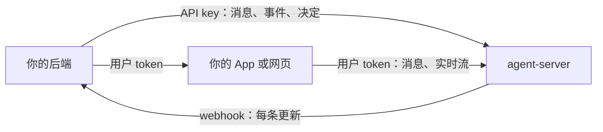

# 教程：部署运行与接入应用

[English](../en/tutorial.md)

本教程写给想把这个主动式 agent 放进自己产品的团队。它在一台机器上几分钟内启动整个服务，试用一遍，再一步步接入一个应用，最后列出真实用户到来之前要检查的事。每个接口的说明见
[Agent API](agent-api.md) 指南；服务内部如何工作见 [Agent 服务](agent-service.md)。

## 你将运行什么

| 部分 | 作用 |
| --- | --- |
| `agent-server` | 你的应用调用的 Agent API，端口 8090 |
| `inbox-server` | 事件收件箱：把消息和事件变成一个个 run，同一条工作线同一时刻只有一个。只有 `agent-server` 和它打交道 |
| PostgreSQL | 两个服务的数据库 |
| Claude Managed Agents | Anthropic 运行 agent 及其工具的平台。演示模式下由 `agent-server` 里的脚本代替 |

服务以演示模式启动，不需要任何 key：agent 会复述用户说的话，并把每个事件告诉用户。这已经足够开发和测试接入。真实模式用 Anthropic API key 把 Claude
接到同一套 API 后面（[第 11 步](#11-切换到真实模式)）。

## 1. 启动服务

### 用 Docker

需要带 Compose v2 的 Docker（Docker Desktop，或 Docker Engine 24 及以上）和 git；示例还会用到 curl 和 python3。Windows 上请在 WSL 或 Git Bash
里运行这些命令。

```bash
git clone -b claude/tender-heisenberg-z2tbl7 https://github.com/joannaann0213-coder/Agent-research.git
cd Agent-research/proactive-agent
docker compose up -d --build --wait
docker compose ps
curl -s http://localhost:8090/actuator/health
```

第一次构建要下载依赖，需要几分钟；带上 `--wait`，命令会等三个服务都变成 `healthy`（`docker compose ps` 可以看到）之后才返回，这时健康检查返回
`"status":"UP"`。API 监听在 `127.0.0.1:8090`，只有本机能访问。

```bash
# 跟踪 agent 服务的日志
docker compose logs -f agent
# 停止全部服务；数据保留在 Docker 卷里
docker compose down
# 停止全部服务并删除数据
docker compose down -v
```

设置写在 `docker-compose.yml` 旁边的 `.env` 文件里：复制 `.env.example`（里面逐项说明了每个设置），改完之后再运行一次 `docker compose up -d`。

### 不用 Docker

需要 JDK 21、Maven 3.9 和 PostgreSQL 16。构建两个服务，建好它们的数据库（在 Debian 和 Ubuntu 上 `scripts/pg-local.sh` 会做这件事），然后按
[README](../../README.zh-CN.md#agent-服务) 里的方法启动。

```bash
mvn -DskipTests package
scripts/pg-local.sh
```

## 2. 试一试

```bash
examples/agent-api/quickstart.sh
```

这个脚本依次扮演运维方、应用后端和用户的客户端：登记应用 `acme`，拿到 API key，描述一个 agent，为用户 `u42` 取得 token，发一条消息，等回复，报告一个应用系统里的事件，再等通知。结尾是这样的：

```text
6. The reply comes a moment later.
   agent: You said: Where is my order 1234?
7. Something happens in the application's systems.
8. The agent decides whether the user needs to know; what it says shows among the updates.
   notification: [demo] Something happened that you should know about: order.delayed (order-1234).
9. Everything that happened for the user, in order:
   1 message.created message
   2 message.created reply
   3 message.created notification
```

`examples/agent-api/agent_api.py` 是一个只用标准库的 Python 小客户端；直接运行时，它做同样的事，并以实时流的方式跟踪用户的更新：

```bash
python3 examples/agent-api/agent_api.py --api http://localhost:8090 --admin change-me-admin-key-0123456789abcdef
```

## 3. 你的应用如何对应

| 在你的产品里 | 在 Agent API 里 |
| --- | --- |
| 你的产品，或它的一套部署 | 一个应用，`app_id` |
| 你的一个用户 | 一个用户，用你自己的 `user_id` |
| 一个聊天窗口或话题 | 一个会话，`conversation_id` |
| 你的系统发现的事：订单延误了、工单有了答复 | 一个事件，关于某个 `subject` |
| 需要某个人做的决定 | 一个动作 |
| 要在某个时间做的事 | 一个定时计划 |

三种凭据，对应三类调用方：

| 凭据 | 谁持有 | 从哪里来 |
| --- | --- | --- |
| 管理员 key | 运行服务的你 | `.env` 里的 `AGENT_ADMIN_KEYS_0` |
| API key，`afk.…` | 你的应用后端 | `POST /v1/admin/apps/{app_id}/keys` |
| 用户 token，`aft.…` | 某个用户的 App 或网页，有效 15 分钟到 1 小时 | `POST /v1/users/{user_id}/tokens`，由你的后端调用 |



接入有两种方式，可以混用：

- 经过你的后端。后端用 API key 发送一切，通过 webhook 收到每一条更新。你的用户从不直接和本服务打交道，什么内容送到用户面前由你决定。适合企业系统，以及已经有自己聊天界面的产品。
- 从用户的 App 直连。你的后端给已登录用户的 App 一个用户 token，App 自己发送用户的消息、跟踪实时流。你的后端仍然负责报告事件、做属于应用的决定。适合面向消费者的 App。

## 4. 开通应用

运维方为每个应用登记一次，并给它的后端一个 API key。

```bash
API=http://localhost:8090
ADMIN=change-me-admin-key-0123456789abcdef
curl -s -X POST $API/v1/admin/apps -H "Authorization: Bearer $ADMIN" \
  -H 'Content-Type: application/json' -d '{"app_id": "shop", "name": "My shop"}'
KEY=$(curl -s -X POST $API/v1/admin/apps/shop/keys -H "Authorization: Bearer $ADMIN" \
  -H 'Content-Type: application/json' -d '{"label": "back end"}' \
  | python3 -c "import json,sys; print(json.load(sys.stdin)['api_key'])")
curl -s $API/v1/whoami -H "Authorization: Bearer $KEY"
```

key 只显示这一次：把它存进后端的密钥管理里。要更换时，先建一个新的，再用 `DELETE /v1/admin/apps/{app_id}/keys/{key_id}` 吊销旧的。

## 5. 配置 agent

`PUT /v1/agents/default` 说明 agent 是做什么的、用哪个模型、可以访问你的哪些系统。每次都发送完整的配置。把下面的内容存为 `agent.json`：

```json
{
  "name": "Shop assistant",
  "instructions": "You help the customers of My Shop with their orders, deliveries and returns. Answer briefly. When an order is late, tell the customer with notify_user, and offer a voucher only when it is late by more than three days.",
  "model": "claude-opus-5-5",
  "effort": "medium",
  "mcp_servers": [
    {"name": "orders", "url": "https://mcp.shop.example/orders", "approval": "always_allow", "approver": "app"},
    {"name": "refunds", "url": "https://mcp.shop.example/refunds", "approval": "always_ask", "approver": "user"}
  ],
  "session_budget_usd": 2
}
```

```bash
curl -s -X PUT $API/v1/agents/default -H "Authorization: Bearer $KEY" \
  -H 'Content-Type: application/json' -d @agent.json
```

- `instructions` 写你的规则，包括每类事件该怎么处理：事件里带的内容只作为信息交给 agent，从不作为指令。
- `mcp_servers` 是你的系统，以 agent 调用的 MCP 服务器的形式接入。设置 `approval: always_ask` 后每次调用都要等人决定，`approver`
  指定由谁决定（[第 8 步](#8-审批与提问)）。
- `sandbox` 给 agent 一个带 shell、文件和网页搜索的容器。`memory: per_user` 让它跨会话记住每个用户，需要开启沙箱。
- 一个应用可以有多个 agent，用 `default` 以外的 key 区分。一个会话使用它第一条消息用 `agent` 指定的那个 agent。

演示模式下脚本不理会这些配置，但服务会像真实模式一样检查它们。

## 6. 接入后端

### 消息

由你的后端发送用户的一条消息。`202` 表示已保存，不表示已回答：

```bash
curl -s -X POST $API/v1/users/u-1001/messages -H "Authorization: Bearer $KEY" \
  -H 'Content-Type: application/json' \
  -d '{"message_id": "web-7f3a", "conversation_id": "support", "text": "Where is my order 1234?"}'
```

`message_id` 是你给这条消息的 id：重复发送没有副作用，所以超时后可以放心重试。每个 `conversation_id` 是一个独立的会话，不指定时是 `default`。

回复，以及用户身上发生的其他一切，都是一条更新：`message.created`、`action.created`、`action.resolved` 或 `run.failed`；用了主 agent，还有 `task.created` 和
`task.updated`。后端有两种方式拿到它们。

| 方式 | 怎么做 | 适合 |
| --- | --- | --- |
| Webhook | `PUT /v1/webhook` 设置一次；之后服务把每个用户的每条更新 POST 过来 | 生产环境的后端 |
| 轮询 | `GET /v1/users/{user_id}/updates?after=<seq>`，带上一页的 `next_after` | 脚本、测试，以及不能接收请求的后端 |

```bash
curl -s "$API/v1/users/u-1001/updates?after=0" -H "Authorization: Bearer $KEY"
```

### 用 webhook 接收更新

用你自己后端的地址代替示例里的地址，设置一次：

```bash
curl -s -X PUT $API/v1/webhook -H "Authorization: Bearer $KEY" \
  -H 'Content-Type: application/json' -d '{"url": "https://api.shop.example/agent-webhook"}'
```

返回里的 `signing_secret`（以 `whsec_` 开头）只显示这一次；`rotate_secret: true` 会生成一个新的。信任每次投递之前先校验签名，立即以 2xx 应答，并忽略见过的
`id`。用 Node.js：

```javascript
import crypto from "node:crypto";

// secret: the signing_secret. headers: their names in lower case. body: the raw body, a Buffer.
export function verifyWebhook(secret, headers, body, toleranceSeconds = 300) {
  const key = Buffer.from(secret.replace(/^whsec_/, ""), "base64");
  const signed = Buffer.concat([Buffer.from(`${headers["webhook-id"]}.${headers["webhook-timestamp"]}.`), body]);
  const expected = "v1," + crypto.createHmac("sha256", key).update(signed).digest("base64");
  const fresh = Math.abs(Date.now() / 1000 - Number(headers["webhook-timestamp"])) <= toleranceSeconds;
  return fresh && headers["webhook-signature"].split(" ").some((candidate) =>
    candidate.length === expected.length && crypto.timingSafeEqual(Buffer.from(candidate), Buffer.from(expected)));
}
```

Python 里 `examples/agent-api/agent_api.py` 的 `verify_webhook` 做同样的事；Java 里用模块 `agent-api` 的 `WebhookSignature.verify`。

### 在本机试 webhook

webhook 只投递到公网的 https 地址。要在本机试，就让服务可以通过明文 http 投递到内网地址，再启动示例里的接收器，它会校验并打印每一次投递：

```bash
[ -f .env ] || cp .env.example .env
# 在 .env 里把 AGENT_WEBHOOKS_ALLOWPRIVATENETWORKS 和 AGENT_WEBHOOKS_ALLOWPLAINHTTP 设为 true；生产环境绝不要这样做
docker compose up -d --wait
SECRET=$(curl -s -X PUT $API/v1/webhook -H "Authorization: Bearer $KEY" \
  -H 'Content-Type: application/json' -d '{"url": "http://host.docker.internal:9999/", "rotate_secret": true}' \
  | python3 -c "import json,sys; print(json.load(sys.stdin)['signing_secret'])")
python3 examples/agent-api/webhook_receiver.py --port 9999 --secret "$SECRET"
```

在另一个终端发一条消息，接收器会打印这条消息和回复。

## 7. 接入用户端

你的后端为已登录的用户取得一个 token，交给用户的 App：

```bash
curl -s -X POST $API/v1/users/u-1001/tokens -H "Authorization: Bearer $KEY" \
  -H 'Content-Type: application/json' -d '{"ttl_seconds": 900}'
```

这个 token 能访问该用户的消息、更新、定时计划和凭据，以及该由用户决定的动作；它永远访问不到事件和 agent 配置。在 `expires_at` 之前换一个新的。
`DELETE /v1/users/{user_id}/tokens` 会作废这个用户的所有 token，比如在用户退出登录时。

网页用 token 发消息，并以 server-sent events 的方式跟踪用户的更新。浏览器的 `EventSource` 不能带请求头，所以要用一次性票据打开流；连接断开时，下面的代码会从收到的最后一条更新之后重新打开：

```javascript
const API = "https://agent.shop.example";

async function call(token, method, path, body) {
  const response = await fetch(API + path, {
    method,
    headers: { "Authorization": `Bearer ${token}`, "Content-Type": "application/json" },
    body: body === undefined ? undefined : JSON.stringify(body),
  });
  if (!response.ok) throw new Error(`${response.status} ${await response.text()}`);
  return response.status === 204 ? null : response.json();
}

// userId: the signed-in user. getToken: a user token from your back end. after: the seq of the
// last update the page has (0: all of them). onUpdate: gets every later update, in order.
export function followUser(userId, getToken, after, onUpdate) {
  let stream = null;
  let closed = false;
  async function connect() {
    if (closed) return;
    try {
      const { ticket } = await call(await getToken(), "POST", `/v1/users/${userId}/stream-tickets`);
      stream = new EventSource(`${API}/v1/users/${userId}/stream?ticket=${encodeURIComponent(ticket)}&after=${after}`);
      for (const type of ["message.created", "action.created", "action.resolved", "task.created", "task.updated", "run.failed"]) {
        stream.addEventListener(type, (event) => {
          const update = JSON.parse(event.data);
          after = update.seq;
          onUpdate(update);
        });
      }
      // A ticket opens the stream once: when the stream ends, open it again with a new ticket.
      stream.onerror = () => { stream.close(); setTimeout(connect, 2000); };
    } catch (error) {
      setTimeout(connect, 5000);
    }
  }
  connect();
  return {
    send: async (text, conversationId = "default") =>
      call(await getToken(), "POST", `/v1/users/${userId}/messages`, { text, conversation_id: conversationId }),
    close: () => { closed = true; if (stream) stream.close(); },
  };
}
```

```javascript
const chat = followUser("u-1001", () => fetch("/my-api/agent-token").then((r) => r.json()).then((t) => t.token), 0,
  (update) => console.log(update.type, update.data));
await chat.send("Where is my order 1234?");
```

`getToken` 向你自己的后端要 token，后端可以在 token 快过期之前一直给同一个。网页和 API 不在同一个源（origin）时，需要允许这个源：把它写进 `.env` 的
`AGENT_CORS_ALLOWEDORIGINS`，例如 `https://app.shop.example,http://localhost:3000`。移动端 App 调用的是同样的接口；它可以用任何 SSE
库跟踪流，或者轮询更新。

## 8. 审批与提问

当 agent 要调用一个设置了 `approval: always_ask` 的服务器的工具，或者用 `ask_user` 问用户问题时，这一轮会停下来等待，同时出现一个动作，并产生一条
`action.created` 更新。把它展示给做决定的人，再把决定发回来：

```bash
curl -s $API/v1/users/u-1001/actions -H "Authorization: Bearer $KEY"
curl -s -X POST $API/v1/users/u-1001/actions/ACTION_ID/resolve -H "Authorization: Bearer $KEY" \
  -H 'Content-Type: application/json' -d '{"decision": "approve"}'
```

| 类型 | 要展示什么 | 怎么决定 |
| --- | --- | --- |
| `approval` | `tool`：服务器、工具和调用参数 | `{"decision": "approve"}`，或 `{"decision": "deny", "message": "why"}` |
| `question` | `question`，以及 agent 给出的 `options` | `{"answer": "..."}`；在会话里发一条消息也算回答 |

用户 token 只能决定该由用户决定的事（`approver: user` 的审批，以及提问）；其余的由你的后端决定。没人决定的动作 24
小时后过期。演示脚本从不提问，所以这一部分要在真实模式下试，比如用 `scripts/agent-live-smoke.sh`。

## 9. 业务事件、第三方系统与定时

把你的系统里发生的事告诉 agent；由它判断用户是否需要知道：

```bash
curl -s -X POST $API/v1/users/u-1001/events -H "Authorization: Bearer $KEY" \
  -H 'Content-Type: application/json' \
  -d '{"event_id": "order-1234-late", "type": "order.delayed", "subject": "order-1234",
       "data": {"order_id": "1234", "new_delivery_date": "2026-11-27"}}'
```

同一个 `subject` 的事件依次由一个记得之前事件的 agent 处理。它告诉用户的内容以 `kind: notification` 的消息出现在 `conversation_id`
指定的会话里（不指定时是 `default`）。`deliver_at` 让事件推迟到指定时间再处理。

把你的 MCP 服务器的凭据交给 agent。它们存进 agent 平台上的 vault，永远不进本服务，也不进 agent 的沙箱：

```bash
curl -s -X PUT $API/v1/credentials/orders -H "Authorization: Bearer $KEY" \
  -H 'Content-Type: application/json' \
  -d '{"mcp_server_url": "https://mcp.shop.example/orders", "token": "your-orders-api-token"}'
```

用户自己的账号（在你的 App 里通过 OAuth 授权）用 `PUT /v1/users/{user_id}/credentials/{name}`，以 `oauth` 代替 `token`；见
[指南](agent-api.md#mcp-服务器的凭据)。

定时计划让 agent 在指定时间做一件事：一次（`at`），或者按用户 `time_zone` 里的 `cron` 规则反复执行。agent 也会给自己设跟进，比如“一小时后提醒我”。

```bash
curl -s -X POST $API/v1/users/u-1001/schedules -H "Authorization: Bearer $KEY" \
  -H 'Content-Type: application/json' \
  -d '{"name": "Morning brief", "instructions": "Tell the user about any order that needs them today.",
       "cron": "0 8 * * 1-5", "time_zone": "Asia/Shanghai", "subject": "orders"}'
```

## 10. 把工作交给 worker 的主 agent

到这里为止，每个会话、你的事件的每个主题，各有自己的 agent session。主 agent 则是在它所服务的会话里得知用户一切的那一个 agent：用户写的话、你的事件和定时计划、它的 worker
的汇报。每一次它自己判断是行动、告诉用户，还是保持安静；耗时的工作交给 worker，也就是各有自己 session 的 agent。它如何工作见[主 agent 与 worker](main-agent.md)。

worker 就是普通的 agent；一个 agent 列出自己的 worker，就成了主 agent。把下面的内容存为 `main-agent.json`：

```json
{
  "name": "Shop assistant",
  "instructions": "You look after the customers of My Shop. Hand research on orders to the research worker.",
  "coordinator": {
    "workers": [
      {"role": "research", "agent": "researcher", "description": "Looks things up in the order system and reports what it found.", "start": "ask"}
    ]
  }
}
```

```bash
curl -s -X PUT $API/v1/agents/researcher -H "Authorization: Bearer $KEY" \
  -H 'Content-Type: application/json' \
  -d '{"name": "Researcher", "instructions": "You look things up in the order system and report what you found."}'
curl -s -X PUT $API/v1/agents/default -H "Authorization: Bearer $KEY" \
  -H 'Content-Type: application/json' -d @main-agent.json
```

用户要求的事直接开始。演示模式下，脚本会把 "task:" 后面的内容交出去：

```bash
curl -s -X POST $API/v1/users/u-1001/messages -H "Authorization: Bearer $KEY" \
  -H 'Content-Type: application/json' \
  -d '{"conversation_id": "support", "text": "task: find out why order 1234 is late"}'
```

稍后任务就出现了，worker 查到的结果会作为一条通知回到用户那里：

```bash
curl -s "$API/v1/users/u-1001/tasks?status=all" -H "Authorization: Bearer $KEY"
```

主 agent 自己起意的事要等用户。把事件发到用户看得到的那个会话；演示模式下，事件 data 里有一段 `task` 文字，主 agent 就会提出要做这件事：

```bash
curl -s -X POST $API/v1/users/u-1001/events -H "Authorization: Bearer $KEY" \
  -H 'Content-Type: application/json' \
  -d '{"type": "order.delayed", "subject": "order-1234", "conversation_id": "support",
       "data": {"task": "find a new delivery slot for order 1234"}}'
```

这个提议是一个状态为 `proposed` 的任务，同时是会话里一条 `kind: proposal` 的消息，用 `task_id` 指明是哪个任务。用户确认之前，什么都不会运行，agent
平台上也不产生任何费用。

```bash
curl -s "$API/v1/users/u-1001/tasks?status=proposed" -H "Authorization: Bearer $KEY"
```

| 用户 | 你的应用 |
| --- | --- |
| 确认 | `POST /v1/users/{user_id}/tasks/{task_id}/start`；或者用户在会话里让 agent 去做 |
| 拒绝 | `POST /v1/users/{user_id}/tasks/{task_id}/close` |
| 让这类工作以后自己开始 | `PUT /v1/users/{user_id}/grants/{agent_key}/{role}`，用 `DELETE` 收回 |
| 不理会 | 3 天后任务被关闭 |

```bash
curl -s -X POST $API/v1/users/u-1001/tasks/TASK_ID/start -H "Authorization: Bearer $KEY"
curl -s -X PUT $API/v1/users/u-1001/grants/default/research -H "Authorization: Bearer $KEY"
```

你清楚该交给谁的活，可以自己交给 worker：在事件里指明那个 agent。这个事件成为主 agent 的一个任务，回执里带着任务的 `task_id`。它不需要谁来确认，因为这是你的应用下的令。主
agent 立刻得知，所以用户问起时它答得上来；worker 和其他 worker 一样向它汇报。指明这个 agent 的定时计划，每次到点也走同一条路。

```bash
curl -s -X POST $API/v1/users/u-1001/events -H "Authorization: Bearer $KEY" \
  -H 'Content-Type: application/json' \
  -d '{"type": "order.returned", "subject": "order-7777", "agent": "researcher", "conversation_id": "support",
       "data": {"order_id": "7777"}}'
```

worker 的汇报回到主 agent，由它决定告诉用户什么。你的应用通过 `task.created` 和 `task.updated` 这两种更新跟踪任务。

主 agent 一开始是积极的：它随时向用户通报进展。用户想听到多少由用户自己说了算，所以给他们一个设置项，或者让他们在对话里直接告诉 agent。`proactive`
是起始档，`balanced` 只说需要用户做的事和结果，`quiet` 只说关键的。不管哪一档，主 agent 仍然知道一切。

```bash
curl -s -X PUT $API/v1/users/u-1001/preferences -H "Authorization: Bearer $KEY" \
  -H 'Content-Type: application/json' -d '{"proactivity": "balanced"}'
```

`examples/agent-api/main-agent.sh` 会一步步把这些都跑一遍。

## 11. 切换到真实模式

需要一个开通了 Claude Managed Agents 的 Anthropic API key。真实模式不接受文档里的示例密钥，所以先生成你自己的：

```bash
[ -f .env ] || cp .env.example .env
openssl rand -hex 32
```

在 `.env` 里设置 `AGENT_CMA_MODE=live` 和 `ANTHROPIC_API_KEY`，并给 `AGENT_ADMIN_KEYS_0`、`AGENT_TOKENS_SECRETS_0` 和
`AGENT_INBOX_SECRET` 各填一个用 `openssl rand -hex 32` 生成的值。然后重新启动，端到端检查一段会话、一条通知和一次提问，再检查一个带 worker 的主 agent：

```bash
docker compose up -d --wait
ADMIN=$(grep '^AGENT_ADMIN_KEYS_0=' .env | cut -d= -f2)
scripts/agent-live-smoke.sh --api http://localhost:8090 --admin-key "$ADMIN"
scripts/main-agent-live.sh --api http://localhost:8090 --admin-key "$ADMIN"
```

演示模式创建的 agent 只存在于演示里：真实模式下请登记新的应用，或者用 `docker compose down -v`
从空数据库重新开始。从现在起每一轮都会调用模型、在平台上运行 session，会产生 token 和 session 时长的费用；等待中的 session 不计费。平台会保存每个 session
的历史直到它被删除，本服务不删除 session。

## 上线前检查

- `.env` 里是你自己的密钥；每个应用的 API key 存在它的后端的密钥管理里。
- API 前面有 https：由反向代理或负载均衡终止 TLS 并转发到 8090 端口，8090 仍只监听 `127.0.0.1`。代理不能缓冲流
  `/v1/users/{user_id}/stream`（nginx 用 `proxy_buffering off`）。
- webhook 指向你的后端的公网 https 地址，两个本机试用 webhook 的设置改回 `false`。
- `AGENT_CORS_ALLOWEDORIGINS` 只写你自己网页的源。
- 备份数据库：Docker 卷 `pgdata`，或者让 `docker-compose.yml` 把服务指向托管的 PostgreSQL。
- 按你的流量调整限制：每个应用和每个用户的请求数，每个用户每天的通知数（[指南](agent-api.md#限制)）。
- 流量更大时，在负载均衡后面运行多个 `agent-server` 实例（[Agent 服务](agent-service.md#部署)）。

## 常见问题

| 现象 | 怎么办 |
| --- | --- |
| 构建在 Maven 下载依赖时停住 | Docker 构建需要访问 Maven Central；在代理后面时，要为 Docker 配置代理 |
| 8090 端口被占用 | 在 `.env` 里设置 `AGENT_PUBLISH=127.0.0.1:18090`，改用这个端口 |
| agent 服务启动失败：“live mode needs secrets of your own” | 按[第 11 步](#11-切换到真实模式)在 `.env` 里设置你自己的密钥 |
| `401 unauthenticated` | 凭据错误、已吊销或已过期：用户 token 默认只有 15 分钟 |
| 主 agent 提出要做一件事，之后没有动静 | 任务在等用户：把 `proposal` 消息展示出来，用户确认时调用 `POST .../tasks/{task_id}/start`，见[第 10 步](#10-把工作交给-worker-的主-agent) |
| 一直没有回复 | 看 `docker compose logs agent`；`run.failed` 更新会说明一轮为什么失败。真实模式下检查 key 和模型 |
| 演示模式里建的应用在真实模式下不回复 | 登记一个新应用，或者从空数据库重新开始 |
| `PUT /v1/webhook` 返回 `400` | 地址不是 https、不是公网地址，或者域名解析不到；要在本机试，见[第 6 步](#在本机试-webhook) |
| 浏览器报 CORS 错误 | 把网页的源加进 `AGENT_CORS_ALLOWEDORIGINS`，再运行 `docker compose up -d` |
| 在 `.env` 里改了数据库密码却不生效 | 密码在数据库创建时设定；`docker compose down -v` 会重新开始，同时删除数据 |
| 本机能用流，放到代理后面就不行 | 代理在缓冲它：为这个流关闭缓冲 |
